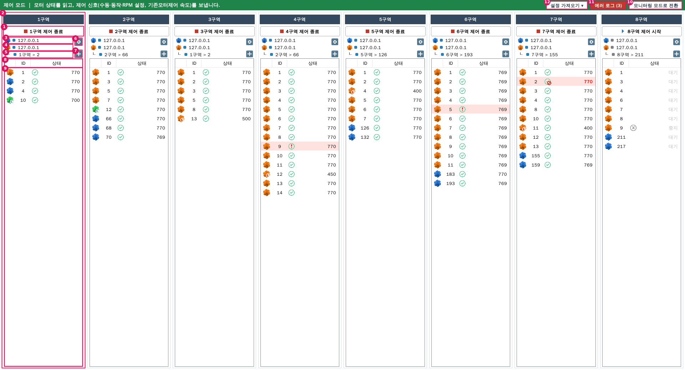
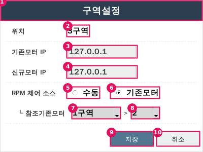
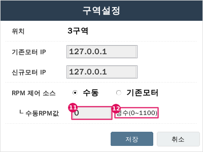
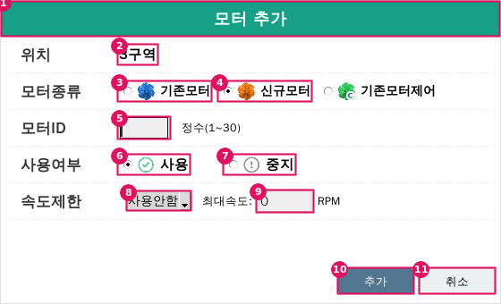
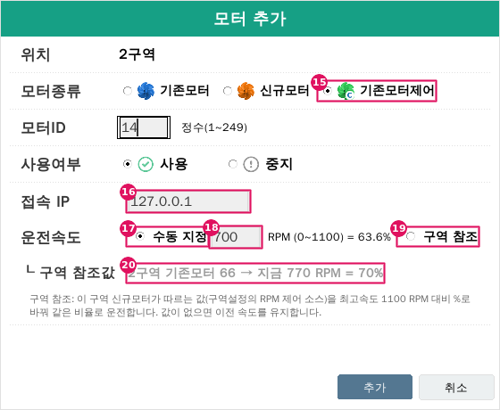
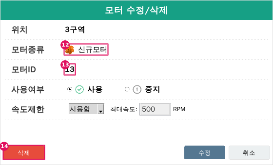
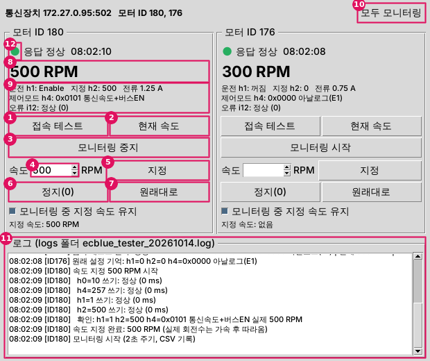

# BLDC MOTOR MONITOR — 스펙시트 (Spec Sheet)

> 이 문서는 **수정 요청 시 의사소통 기준 문서**입니다.
> 화면·창·버튼 등 모든 구성요소에 **고유 ID** 를 붙였습니다. 수정을 요청할 때 이 ID 를 사용하면 정확하게 전달됩니다.
> 코드가 바뀔 때마다 이 문서도 함께 갱신합니다(맨 아래 **변경 이력** 참조).

| 항목 | 내용 |
|---|---|
| 문서 버전 | 2.5.0 (프로그램 버전과 동일) |
| 대상 프로그램 | `motor_monitor` 패키지 (실행: `run.py`) |
| 기준 | **현재 운영 중인 실행파일 `BLDC_MOTOR_MONITOR.exe`** (VB.NET WPF)를 복원·분석한 동작 |
| 설정 파일 | `Config.dll` — 운영 프로그램과 같은 파일을 그대로 사용 (7장) |
| 사용자 매뉴얼 | [USER_MANUAL.md](USER_MANUAL.md) |

---

## 1. ID 명명 규칙과 수정 요청 방법

### 1.1 ID 체계

| 접두어 | 의미 | 예 |
|---|---|---|
| `SCR-` | 화면(메인 창) | `SCR-MAIN` |
| `MAIN-` | 메인 화면 공통 요소 | `MAIN-MODE-BANNER` |
| `TST-` | 기존모터 시험기(`SCR-TESTER`) 구성요소 (모터별은 `TST-{ID}-`, 공통은 `TST-*-`) | `TST-*-BTN-CONN` |
| `DLG-` | 대화상자(팝업 창) | `DLG-LINE`, `DLG-MOTOR` |
| `ZONE-` | 구역 패널 (n = 1~8) | `ZONE-3` (3구역) |
| `MSG-` | 메시지(확인/오류 알림) 문구. 프로그램 창 안에 뜨는 메시지 창 `DLG-MSG` 로 표시 | `MSG-LINE-02` |
| `P-` | 동작 파라미터(설정 상수) | `P-WARN-SEC` |
| `C-` | 색상 | `C-NET-OK` |

- 구성요소 종류 약어: `BTN` 버튼, `TXT` 입력칸, `LBL` 표시 글자, `RB` 라디오버튼(선택 동그라미), `CB` 콤보박스(펼침 목록), `DOT` 상태 점, `LIST` 목록, `HDR` 머리글, `COL` 열, `ROW` 줄, `TITLE` 창 제목줄.
- 구역 코드: `H1R{n}` — `H1R1` = 1구역 … `H1R8` = 8구역 (설정 파일 안의 이름).
- 8개 구역에 공통인 요소는 `ZONE-*-BTN-SET` 처럼 `*` 로, 특정 구역은 `ZONE-3-BTN-SET` 처럼 씁니다.

### 1.2 수정 요청 예시

- "`ZONE-*-LBL-REF` 글자를 굵게 해줘" → 8개 구역 모두의 RPM 소스 문구 변경
- "`ZONE-*-LIST` 의 `COL-STATUS` 에 마지막 수신시각도 보여줘"
- "`P-TIMEOUT-SEC` 을 10분으로 줄여줘" (이상 판정 시간)
- "`MSG-MAIN-04` 문구를 바꿔줘", "`C-NET-ERR` 색을 주황색으로"

---

## 2. 화면/창 목록

| ID | 이름 | 여는 방법 | 크기 | 코드 (파일 / 클래스) | 운영 프로그램 |
|---|---|---|---|---|---|
| `SCR-MAIN` | 메인 화면 (1~8구역 가로 배치). 실행 모드: **모니터링 모드**(항상 이 모드로 시작, 4.4절) / **제어 모드** | 프로그램 실행 | Windows: 최대화로 시작 / 그 외 1600×900, 최소 1500×450 | `motor_monitor/ui/main_window.py` / `MainWindow` | `MainWindow` |
| `SCR-TESTER` | 기존모터 시험기 (별도 프로그램, 3.6절) | `ECBLUE_TESTER.exe` / `ecblue_tester.bat` / `python tools/ecblue_tester.py` | 620×520, 최소 460×470 | `tools/ecblue_tester.py` / `TesterApp`, `MotorPanel` | – (신규) |
| `DLG-LINE` | 구역설정 창 | `ZONE-*-BTN-SET` 클릭 | 400×300 고정, 모달 | `motor_monitor/ui/dialogs.py` / `LineSettingsDialog` | `wHOUSE` |
| `DLG-MOTOR` (ADD) | 모터 추가 창 | `ZONE-*-BTN-ADD` 클릭 | 560×340, 기존모터제어 선택 시 560×460, 모달 (운영 프로그램 400×300 보다 큼) | `dialogs.py` / `MotorDialog(mode="ADD")` | `wMotor` |
| `DLG-MOTOR` (MOD) | 모터 수정/삭제 창 | `ZONE-*-LIST` 항목 더블클릭 | 위와 같음, 모달 | `dialogs.py` / `MotorDialog(mode="MOD")` | `wMotor` |
| `SCR-ERRLOG` | 에러 로그 창 (4.2절, 매뉴얼 4.5절) | `MAIN-BTN-ERRLOG` 클릭 | 920×480, 최소 640×300, 모달 아님 | `motor_monitor/ui/tools.py` / `ErrorLogWindow` | – (신규) |
| `DLG-IMPORT-CFG` | 운영 프로그램 설정 가져오기 창 (7.3절, 매뉴얼 4.6절) | `MAIN-BTN-IMPORT` → 운영 프로그램 설정 | 820×470, 모달 | `tools.py` / `ConfigImportDialog` | – (신규) |
| `DLG-IMPORT-MINI` | 미니 제어기 목록 가져오기 창 (7.3절, 매뉴얼 4.6절) | `MAIN-BTN-IMPORT` → 미니 제어기 목록 | 640×430, 모달 | `tools.py` / `MiniImportDialog` | – (신규) |
| `DLG-MSG` | 메시지 창 (확인 예/아니오, 알림 확인). `MSG-*` 문구를 보여 줌 | 확인·오류가 필요할 때 | 폭 460, 높이는 문구에 맞춤, 모달. 키보드: Enter·KP_Enter·Space·Y(ㅛ) = 첫 버튼(예/확인), Esc·N(ㅜ)·닫기 = 아니오. 왼쪽 아래 안내 `lbl_keys` | `dialogs.py` / `MessageDialog`, 호출은 `ui/msgbox.py` (`ask_yes_no`, `show_info`, `show_warning`, `show_error`) | Windows 메시지 상자 |

**창 위치** (`dialogs.place_inside` / `inside_position`): 모든 새 창(`DLG-*`, `SCR-ERRLOG`, `DLG-MSG`)은 **부모 창 가운데**에 두고 **메인 창(`SCR-MAIN`) 밖으로 나가지 않게** 맞춥니다(새 창이 더 크면 메인 창 왼쪽 위). 화면(모니터) 크기로 자르지 않으므로 메인 창이 다른 모니터(음수 좌표 포함)에 있으면 그 모니터에 뜹니다. 창 크기가 바뀌어도(`DLG-MOTOR` 340→460) 메인 창 안에 머뭅니다(`keep_inside_owner`). 메시지 창을 닫으면 그 아래 대화상자가 다시 입력을 받습니다. 예외: 파일 선택 창(OS 표준 창이라 위치는 OS 가 정함, 부모 창은 메인 창으로 지정)과 메인 창이 생기기 전의 `MSG-MAIN-01`·`06`(OS 메시지 상자).

---

## 3. 구성요소 상세

### 3.1 `SCR-MAIN` 메인 화면

1~8구역이 가로 8열로 같은 폭으로 나뉩니다. 각 구역은 독립적으로 제어를 시작/종료합니다.
맨 위 `MAIN-MODE-BANNER` 가 현재 실행 모드(제어=초록 / 모니터링=주황)를 보여 주고, 오른쪽 `MAIN-MODE-BTN` 으로 실행 중에 모드를 바꿉니다. 프로그램은 항상 모니터링 모드로 시작합니다. 모니터링 모드에서는 버튼 문구의 '제어' 가 '모니터링' 으로 바뀝니다(4.4절).



| 번호 | ID | 이름 | 종류 | 코드 객체 | 표시 / 동작 |
|---|---|---|---|---|---|
| – | `MAIN-MODE-BANNER` | 실행 모드 표시 띠 | 띠 + 글자 | `MainWindow.mode_banner` / `mode_label` | 항상 맨 위에 표시, 모드에 따라 색상·문구 변경. **제어 모드**: 초록(`C-MODE-CTRL`) "제어 모드 \| 모터 상태를 읽고, 제어 신호(수동·동작·RPM 설정)를 보냅니다." / **모니터링 모드**: 주황(`C-MODE-BANNER`) "모니터링 모드 \| 모터 상태를 읽기만 하고, 제어 신호(수동·동작·RPM 설정)는 보내지 않습니다." + 창 제목에 `[모니터링 모드 - 제어 신호 전송 안 함]` |
| 11 | `MAIN-BTN-ERRLOG` | 에러 로그 버튼 | 버튼 | `MainWindow.BtnErrors` | 띠 오른쪽. 클릭 → `SCR-ERRLOG`. 확인하지 않은 새 에러가 있으면 빨간 바탕(`C-NET-ERR`) "에러 로그 (건수)", 창을 열면 흰 바탕 "에러 로그" |
| 12 | `MAIN-BTN-IMPORT` | 설정 가져오기 버튼 | 버튼 + 메뉴 | `MainWindow.BtnImport` / `import_menu` | 메뉴: "운영 프로그램 설정 (Config.dll / Config.ini)…" → 파일 선택 → `DLG-IMPORT-CFG` / "미니 제어기 목록 (mini_control.json)…" → `DLG-IMPORT-MINI` |
| 10 | `MAIN-MODE-BTN` | 모드 전환 버튼 | 버튼 | `MainWindow.BtnMode` | 띠 오른쪽 흰 버튼. 제어 모드에서 "모니터링 모드로 전환"(확인 `MSG-MAIN-09`), 모니터링 모드에서 "제어 모드로 전환"(경고 확인 `MSG-MAIN-10`). '예' 를 누르면 즉시 전환되고 띠 색상·문구, 창 제목, 모든 구역 버튼 문구가 함께 바뀜. 실행 중인 구역은 멈추지 않고 계속 동작 |
| 1 | `ZONE-*-BTN-START` | n구역 제어 시작 버튼 | 버튼 | `ZonePanel.StartBtn` | 확인(`MSG-MAIN-02`) 후 이 구역만 통신·제어 시작 → `BTN-STOP` 으로 바뀜. 구역 폭 전체, 높이 29 |
| 1 | `ZONE-*-BTN-STOP` | n구역 제어 종료 버튼 | 버튼 | `ZonePanel.StopBtn` | 확인(`MSG-MAIN-03`) 후 이 구역 통신·제어 중지 → 시작 버튼으로 바뀜 |
| 2 | `ZONE-{n}` | 구역 패널 | 묶음 | `ZonePanel` (`MainWindow.zone_panels["H1R{n}"]`) | 위에서부터 제목줄, 제어 버튼, 머리 영역, 모터 목록 |
| 2 | `ZONE-*-TITLE` | 구역 제목줄 | 글자 | `ZonePanel` 내부 Label | "n구역", 배경 `C-ZONE-TITLE`, 흰 굵은 글씨 |
| 3 | `ZONE-*-DOT-OLD` / `ZONE-*-LBL-OLD` | 기존모터 통신상태 점 / IP | 점 / 글자 | `rec_SOURCE_NETSTATUS` / `lbl_old_ip` | 4.1절 색 규칙 / `172.27.0.82` 형식 (PORT 는 502 고정이라 표시 안 함). 잘리면 마우스를 올려 전체 문구 |
| 4 | `ZONE-*-DOT-NEW` / `ZONE-*-LBL-NEW` | 신규모터 통신상태 점 / IP | 점 / 글자 | `rec_TARGET_NETSTATUS` / `lbl_new_ip` | 위와 같음 |
| 5 | `ZONE-*-DOT-REF` / `ZONE-*-LBL-REF` | RPM 소스 상태 점 / 문구 | 점 / 글자 | `rec_SID_NETSTATUS` / `lbl_source` | 수동: `수동 > 800 RPM` / 참조: `1구역 > 2` (참조 구역 > 기존모터 ID) |
| 6 | `ZONE-*-BTN-SET` | 설정 버튼(톱니) | 그림 버튼 | `ZonePanel.Btn_Settings` | 클릭 → `DLG-LINE`. 툴팁 "설정" |
| 7 | `ZONE-*-BTN-ADD` | 추가 버튼(+) | 그림 버튼 | `ZonePanel.Btn_Add` | 클릭 → `DLG-MOTOR`(ADD). 툴팁 "추가" |
| 8 | `ZONE-*-LIST-HDR` | 모터 목록 머리글 | 머리글 | `MotorListView.header` | 클릭 시 정렬 (3.2절) |
| 9 | `ZONE-*-LIST` | 모터 목록 | 목록 | `ZonePanel.LV` (`MotorListView`) | 3.2절 |

### 3.2 `ZONE-*-LIST` 모터 목록

| ID | 이름 | 폭 | 내용 | 머리글 클릭(정렬 기준) |
|---|---|---|---|---|
| `COL-TYPE` | 종류 열 (머리글 빈칸) | 32px | 아래 '종류 그림' 표 | 종류 |
| `COL-ID` | ID 열 | 42px | 모터 ID (신규모터 1~30, 기존모터·기존모터제어 1~249) | ID |
| `COL-STATUS` | 상태 열 | 나머지 | 상태 그림 + 오른쪽 정렬 문구 (아래 표) | 상태 코드 |

**종류 그림 (`COL-TYPE`)**

| 그림 | 뜻 (툴팁) |
|---|---|
| 청색 팬 (`oldmotor.png`) | 기존모터 |
| 주황색 팬 (`newmotor.png`) | 신규모터 |
| 주황색 팬 + 빨간 **L** (`newmotor_limit.png`) | 신규모터(제한모드) — 속도제한 사용 중 |
| 녹색 팬 + **C** (`oldmotor_ctrl.png`) | 기존모터제어 — 툴팁에 접속 IP, 운전속도 방식(`수동 지정 700 RPM (63.6%)` / `구역 참조 2구역 기존모터 66 (지금 770 RPM = 70%) → 설정 70% = 770 RPM`), 보정한 지정값(`보정: 지정값 735 RPM (설정보다 +35)`), 모터 최고속도 대비 %(`모터 최고속도(h8) 1400 RPM: 설정 770 RPM = 최고속도의 55%`), 제어 문제 (4.5절) |
| 붉은 팬 (`*_red.png`) | **속도 변경을 보냄**: 신규모터 RPM 설정(0x16)·기존모터제어 운전속도(h2)를 보내면 그 행의 팬 그림이 1초 동안 0.25초 붉게/0.25초 원래대로 → 0.5초 간격으로 두 번 깜빡 (`MotorListView.blink_on`, `BLINK_SEC`=1, `BLINK_PHASE`=0.25) |

**상태 표시 (`COL-STATUS`)**

| 상태 | 조건 | 그림 (툴팁) | 문구 |
|---|---|---|---|
| 정상 | 응답 받음, 이상표시 없음 | 녹색 ✓ (정상 + 신규모터·기존모터제어는 `설정 770 · 지정 785 · 실제 768 RPM (오차 1% 이내)`) | RPM 숫자, 검정 |
| 속도 미달 | 보정해도 설정 속도에 1% 넘게 못 미침(4.6절), 기존모터제어의 설정 속도가 모터 최고속도(h8)보다 높음 | 빨간 **!** (속도 미달 + 이유) | RPM 숫자, 검정 |
| 이상표시 | 명령 후 60초 무응답, 통신장치 접속 실패/연결 끊김, 기존모터제어 제어 문제(제어모드·쓰기 실패, 구역 참조값 60초 넘게 없음, 구역 참조값이 자기 자신) | 빨간 **!** (통신 이상 / 응답 대기 중 이상 + 이유) | RPM 숫자(검정) 또는 `대기` |
| 이상 | 마지막 응답 후 1시간(`P-TIMEOUT-SEC`) 경과 | ✓+빨간 금지표시 (이상) | 마지막 RPM 숫자, **빨강 굵게** |
| 중지 | 사용여부 = 중지 | 회색 ⓧ (중지(사용안함)) | `중지`, 연회색 굵게 |
| 대기 | 제어 시작 전이거나, 시작 후 아직 응답 없음 | 없음 | `대기`, 연회색 굵게 |

- **RPM 숫자**: 기존모터·기존모터제어 = 입력 레지스터 14(i14, 실제 회전수) 값, 신규모터 = 레지스터 0x05(현재 RPM) 값.
- **이상표시(빨간 !)** 는 **다시 응답이 오면 바로 지워져** 녹색 ✓ 로 돌아갑니다(기존모터제어의 제어 문제는 해결될 때까지 유지). 제어를 다시 시작해도 지워집니다. 이상·복구는 에러 로그(4.2절)에 기록됩니다.

**정렬 규칙**
- 처음: **ID 오름차순** (종류와 관계없이, 같은 ID 는 기존모터 → 신규모터 → 기존모터제어). 운영 프로그램은 '신규모터 먼저, 종류 안에서 ID 순' 이었음.
- 다른 열을 클릭하면 그 열 기준 오름차순, 같은 열을 다시 클릭하면 오름/내림 전환. 정렬은 클릭·추가·삭제 시점에만 다시 계산.

**행 음영**: 문제 상태(`Motor.has_problem` = 이상표시 / 이상 / 속도 미달, 사용 중인 모터만)인 행은 바탕을 `C-LIST-PROBLEM`(연한 붉은색)으로 칠함. 선택·마우스오버하면 더 진한 붉은색. 문제가 풀리면 원래대로 (`MotorListView.row_fill`).

**기타**: 한 번 클릭 = 선택(하늘색), 더블클릭 = `DLG-MOTOR`(MOD), 목록 툴팁 "항목 더블클릭시 수정/삭제", 많으면 세로 스크롤.

### 3.3 `DLG-LINE` 구역설정 창

 

| 번호 | ID | 이름 | 종류 | 코드 객체 | 초기값 / 동작 |
|---|---|---|---|---|---|
| 1 | `DLG-LINE-TITLE` | 창 제목줄 "구역설정" | 제목줄 | `header`, `title_label` | 배경 `C-DLG-LINE`. 끌어서 창 이동 |
| 2 | `DLG-LINE-LBL-HOUSE` | 위치 | 글자 | `lbl_house` | 예) `3구역` |
| 3 | `DLG-LINE-TXT-SIP` | 기존모터 IP | 입력칸 | `txtSIP` | 현재 설정값. PORT 입력칸 없음(502 고정, `-TXT-SPORT` 는 2.4.0 에서 없앰) |
| 4 | `DLG-LINE-TXT-TIP` | 신규모터 IP | 입력칸 | `txtTIP` | 현재 설정값 (`-TXT-TPORT` 는 2.4.0 에서 없앰) |
| 5 | `DLG-LINE-RB-MANUAL` | RPM 제어 소스: 수동 | 라디오 | `rb_source_manual` | 선택 시 `ROW-MANUAL` 표시 |
| 6 | `DLG-LINE-RB-REF` | RPM 제어 소스: 기존모터 | 라디오 | `rb_source_ref` | 선택 시 `ROW-REF` 표시 |
| 7 | `DLG-LINE-CB-LINE` | 참조 구역 선택 | 콤보 | `cb_lines` | 항목: 구역선택 / 1구역 … 8구역. 바꾸면 `CB-ID` 다시 채움 |
| 8 | `DLG-LINE-CB-ID` | 참조 모터 ID | 콤보 | `cb_ids` | "ID" + 선택 구역의 **기존모터** ID (등록 순서) |
| 9 | `DLG-LINE-BTN-SAVE` | 저장 (Enter) | 버튼 | `BtnSave` | 검증 → 저장 → 메인 머리 영역 갱신 → 닫기 |
| 10 | `DLG-LINE-BTN-CANCEL` | 취소 (Esc) | 버튼 | `BtnCancel` | 저장 없이 닫기 |
| 11 | `DLG-LINE-TXT-MRPM` | 수동RPM값 | 입력칸 | `txtMRPM` (`ROW-MANUAL` = `manual_line`) | 현재 설정값 |
| 12 | `DLG-LINE-LBL-RANGE` | 범위 안내 | 글자 | `lbl_rpm_range` | `정수(0~1100)` |

**초기값**: 참조 구역이 비어 있으면 자기 구역을 선택. 참조 ID 가 목록에 있으면 그 ID 선택.

**저장 시 검증 순서** (제목 "에러")

| 순서 | 조건 | 메시지 ID |
|---|---|---|
| 1~2 | 기존모터 IP 비어있음 / 형식오류 | `MSG-LINE-01`, `02` |
| 3~4 | 신규모터 IP 비어있음 / 형식오류 | `MSG-LINE-06`, `07` |
| 5~6 | (수동) RPM 정수 아님 / 0~1100 밖 | `MSG-LINE-11`, `12` |
| 7~8 | (기존모터) 참조 구역 미선택 / 참조 ID 미선택 | `MSG-LINE-13`, `14` |

**저장 값**: 참조 구역은 `H1` + 선택값(예: `R2` → `H1R2`). 수동 모드에서도 선택된 참조 구역/ID 를 함께 저장(ID 미선택 시 -1). PORT 는 항상 502(`P-MODBUS-PORT`). IP 변경은 다음 접속부터 적용.

### 3.4 `DLG-MOTOR` 모터 추가 / 수정·삭제 창

  

| 번호 | ID | 이름 | 종류 | 코드 객체 | 모드 | 동작 |
|---|---|---|---|---|---|---|
| 1 | `DLG-MOTOR-TITLE` | 창 제목줄 | 제목줄 | `header`, `title_label` | 공통 | "모터 추가" / "모터 수정/삭제". 배경 `C-DLG-MOTOR` |
| 2 | `DLG-MOTOR-LBL-HOUSE` | 위치 | 글자 | `lbl_house` | 공통 | 예) `3구역` |
| 3 / 4 | `DLG-MOTOR-RB-OLD` / `-RB-NEW` | 모터종류 | 라디오 | `rb_oldmotor`, `rb_newmotor` | ADD | 처음엔 선택 없음. 신규모터 선택 시 `ROW-LIMIT` 표시 |
| 15 | `DLG-MOTOR-RB-CTRL` | 모터종류: 기존모터제어 | 라디오 | `rb_ctrlmotor` | ADD | 선택 시 `ROW-CTRL`(16~20) 표시, 창 높이 460 (메인 창 안에 머물도록 위치 조정) |
| 5 | `DLG-MOTOR-TXT-ID` | 모터ID | 입력칸 | `txtID` | ADD | 옆에 종류별 범위(`lbl_id_range`): 신규모터 `정수(1~30)`, 기존모터·기존모터제어 `정수(1~249)` (`constants.id_range`) |
| 16 | `DLG-MOTOR-TXT-CIP` | 기존모터제어 접속 IP | 입력칸 | `txtCIP` (`ROW-CTRL` = `ctrl_ip_row`) | 기존모터제어 | ADD: 이 구역의 기존모터 IP 가 기본값 / MOD: 수정 불가(읽기전용). PORT 입력칸 없음(502 고정, `-TXT-CPORT` 는 2.4.0 에서 없앰) |
| 17 / 19 | `DLG-MOTOR-RB-CTRL-MANUAL` / `-RB-CTRL-REF` | 운전속도 방식: 수동 지정 / 구역 참조 | 라디오 | `rb_ctrl_manual`, `rb_ctrl_ref` (`ctrl_mode_var`) | 기존모터제어 | ADD 기본 수동 지정 / MOD 현재값. 구역 참조면 18 비활성 |
| 18 | `DLG-MOTOR-TXT-SETRPM` / `-LBL-SETPCT` | 운전속도 (RPM, 수동 지정) / 1100 대비 % | 입력칸 / 글자 | `txtSETRPM`, `lbl_set_pct` (`ctrl_speed_row`) | 기존모터제어(수동) | 0~1100, **수동 지정이면 필수 입력**(빈칸이면 오류 — 실수로 0 이 되어 멈추는 것 방지). 이 속도로 계속 운전. 옆 글자 `RPM (0~1100) = 63.6%` (입력할 때마다 갱신) |
| 20 | `DLG-MOTOR-LBL-ZONEREF` | 구역 참조값 | 글자 | `lbl_zone_ref` (`ctrl_ref_row`), `zone_reference_text()` | 기존모터제어 | 이 구역 신규모터가 따르는 값의 출처·현재 값·% (`HouseLine.zone_reference()`): 예) `2구역 기존모터 66 → 지금 770 RPM = 70%`, `구역 수동 600 RPM → 지금 600 RPM = 54.5%`, 읽기 전이면 `→ 지금 값 없음 (…)`. 구역 참조가 아니면 흐리게. 아래 안내 `ctrl_ref_note` (참조 IP/PORT/ID 입력칸·[구역 참조] 버튼은 2.4.0 에서 없앰) |
| – | `DLG-MOTOR-LBL-MOTORMAX` | 모터 최고속도 대비 % | 글자(파랑) | `lbl_motor_max` | 기존모터제어(MOD) | 구역 제어 중 h8 을 읽은 뒤에만 표시: `모터 최고속도(h8) 1400 RPM: 원하는 속도 770 RPM = 최고속도의 55%` (원하는 속도 = 수동 지정값 또는 구역 참조값). 최고속도보다 높으면 "(최고속도보다 높아 최고속도로 운전)" |
| 6 / 7 | `DLG-MOTOR-RB-USE` / `-RB-NOUSE` | 사용여부 | 라디오 | `rb_use`, `rb_nouse` | 공통 | ADD: 기본 **사용** / MOD: 현재값 |
| 8 | `DLG-MOTOR-CB-LIMIT` | 속도제한 사용함/사용안함 | 콤보 | `cbUSELIMIT` (`ROW-LIMIT` = `limit_row`) | 신규모터만 | ADD 기본 "사용안함" / MOD 현재값 |
| 9 | `DLG-MOTOR-TXT-LIMIT` | 최대속도 (RPM) | 입력칸 | `txtLIMITRPM` | 신규모터만 | ADD 기본 0 / MOD 현재값. 0~1100 |
| 10 | `DLG-MOTOR-BTN-SAVE` | 추가 / 수정 (Enter) | 버튼 | `BtnSave` | 공통 | 3.4.1 |
| 11 | `DLG-MOTOR-BTN-CANCEL` | 취소 (Esc) | 버튼 | `BtnCancel` | 공통 | 닫기 |
| 12 | `DLG-MOTOR-LBL-TYPE` | 모터종류 표시 | 그림+글자 | `mod_type_line` | MOD | 수정 불가 |
| 13 | `DLG-MOTOR-LBL-ID` | 모터ID 표시 | 글자 | `lblID` | MOD | 수정 불가 |
| 14 | `DLG-MOTOR-BTN-DELETE` | 삭제 | 버튼(빨강) | `BtnDelete` | MOD | 3.4.2 |

**3.4.1 추가/수정 처리 순서**
1. (ADD) 종류 미선택 → `MSG-MOTOR-01` / ID 비었거나 숫자 아님 → `MSG-MOTOR-02` / 종류별 범위(신규모터 1~30, 기존모터·기존모터제어 1~249) 밖 → `MSG-MOTOR-03`
2. 사용여부 미선택 → `MSG-MOTOR-04`
3. 최대속도 비었으면 0 으로 채움 / 숫자 아님 → `MSG-MOTOR-09` / 0~1100 밖 → `MSG-MOTOR-10`
3-1. (기존모터제어) IP 비어있음 → `MSG-MOTOR-11` / IP 형식 → `MSG-MOTOR-12` / (수동 지정) 운전속도 비었거나 0~1100 밖 → `MSG-MOTOR-14` / (구역 참조) 구역의 참조 기존모터가 이 모터 자신(`Plant.reference_endpoint(구역)` = 접속 IP·502·ID) → `MSG-MOTOR-21`. 구역 참조에서 수동 운전속도 칸이 비었거나 범위 밖이면 0 으로 저장(쓰지 않음). PORT 는 502 로 저장
4. 확인 `MSG-MOTOR-05` (기존모터제어는 `MSG-MOTOR-15`) (아니오 → 창 유지)
5. 기존모터·기존모터제어는 속도제한을 항상 '사용안함, 0' 으로 저장
6. (ADD) 같은 종류+ID 가 있으면 `MSG-MOTOR-06` / 없으면 추가
7. (MOD) 사용여부·속도제한(기존모터제어는 운전속도 방식·수동 운전속도) 반영. 사용→중지로 바꾼 신규모터는 다음 주기에 RPM 0 을 한 번 전송
8. `Config.dll` 저장 → 닫기 → 목록 갱신

**3.4.2 삭제**: 확인 `MSG-MOTOR-07`(기존모터제어는 `MSG-MOTOR-16`) → 기존모터를 다른 구역이 참조 중이면 `MSG-MOTOR-08` 후 중단 → 삭제·저장·닫기.

### 3.5 메시지 창 목록 (`MSG-`)

| ID | 제목 | 문구 | 버튼 | 발생 위치 |
|---|---|---|---|---|
| `MSG-MAIN-01` | BLDC MOTOR MONITOR | 모니터가 이미 실행중입니다. | 확인 | 중복 실행 (후 종료) |
| `MSG-MAIN-02` | 제어 | n구역 제어를 시작하시겠습니까? | 예/아니오 | `ZONE-*-BTN-START` |
| `MSG-MAIN-03` | 제어 | n구역 제어를 종료하시겠습니까? | 예/아니오 | `ZONE-*-BTN-STOP` |
| `MSG-MAIN-04` | 종료 | 종료하시겠습니까? 종료시 제어기능이 동작하지 않습니다. | 예/아니오 | 메인 창 닫기(X) |
| `MSG-MAIN-05` | 오류 | 설정 저장에 실패했습니다. (+오류내용) | 확인 | 종료 시 저장 실패 (신규) |
| `MSG-MAIN-06` | 오류 | 프로그램 설정 정보가 처리중 오류가 발생했습니다. 제작사에 문의바랍니다. | 확인 | 시작 시 `Config.dll` 해독 실패 (후 종료, 파일은 그대로 둠) |
| `MSG-MAIN-07` | 모니터링 | n구역 모니터링을 시작하시겠습니까? / n구역 모니터링을 종료하시겠습니까? | 예/아니오 | 모니터링 모드의 `ZONE-*-BTN-START` / `-STOP` |
| `MSG-MAIN-08` | 종료 | 종료하시겠습니까? | 예/아니오 | 모니터링 모드에서 메인 창 닫기(X) |
| `MSG-MAIN-09` | 모니터링 모드로 전환 | 모니터링 모드로 전환하시겠습니까? 전환하면 제어 신호 전송을 즉시 멈추고, 모터 상태 읽기만 계속합니다. 모터는 마지막으로 받은 설정대로 계속 운전합니다. | 예/아니오 | 제어 모드에서 `MAIN-MODE-BTN` |
| `MSG-MAIN-10` | 제어 모드로 전환 | (경고 아이콘) 제어 모드로 전환하시겠습니까? 전환하면 제어 신호(수동·동작·RPM 설정)를 모터로 보냅니다. + 실행 중인 구역이 있으면 "실행 중인 구역(1구역, 3구역…)에 제어 신호가 바로 전송됩니다. 운영 프로그램이 같은 모터를 제어하고 있다면 신호가 겹칠 수 있습니다." | 예/아니오 | 모니터링 모드에서 `MAIN-MODE-BTN` |
| `MSG-LINE-01` | 에러 | 기존모터 접속 IP를 입력해 주세요. | 확인 | `DLG-LINE` 저장 |
| `MSG-LINE-02` | 에러 | 기존모터 접속 IP가 올바른 형식이 아닙니다.. | 확인 | 〃 |
| ~~`MSG-LINE-03`~`05`~~ | – | (2.4.0 에서 없앰: PORT 502 고정, 입력칸 없음) 기존모터 접속 PORT 검사 | – | – |
| `MSG-LINE-06` | 에러 | 신규 모터 접속 IP를 입력해 주세요. | 확인 | 〃 |
| `MSG-LINE-07` | 에러 | 신규모터 접속 IP가 올바른 형식이 아닙니다.. | 확인 | 〃 |
| ~~`MSG-LINE-08`~`10`~~ | – | (2.4.0 에서 없앰: PORT 502 고정) 신규모터 접속 PORT 검사 | – | – |
| `MSG-LINE-11` | 에러 | 수동 RPM속도를 숫자로 입력해주세요. | 확인 | 〃 |
| `MSG-LINE-12` | 에러 | 수동 RPM속도를 0~1100범위내로 입력해주세요. | 확인 | 〃 |
| `MSG-LINE-13` | 에러 | 참조할 모터가 있는 구역을 선택해주세요. | 확인 | 〃 |
| `MSG-LINE-14` | 에러 | 참조할 모터 ID를 선택해주세요. | 확인 | 〃 |
| `MSG-MOTOR-01` | 오류 | 모터 종류을 선택해 주세요. | 확인 | `DLG-MOTOR` 추가 |
| `MSG-MOTOR-02` | 오류 | 모터 ID값을 숫자로 입력해주세요. | 확인 | 〃 |
| `MSG-MOTOR-03` | 오류 | 모터ID값은 숫자로 1-30범위로 입력하셔야 합니다. (신규모터) / …1-249범위로… (기존모터·기존모터제어) | 확인 | 〃 |
| `MSG-MOTOR-04` | 오류 | 사용 여부을 선택해 주세요. | 확인 | `DLG-MOTOR` |
| `MSG-MOTOR-05` | 추가 / 수정 | 해당 모터정보를 추가하시겠습니까? / 해당 모터정보를 수정하시겠습니까? | 예/아니오 | 〃 |
| `MSG-MOTOR-06` | 오류 | 이미 해당 모터 종류와 ID를 갖는 모터가 있습니다. 확인바랍니다. | 확인 | `DLG-MOTOR` 추가 |
| `MSG-MOTOR-07` | 삭제 | 해당 모터정보를 삭제하시겠습니까? | 예/아니오 | `DLG-MOTOR-BTN-DELETE` |
| `MSG-MOTOR-08` | 오류 | 해당 모터를 참조로 사용하는 구역이 있습니다. 변경 후, 삭제할 수 있습니다. | 확인 | 〃 |
| `MSG-MOTOR-09` | 오류 | 제한모드 RPM값을 숫자 0~1100범위로 입력해주세요. | 확인 | `DLG-MOTOR` 저장 |
| `MSG-MOTOR-10` | 오류 | 제한모드 RPM값은 숫자 0~1100범위로 입력하셔야 합니다. | 확인 | 〃 |
| `MSG-MOTOR-11` | 오류 | 기존모터제어 접속 IP를 입력해 주세요. | 확인 | 기존모터제어 저장 |
| `MSG-MOTOR-12` | 오류 | 기존모터제어 접속 IP가 올바른 형식이 아닙니다.. | 확인 | 〃 |
| ~~`MSG-MOTOR-13`~~ | – | (2.4.0 에서 없앰: PORT 502 고정) 기존모터제어 접속 PORT 검사 | – | – |
| `MSG-MOTOR-14` | 오류 | 운전속도를 숫자 0~1100범위로 입력해주세요. | 확인 | 〃 |
| `MSG-MOTOR-15` | 추가 / 수정 | 해당 모터정보를 추가(수정)하시겠습니까? + "구역 제어를 시작하면 이 모터는 아날로그 제어신호 대신 통신으로 받은 속도로, 지정한 속도(n RPM = n%)로 / 이 구역 신규모터가 따르는 값(출처)을 최고속도 1100 RPM 대비 %로 바꿔 같은 비율로(지금 n RPM = n%) 계속 운전합니다." | 예/아니오 | 〃 |
| `MSG-MOTOR-16` | 삭제 | 해당 모터정보를 삭제하시겠습니까? + "삭제해도 모터는 마지막으로 받은 속도로 계속 운전합니다(통신 제어모드 유지)." | 예/아니오 | 기존모터제어 삭제 |
| ~~`MSG-MOTOR-17`~`20`~~ | – | (2.4.0 에서 없앰: 참조 IP/PORT/ID 입력칸 없음) 참조모터 IP·PORT·ID·자기 자신 검사 | – | – |
| `MSG-MOTOR-21` | 오류 | 구역 참조값이 이 모터 자신의 회전수입니다(구역설정의 참조기존모터). 수동 지정으로 하거나 구역설정에서 다른 참조기존모터를 지정해 주세요. | 확인 | 기존모터제어(구역 참조) 저장 |
| `MSG-MAIN-11` | 설정 가져오기 | 실행 중인 구역이 있습니다. 모든 구역을 종료한 뒤 가져오세요. | 확인 | `MAIN-BTN-IMPORT` 운영 프로그램 설정 (실행 중 구역 있음) |
| `MSG-MAIN-12` | 설정 가져오기 | 설정 파일을 읽지 못했습니다. / 파일을 읽지 못했습니다. (+이유) | 확인 | 운영 프로그램 설정 파일이 아님·해독 불가 / 미니 제어기 파일 형식 오류 |
| `MSG-IMPORT-01` | 가져오기 | 설정을 가져오시겠습니까? 지금 설정 파일은 백업 후 바뀝니다. → 완료: 설정을 가져왔습니다. 이전 설정 백업: (경로) | 예/아니오 → 확인 | `DLG-IMPORT-CFG` |
| `MSG-IMPORT-02` | 가져오기 | n구역에 기존모터제어 n개를 추가하시겠습니까? → 완료: n구역에 n개를 추가했습니다. (+건너뜀 목록) | 예/아니오 → 확인 | `DLG-IMPORT-MINI` |

> 문구(맞춤법 포함)는 운영 프로그램 그대로입니다. 메시지는 모두 `DLG-MSG`(프로그램 창 안)로 보여 줍니다. 단, 메인 창이 생기기 전의 `MSG-MAIN-01`·`06` 은 OS 메시지 상자입니다.

### 3.6 `SCR-TESTER` 기존모터 시험기

기존(ECblue) 모터 2대를 직접 시험하고 결과를 로그로 남기는 별도 프로그램입니다. 운영 프로그램·`Config.dll` 과 무관하게 동작합니다.
대상은 코드에 고정되어 화면에서 바꿀 수 없습니다: `HOST = "172.27.0.95"`, `PORT = 502`, `MOTOR_IDS = (180, 176)` (`tools/ecblue_tester.py` 맨 위).



| 번호 | ID | 이름 | 종류 | 코드 객체 | 동작 |
|---|---|---|---|---|---|
| – | `TST-{ID}` | 모터 패널 (왼쪽 180, 오른쪽 176) | 묶음 | `MotorPanel` | 모터 1대의 상태와 버튼 |
| 12 | `TST-*-DOT` / `TST-*-LBL-STATE` | 응답 상태 점 / 문구 | 점 / 글자 | `dot` / `lbl_state` | 초록 = 응답 정상, 빨강 = 응답 없음, 회색 = 시험 전. 마지막 응답 시각 |
| 8 | `TST-*-LBL-RPM` | 실제 회전수 | 큰 글자 | `lbl_rpm` | i14 (RPM) |
| 9 | `TST-*-LBL-INFO` | 상세 상태 | 글자 3줄 | `info` | 운전 h1(Enable), 지정 h2, 전류 i15(A), 제어모드 h4, 오류 i12(비트 이름) |
| 1 | `TST-*-BTN-CONN` | 접속 테스트 | 버튼 | `btn_conn` | TCP 새로 접속 → h1~h4·i14(+i15)·i12 읽기 → 결과 로그. 쓰기 없음. 처음 성공한 h1/h2/h4 를 '원래 설정' 으로 기억 |
| 2 | `TST-*-BTN-SPEED` | 현재 속도 | 버튼 | `btn_speed` | i14 만 1회 읽기 (운영 기존모터 읽기와 같은 요청). 쓰기 없음 |
| 3 | `TST-*-BTN-MON` | 모니터링 시작/중지 | 버튼 | `btn_mon` | 2초(`MONITOR_INTERVAL_MS`)마다 전체 읽기, 화면 갱신, CSV 기록. 응답 끊김/회복을 로그 |
| 4 | `TST-*-TXT-RPM` | 속도 입력 | 숫자칸 | `ent_rpm` | 0~1100, 50 단위 화살표 |
| 5 | `TST-*-BTN-SET` | 지정 | 버튼 | `btn_set` | 확인 `TST-MSG-SET` → 제어모드가 아니면 경고 확인 `TST-MSG-MODE` 후 PIN(h0=10) → h4 → h1 Enable → h2 쓰기 → 다시 읽어 확인. 성공하면 지정 속도로 기억하고 모니터링 자동 시작 |
| 6 | `TST-*-BTN-STOP` | 정지(0) | 버튼 | `btn_stop` | 확인 후 h2 = 0 (지정 속도 0 으로 유지) |
| 7 | `TST-*-BTN-RESTORE` | 원래대로 | 버튼 | `btn_restore` | 확인 후 기억한 h2 → h1 → PIN → h4 순서로 복원 → 다시 읽어 확인. 지정 속도 해제 |
| – | `TST-*-CHK-KEEP` | 모니터링 중 지정 속도 유지 | 체크 | `keep` | 기본 켜짐. 모니터링에서 h2 가 지정 속도와 다르면(정전 후 재시작 등) h2 다시 쓰기 |
| – | `TST-*-LBL-TARGET` | 지정 속도 | 글자 | `lbl_target` | 없음 / n RPM / 0 RPM(정지) |
| 10 | `TST-BTN-MONALL` | 모두 모니터링 | 버튼 | `TesterApp.btn_all` | 두 모터 모니터링을 함께 시작/중지 |
| 11 | `TST-LOG` | 로그 창 | 글자 목록 | `TesterApp.txt` | 모든 동작·결과. 경고 주황, 오류 빨강 |

- 메시지: `TST-MSG-SET` "모터 ID n 를 r RPM 으로 운전합니다. 계속할까요?" / `TST-MSG-MODE` (경고) 제어모드(h4) 변경 안내 / `TST-MSG-STOP` / `TST-MSG-RESTORE` / `TST-MSG-EXIT` "시험기를 종료할까요? 모터는 마지막으로 지정한 상태로 계속 운전합니다."
- 통신: 연결 1개를 작업 쓰레드 하나가 순서대로 사용(요청 간격 0.1초, 응답 대기 2초). 끊기면 다음 요청 때 다시 접속.
- h4(영구저장) 쓰기는 실행 1회당 모터별 3번까지만 시도(`MODE_WRITE_MAX_TRIES`).
- i15(전류)를 지원하지 않는 펌웨어면 i14 만 읽습니다. i12 를 읽지 못하면 '-' 로 표시합니다.
- 실행파일: `ecblue_tester.spec` → `dist/ECBLUE_TESTER.exe` (파일 하나, 콘솔 없음). Windows 에서 `build_tester_exe.bat`, 또는 GitHub Actions `Build ECblue tester exe` (main 반영 시 자동, 수동 실행 가능) 의 Artifacts. 시작 오류는 `logs/ecblue_tester_error.txt`.
- 로그 폴더: exe 는 exe 옆 `logs`, 파이썬 실행은 프로그램 폴더 `logs`.
- 로그: `logs/ecblue_tester_YYYYMMDD.log` (모든 동작), `logs/ecblue_monitor_YYYYMMDD.csv` (시각, ID, 응답, 실제RPM, 전류A, h1, h2, h4, 오류i12, 유지목표RPM).
- 종료(X): 모터 설정은 바꾸지 않습니다.

---

## 4. 동작 사양

### 4.1 통신상태 점 색 (`ZONE-*-DOT-*`, 5초마다 갱신)

| 조건 | `DOT-OLD` | `DOT-NEW` | `DOT-REF` |
|---|---|---|---|
| 이 구역 제어 중지 | 회색 | 회색 | 회색 |
| 제어 중 + 정상 | 파랑: 기존모터 게이트웨이 접속됨 | 파랑: 신규모터 게이트웨이 접속됨 | 파랑: 수동이거나 참조 기존모터가 '정상' |
| 제어 중 + 이상 | 빨강: 접속 실패/끊김 (10초마다 재시도) | 빨강 | 빨강: 참조 모터가 정상 아님/없음 → **이 구역 신규모터 제어 보류** |

### 4.2 모터 상태 판정
- 응답을 받으면 즉시 **정상**, 표시 RPM·마지막 응답 시각 갱신, **이상표시 해제**(기존모터제어의 제어 문제가 남아 있으면 유지) + 에러 로그 '복구'.
- 아래 판정은 **이 구역이 제어 중일 때만 5초마다** 수행(제어 종료 시 마지막 표시 유지).

| 조건 | 결과 |
|---|---|
| 사용 = 중지 | 중지 |
| 사용 + 응답 이력 없음 | 대기 |
| 명령 전송 후 60초(`P-WARN-SEC`) 동안 응답 없음 (응답 이력이 없어도) | 이상표시(빨간 !) — 상태는 정상/대기 유지, 에러 로그 |
| 통신장치 접속 실패·연결 끊김 (기존모터/신규모터/기존모터제어 통신장치별) | 그 장치의 사용 중인 모터에 이상표시 즉시, 에러 로그는 장치마다 끊김 1번·복구 1번 |
| 마지막 응답 후 3600초(`P-TIMEOUT-SEC`) 이상 | 이상, 에러 로그 |
| 그 외 | 정상 |

- 제어 시작 시 그 구역 모든 모터의 이상표시·응답이력 초기화(대기부터 다시 시작).
- 에러 로그(`Plant.errors`, `motor_monitor/errorlog.py`): 상태가 바뀔 때만 기록(같은 문제 반복 기록 없음). 메모리 최근 1000건 + `logs/error.log`(2MB×5 순환), 다시 켜면 파일의 지난 기록을 읽어 옴. 화면: `SCR-ERRLOG` (매뉴얼 4.5절).

### 4.3 제어 흐름 (구역 1개, `ZONE-*-BTN-START` 후)

```
[기존모터 송신]                             [신규모터 송신]
 ① 미접속이면 접속(1초) / 실패 시 10초 후 재시도   ① 미접속이면 접속(1초) / 실패 시 10초 후 재시도
 ② 읽기 대기열을 0.3초 간격으로 전송             ② 읽기 대기열 항목마다: 쓰기(제어) 대기열 먼저 모두 전송 → 읽기 1건 (0.3초 간격)
 ③ 점검 차례(30초마다, kick 이면 바로)면          ③ 쓰기 대기열이 남았으면 바로 전송 (다음 점검을 기다리지 않음)
    사용 중 기존모터마다 RPM 읽기 적재            ④ 점검 차례(30초마다, kick 이면 바로)면 사용 중 신규모터마다 1페이지·2페이지 읽기 적재,
 ④ 아니면 짧게(0.3초 이내) 기다림                   중지로 바뀐 신규모터는 RPM 0 쓰기 1회 적재 / 아니면 짧게 기다림

[기존모터 수신] 11바이트 FC04 → RPM·정상 갱신
[신규모터 수신] 27바이트 1페이지 → 현재 RPM(0x05, 실제 속도)·정상 갱신
               23바이트 2페이지 → 설정 속도 결정 → (속도제한 사용) 이면 최대속도 이하
                                 · 수동: 수동RPM값 / 참조: 참조 기존모터가 정상이면 그 RPM, 아니면 이번엔 정하지 않음
                                 → 속도 보정(4.6절)으로 지정값 결정 (설정 속도를 모르면 최초 1번만 기억한 지정값)
                                 자동/수동 ≠ 1 → 수동(1) 쓰기, 동작/정지 ≠ 1 → 동작(1) 쓰기, RPM 설정 ≠ 지정값 → 지정값 쓰기
```
- kick (`HouseLine.kick`): 모터 추가·수정, 구역설정 저장(`Plant.set_line_config`, 모든 구역), 제어 모드로 전환(`Plant.set_monitoring(False)`) 때 30초를 기다리지 않고 바로 한 번 점검.

### 4.4 모니터링 모드 (읽기 전용)

제어 신호가 겹치거나 의도하지 않은 속도 변경이 없도록 **읽기만** 하는 실행 모드입니다. **프로그램은 실행하면 항상 이 모드로 시작합니다**(`app.create_plant`, `--monitoring` 옵션은 남아 있으나 효과 없음).

| 항목 | 제어 모드 | 모니터링 모드 (시작 시 항상) |
|---|---|---|
| 들어가는 방법 | 모니터링 모드에서 `MAIN-MODE-BTN` "제어 모드로 전환" | 프로그램 시작 / 제어 모드에서 "모니터링 모드로 전환" |
| 실행 중 모드 전환 | `MAIN-MODE-BTN` "모니터링 모드로 전환" (확인 `MSG-MAIN-09`) | `MAIN-MODE-BTN` "제어 모드로 전환" (경고 확인 `MSG-MAIN-10`) |
| 기존모터 RPM 읽기 (FC04) | 함 | 함 |
| 신규모터 1·2페이지 읽기 (FC03) | 함 | 함 (현재 RPM, 상태 표시) |
| 신규모터 쓰기 (FC06: 수동 0x13, 동작 0x14, RPM 0x16, 중지 시 RPM 0) | 함 | **하지 않음** — 명령을 만들지도 보내지도 않음 |
| 기존모터제어 읽기 (h1~h4, i14) + 구역 참조값 확인 | 함 | 함 (실제 회전수·구역 참조값과 % 표시) |
| 기존모터제어 쓰기 (h0 PIN, h4 제어모드, h1 Enable, h2 운전속도) | 함 | **하지 않음** |
| 상태 판정, 상태 점, 목록 표시 | 같음 | 같음 (`DOT-REF` 는 "제어 모드였다면 제어 가능한지" 를 표시) |
| 시작/종료 시 `Config.dll` 자동 저장 | 함(종료 시) | **하지 않음** (구역설정·모터 추가/수정/삭제·설정 가져오기처럼 직접 바꾼 내용만 저장). 항상 모니터링 모드로 시작하므로 시작 시에는 저장하지 않음, 종료 시점은 종료할 때의 모드 기준 |
| 화면 | 초록 `MAIN-MODE-BANNER`, 버튼 "n구역 제어 시작/종료" | 주황 `MAIN-MODE-BANNER`, 창 제목 표시, 버튼 "n구역 모니터링 시작/종료" |

- 구현: 모든 쓰기 명령은 `HouseLine._enqueue_write` 한 곳을 거치며, 모니터링 모드면 버려집니다. 전송 단계(`_flush_writes`)에서도 한 번 더 막습니다(이중 차단). 기존모터제어 쓰기는 `_ctrl_write` 에서 막습니다. 자동 시험 `test_monitoring_mode_never_writes`, `test_monitoring_mode_never_writes_including_ref_mode` 가 쓰기 요청 0건을 확인합니다.
- 실행 중 전환의 동작:
  - 통신 스레드는 명령을 만들 때마다 현재 모드(`Plant.monitoring`)를 다시 확인하므로 전환은 **즉시** 반영됩니다. 구역을 멈추거나 다시 시작할 필요가 없습니다.
  - 제어 → 모니터링: 그 순간부터 쓰기 0건, 아직 보내지 않은 쓰기 명령도 버립니다. 모터는 마지막으로 받은 설정(수동·동작·RPM, ECblue h2)대로 계속 운전합니다.
  - 모니터링 → 제어: 다음 주기부터 목표 RPM·운전속도를 씁니다. 모니터링 모드 중에 '사용중지' 로 바꾼 모터의 RPM 0(운전속도 0) 명령은 보류했다가 이때 보냅니다.
  - 자동 시험 `test_monitoring_mode_switch_at_runtime`, `test_mode_toggle_button` 이 확인합니다.
- 주의: 읽기 요청은 보내므로, 운영 프로그램과 동시에 쓰면 통신장치에 연결이 하나 더 생깁니다. 통신장치의 동시 접속 허용 수를 확인하세요.

### 4.5 기존모터제어 (기존 ECblue 모터 직접 속도 지정)

기존 모터의 아날로그 제어신호선(E1, 0-10V)에 문제가 있을 때, 기존 모터를 **Modbus 통신으로 받은 속도로 운전**시키는 모터 종류입니다. 운전속도는 **수동 지정**(고정값) 또는 **구역 참조**(이 구역 신규모터가 따르는 값을 1100 대비 % 로 같은 비율) 중에서 고릅니다. 근거 문서: ZIEHL-ABEGG "ECblue MODBUS Description" L-BAL-E076-GB 1517 Index 013 (펌웨어 1.03~14).

- 모터마다 **접속 IP / ID(1~249)** 와 **운전속도 방식**을 지정합니다(PORT 는 502 고정). 같은 IP 의 모터들은 연결 하나를 같이 씁니다.
- **구역 참조 방식** (`HouseLine._ctrl_target`):
  1. 구역 참조값 = 이 구역 신규모터가 따르는 값 그대로 (`HouseLine.zone_reference()` → `resolve_setting_rpm()`): 구역설정이 수동이면 수동 RPM, 기존모터 참조면 참조 기존모터가 '정상'일 때의 RPM. 별도 통신 없이 신규모터 제어와 같은 값을 씁니다.
  2. % = 구역 참조값 ÷ `P-MAX-RPM`(1100) × 100 (0~100, 넘으면 100) — `constants.rpm_to_pct`.
  3. 운전속도 = `P-MAX-RPM` × % (`constants.pct_to_rpm`, 미니 제어기와 같은 계산: 100% = 1100). h4 제어모드는 수동 지정과 같은 절대 회전수 방식이라 h2 에는 RPM 을 씁니다(예: 770 RPM → 70% → h2 = 770).
  4. 값이 없으면(참조 기존모터 대기·상태 이상·없음, 그 구역 실행 안 함) **이전에 정한 속도를 유지**(한 번도 정하지 못했으면 h2 를 쓰지 않음). 값 없음이 `P-WARN-SEC`(60초) 넘게 이어지면 이상표시·에러 로그 "구역 참조값(출처) 60초 넘게 값 없음 … - 이전 지정 n% (n RPM) 유지". 구역을 막 시작해 참조 기존모터를 아직 읽기 전에는 에러 없이 기다림.
  5. 참조 기존모터가 이 모터 자신(`Plant.reference_endpoint(구역)` = 접속 IP·PORT·ID)이면 따라가지 않고 이상표시 (자기 회전수를 목표로 하면 속도가 굳음).
- 구역 제어를 시작하면 구역마다 '기존모터제어' 처리 1개가 모터마다 **30초에 한 번**(kick 이면 바로) 아래를 합니다 (명령 간격 0.3초):

| 순서 | 동작 | 레지스터 | 조건 / 비고 |
|---|---|---|---|
| 0 | (구역 참조 방식) 구역 참조값·% 확인 | 통신 없음 (신규모터 제어와 같은 값) | 모니터링 모드에서도 확인해 표시 |
| 1 | 현재 설정 읽기 | FC03 h1~h8 (주소 1부터 8개) | h2 = 지금 지정값, h4 = 제어모드, h8 = 모터 최고속도(1/min, 0 = 설정 없음) |
| 2 | 실제 회전수 읽기 | FC04 i14 (주소 14) | 목록에 표시, 응답 시 '정상' |
| 3 | 제어모드 설정 | h0 ← 0010 (PIN 보호 2단계 해제) 후 h4 ← (bit[3:0]=1, bit8=1, 나머지 비트 유지) | h4 가 이미 맞으면 **쓰지 않음**. h4 는 영구저장(NV, 쓰기 수명 1만 회)이라 프로그램 실행 1회당 모터별 최대 3회(`P-CTRL-MODE-TRIES`)만 시도, 실패 시 빨간 ! 와 툴팁 "제어모드 설정 실패" |
| 4 | Enable | h1 bit0 ← 1 | 꺼져 있을 때만 |
| 5 | 운전속도 | h2 ← 지정값 = 운전속도(수동 지정값 또는 1100 × 구역 참조 %)에서 속도 보정(4.6절)한 값. 보정 상한 = min(1100, h8) | 읽은 값과 다를 때만 (휘발성 레지스터). 쓰기 실패 시 이상표시·에러 로그. 운전 방식·Enable 을 이번에 바꿨으면 이번 점검은 보정 판단 안 함 |
| – | 사용 '중지' 로 바꿀 때 | h2 ← 0 (1회) | |

- **계속 운전**: h2 는 다음 명령이 올 때까지 유지되고, 통신 감시(h17) 기본값이 꺼짐이라 프로그램을 꺼도 마지막 속도로 계속 운전합니다. 모터가 재시작되어 h2 가 0 이 되면, 프로그램이 다음 주기에 다시 맞춥니다.
- **아날로그 신호 무시**: 제어모드 1 이 되면 E1(0-10V) 입력은 속도에 쓰이지 않습니다. 원래 아날로그 제어로 되돌리려면 h4 bit[3:0]=0, bit8=0 으로 되돌려야 하며(현재 프로그램에는 되돌리는 기능 없음, 11장 3번), 모터 삭제·중지만으로는 되돌아가지 않습니다.
- 읽기 전용 '기존모터'(종류 0, 구역의 기존모터 게이트웨이로 RPM 만 읽음)와는 별개 항목입니다. 같은 모터를 둘 다 등록할 수 있습니다. 신규모터의 참조 대상은 지금처럼 '기존모터' 만 선택할 수 있습니다.
- **모터 최고속도(h8) 기준 %** (검토 결과): 문서 L-BAL-E076-GB 기준으로 h8(Max. Speed, 1/min)을 읽을 수 있어, 원하는 속도의 % = 원하는 속도 ÷ h8 × 100 을 계산해 툴팁·수정 창(`DLG-MOTOR-LBL-MOTORMAX`)에 보여 줍니다. 속도는 **절대 회전수 방식(h4 bit[3:0]=1)으로 원하는 RPM 을 그대로** 보냅니다 — 문서 3.4.5 주3: % 방식(2·3)은 최저속도(h7) > 0 이면 실제 속도가 원하는 값보다 높아지고, 방식 1 은 h7 과 관계없이 지정 회전수를 유지. 3.4.6 주2: h8 을 넘는 속도는 h8 로 제한 → 보정 상한을 h8 로 하고, 설정 속도 > h8 이면 h8 로 운전하며 속도 미달 알림 "모터 최고속도(h8) n RPM 이 설정 n RPM 보다 낮아 최고속도로 운전". h8 = 0 이면 1100 을 상한으로 씀. 신규모터는 최고속도 레지스터가 알려져 있지 않아 1100(속도제한이면 그 값).

### 4.6 속도 점검·보정·기억 (`motor_monitor/speedtrim.py`)

신규모터(지정 0x16 / 실제 0x05)와 기존모터제어(지정 h2 / 실제 i14)에 같은 규칙을 씁니다. **설정 속도**(target) = 그 모터가 돌아야 할 속도(신규모터: 구역 목표 RPM·속도제한 적용 / 기존모터제어: 운전속도), **지정값**(cmd) = 모터에 보내는 값, **실제 속도**(actual) = 모터가 보고하는 회전수. 보정은 설정 속도를 바꾸지 않고 지정값만 조절합니다. 점검(`P-CHECK-INTERVAL` 30초)마다 `Trim.decide(설정, 실제, 최대값, 기억)` 한 번 (모니터링 모드에서는 하지 않음):

| 순서 | 조건 | 동작 |
|---|---|---|
| 1 | 설정 속도가 처음이거나 지금 맞추는 값에서 1%(`P-SPEED-TOL`) 넘게 바뀜 | 새로 시작: 기억이 있으면 같은 설정 속도(1% 이내)면 기억한 지정값, 다르면 같은 비율(설정 × 기억 지정값/기억 설정), 없으면 설정 속도. 최대값 이하. 이번 점검은 실제 속도로 판단하지 않음 |
| 2 | \|실제 − 설정\| ≤ 설정 × 1% | 오차 인정: 그대로, 알림 해제, (설정, 지정값) 기억 → `speed_memory.json` |
| 3 | 실제 < 설정 − 1%, 직전에 올렸는데 실제가 1% 넘게 바뀌지 않음 | 다시 보내지 않고 기다림. `P-SPEED-STALL`(2번 = 60초) 동안 그대로면 보정 멈춤(hold) + 속도 미달 알림 |
| 4 | 실제 < 설정 − 1%, 지정값 = 최대값 | 보정 멈춤 + 알림 "지정값이 최대 n RPM 이라 더 올리지 못함" |
| 5 | 실제 < 설정 − 1% | 지정값 += 차이, 단 설정 속도의 2~3%(`P-SPEED-STEP`) 범위, 최대값 이하 |
| 6 | 실제 > 설정 + 1%, 지정값 > 설정 | 지정값 −= 같은 방식 (설정 속도 아래로는 내리지 않음) |
| – | 설정 속도를 아직 모름 (참조값 없음) | 처음 한 번만 기억한 지정값을 최초 신호로 보냄 (`Trim.first_signal`) |

- 최대값(cmd_max): 신규모터 = 1100, 속도제한 사용이면 제한값 / 기존모터제어 = min(1100, h8).
- 지정값은 모터가 가진 값과 다를 때만 보냄 → 오차 안이거나 보정을 멈춘 뒤에는 신호를 반복해서 보내지 않음.
- 기억(`Plant.memory` = `SpeedMemory`): 키 `구역코드/모터키`(예 `H1R1/1_5`), 값이 바뀔 때만 30초에 한 번까지 파일에 쓰고 종료 시 반드시 씀. 읽지 못하면 새로 시작.
- 속도 미달 알림(`Motor.speed_note`)은 행 음영·빨간 ! 툴팁 "속도 미달"·에러 로그(처음 1번, 해제 시 '속도 문제 해제')로 표시.
- 예) 설정 800, 실제가 지정의 95%: 800 → (실제 760) 824 → (783) 841 → (799, 오차 안) 유지·기억 → 다음 실행의 최초 신호 841.

---

## 5. 동작 파라미터 (`motor_monitor/constants.py`)

| ID | 상수명 | 값 | 의미 |
|---|---|---|---|
| `P-MAX-RPM` | `MAX_RPM` | 1100 | 수동 RPM·최대속도 상한. 기존모터제어 구역 참조 % 의 기준(100% = 1100, `rpm_to_pct`/`pct_to_rpm`/`pct_text`) |
| `P-MOTOR-ID-RANGE` | `MOTOR_ID_MIN`/`MAX` | 1~249 | 기존모터 ID 범위 |
| `P-NEW-ID-RANGE` | `NEW_MOTOR_ID_MAX` | 1~30 | 신규모터 ID 범위 |
| `P-CTRL-ID-RANGE` | `CTRL_ID_MIN`/`MAX` | 1~249 | 기존모터제어 ID 범위. 종류별 범위는 `id_range(종류)` |
| `P-CTRL-MODE-TRIES` | `CTRL_MODE_WRITE_MAX_TRIES` | 3 | 기존모터제어 제어모드(h4, NV) 설정 시도 한도 (실행 1회·모터 1대당) |
| `P-WARN-SEC` | `NO_RESPONSE_WARN_SEC` | 60초 | 무응답 → 이상표시(빨간 !), 응답이 오면 해제. 기존모터제어 구역 참조값이 이 시간 넘게 없을 때도 이상표시 |
| `P-CHECK-INTERVAL` | `CHECK_INTERVAL` | 30초 | 팬 속도 점검 주기 (모터마다 30초에 한 번 읽고 필요하면 보냄). kick 이면 바로 |
| `P-SPEED-TOL` | `SPEED_TOLERANCE_PCT` | 1% | 설정 속도와의 차이가 이 안이면 오차로 인정. 설정 속도가 이 안으로 바뀌면 다시 보내지 않음 |
| `P-SPEED-STEP` | `SPEED_STEP_MIN_PCT` / `MAX_PCT` | 2% / 3% | 보정 한 번에 바꾸는 양 (설정 속도 대비) |
| `P-SPEED-STALL` | `SPEED_STALL_CHECKS` | 2번 (60초) | 올린 뒤 이 횟수 동안 속도가 바뀌지 않으면 보정 멈춤 |
| `P-SPEED-MEMORY` | `SPEED_MEMORY_FILE` | `speed_memory.json` | 오차 안에 든 지정값 기억 파일 (Config.dll 과 같은 폴더) |
| `P-TIMEOUT-SEC` | `MOTOR_TIMEOUT_SEC` | 3600초 | 마지막 응답 후 → 이상 (운영 프로그램 값) |
| `P-STATUS-INTERVAL` | `STATUS_UPDATE_INTERVAL` | 5초 | 상태 판정 주기 |
| `P-NET-INTERVAL` | `NETWORK_UPDATE_INTERVAL` | 5초 | 상태 점 갱신 주기 |
| `P-LIST-REFRESH` | `LIST_REFRESH_MS` (main_window.py) | 0.3초 | 데이터 변경 → 화면 반영 |
| `P-CONNECT-TIMEOUT` | `CONNECT_CHECK_TIMEOUT` | 1초 | 접속 제한시간 |
| `P-RECONNECT` | `RECONNECT_DELAY` | 10초 | 접속 실패 후 재시도 |
| `P-SEND-INTERVAL` | `SEND_INTERVAL` | 0.3초 | 명령 1건 전송 후 대기 |
| `P-CYCLE` | `CYCLE_INTERVAL` | 0.3초 | 읽기 명령 적재 후 대기 |
| `P-ERR-RETRY` | `ERROR_RETRY_DELAY` | 1초 | 전송 오류 후 대기 |
| `P-CMD-IDX-MAX` | `CMD_IDX_MAX` | 9999 | 트랜잭션 번호 최대 |
| `P-MODBUS-PORT` | `MODBUS_PORT` (예전 이름 `DEFAULT_PORT`) | 502 | **모든 접속 PORT (고정)**: 기존모터·신규모터 통신장치, 기존모터제어. 화면에서 입력·표시하지 않고, 설정 파일의 다른 값은 무시(로그에 기록)하며 저장도 502 |
| `P-DEFAULT-IP` | `DEFAULT_IP_PREFIX` | 192.168.0.x | 설정이 없을 때 기본 IP (구역 n: 기존 2n-1, 신규 2n) |
| `P-DEBUG` | `DEBUG_LINE`, `DEBUG_IDS` (house.py) | "ALL", {5, 50} | `--debug` 패킷 로그 범위 |

---

## 6. 색상 / 스타일 (`motor_monitor/ui/theme.py`)

| ID | 상수 | 값 | 사용처 |
|---|---|---|---|
| `C-ZONE-TITLE` | `ZONE_TITLE_BG` | `#34495e` | 구역 제목줄 |
| `C-MODE-BANNER` | `MONITOR_BANNER_BG` | `#d35400` | 모드 표시 띠 - 모니터링 모드 |
| `C-MODE-CTRL` | `CONTROL_BANNER_BG` | `#1e8449` | 모드 표시 띠 - 제어 모드 |
| `C-MODE-BTN` | `MODE_BUTTON_FG` | `#2c3e50` (바탕 흰색) | 모드 전환 버튼 글자 |
| `C-NET-OK` / `C-NET-ERR` / `C-NET-STOP` | `NET_OK` / `NET_ERR` / `NET_STOP` | `#2980b9` / `#c0392b` / `#808080` | 상태 점 |
| `C-BTN-START` / `C-BTN-STOP` | `START_ICON` / `STOP_ICON` | `#2980b9` / `#c0392b` | 제어 버튼 아이콘·마우스오버 |
| `C-DLG-LINE` / `C-DLG-MOTOR` | `LINE_DIALOG_HEADER` / `MOTOR_DIALOG_HEADER` | `#2c3e50` / `#16a085` | 대화상자 제목줄 |
| `C-BTN-NORMAL` / `-SUBMIT` / `-ALERT` | `BUTTON_STYLES` | `#ecf0f1` / `#547791` / `#e74c3c` | 취소 / 저장·추가·수정 / 삭제 |
| `C-LIST-SEL` / `C-LIST-HOVER` | `LIST_SELECTED` / `LIST_HOVER` | `#cce8ff` / `#e5f3ff` | 목록 선택/마우스오버 |
| `C-LIST-PROBLEM` | `LIST_PROBLEM_BG` / `_HOVER` / `_SELECTED` | `#fde2e0` / `#fbcfca` / `#f5b5ae` | 문제 상태 행 음영 (보통/마우스오버/선택) |
| `C-STATUS-ERR` / `C-STATUS-DIM` | `STATUS_ERR_FG` / `STATUS_DIM_FG` | `#ff0000` / `#d3d3d3` | 이상 RPM / 중지·대기 글자 |

그림 파일: `motor_monitor/assets/` (운영 프로그램과 같은 그림. `good`, `bad_haderr`, `bad_new`, `nouse_new`, `oldmotor`, `newmotor`, `newmotor_limit`, `settings`, `add`, `motor.ico`) + 신규 `oldmotor_ctrl`(기존모터제어, 파란 C) + 깜빡임용 붉은 그림 `oldmotor_red`, `newmotor_red`, `newmotor_limit_red`, `oldmotor_ctrl_red`.

---

## 7. 데이터 사양

### 7.1 설정 파일 `Config.dll`
- 위치: 실행 폴더. 운영 프로그램과 **같은 파일**이며 서로 바꿔 써도 됩니다.
- 형식: INI 텍스트를 UTF-16LE 로 바꿔 **Triple DES(CBC, PKCS7)** 로 암호화한 파일. 키 = SHA1("ESAN_#@!", UTF-16LE) 24바이트, IV = SHA1("") 8바이트 (`motor_monitor/crypto3des.py`, 외부 라이브러리 불필요).
- 내용 확인: `python -m motor_monitor.config Config.dll` → 평문 INI 출력.
- 저장 시점: 구역설정 저장, 모터 추가/수정/삭제, 설정 가져오기, 프로그램 종료(제어 모드일 때). 항상 모니터링 모드로 시작하므로 시작만으로는 저장하지 않음. 임시파일에 쓴 뒤 교체.
- 해독 실패 시 `MSG-MAIN-06` 후 종료 — **파일을 덮어쓰지 않음**.

```ini
[LINE_CONFIG]
H1R1_SOURCE_IP=172.27.0.82      ; 기존모터 IP
H1R1_SOURCE_PORT=502            ; 항상 502 (고정. 읽을 때 다른 값은 무시)
H1R1_TARGEIP=172.27.0.111       ; 신규모터 IP (키 이름 오타는 호환용으로 유지)
H1R1_TARGEPORT=502
H1R1_SOURCE_MANUAL=0            ; 1=수동, 0=기존모터 참조
H1R1_MANUAL_RPM=0
H1R1_SOURCE_LINE=H1R1           ; 참조 구역
H1R1_SOURCE_ID=2                ; 참조 기존모터 ID
... (H1R2 ~ H1R8)
[MOTOR_CONFIG]
H1R1_MOTORS=2=0=1=0=0,4=0=1=0=0,1=1=1=0=0
; ID=종류(0기존/1신규)=사용(1/0)=속도제한(1/0)=최대속도, 등록 순서
[CTRL_MOTOR_CONFIG]               ; 기존모터제어가 있을 때만 기록 (이 프로그램 전용)
H1R1_MOTORS=2@172.27.0.82:502=1=700,3@172.27.0.82:502=1=0=REF
; 수동 지정: ID@IP:502=사용(1/0)=운전속도
; 구역 참조: ID@IP:502=사용(1/0)=운전속도(쓰지 않음)=REF
```
- PORT 칸은 예전 형식과 맞추려고 남겨 두며 항상 502 로 씁니다(읽을 때 다른 값·없음은 502).
- 구역 참조 항목(4번째 칸 `REF`)은 버전 2.4.0 부터 기록됩니다. 2.4.0 보다 예전 버전은 이 항목을 읽지 못하고 건너뜁니다. 2.4.0 개발 중의 `R참조ID@참조IP:참조PORT` 형식도 구역 참조로 읽습니다.
- `[CTRL_MOTOR_CONFIG]` 는 이 프로그램 전용입니다. 운영 프로그램(exe)은 이 섹션을 읽지 않으며, **운영 프로그램이 같은 `Config.dll` 을 저장하면 이 섹션이 지워집니다.** 두 프로그램이 같은 파일을 쓰지 않도록 하세요.

### 7.1-1 속도 기억 `speed_memory.json` (4.6절)
- 위치: `Config.dll` 과 같은 폴더. 평문 JSON: `{"H1R1/1_5": {"target": 800, "cmd": 841, "time": "2026-11-03 17:00:00"}, ...}`.
- 실제 속도가 설정 속도의 1% 안에 들 때의 (설정 속도, 지정값). 다음 실행·구역 시작의 최초 신호로 씀. 지우면 처음부터 다시 맞춤.

### 7.2 로그
- `logs/motor_monitor.log` (실행 폴더, 2MB × 5개 순환): 접속 성공/실패, 제어 시작/종료. `--debug` 실행 시 송수신 패킷까지.
- `logs/error.log` (2MB × 5개 순환): 에러 로그. 한 줄 = `시각 | 에러/복구 | 구역 | 대상 | 내용`.

### 7.3 다른 프로그램 설정 가져오기 (`MAIN-BTN-IMPORT`)
| 대상 | 파일 | 읽는 방법 (`config.py`) | 적용 (`plant.py`) |
|---|---|---|---|
| 운영 프로그램 BLDC_MOTOR_MONITOR (VB.NET) | `Config.dll`(3DES), `uconfig.dll`(평문 임시), `Config.ini`(구버전 평문, UTF-8/CP949) | `read_any_config_text` → `config_from_text`. `[LINE_CONFIG]`/`[MOTOR_CONFIG]` 가 없으면 `ConfigError` | `read_config_import` → 미리보기(`ConfigImport.summary_lines`) → `apply_config_import`: 실행 중 구역이 있으면 거부, `Config.dll.bak_YYYYMMDD_HHMMSS` 백업, 8구역 설정·모터 목록 교체(가져온 파일에 기존모터제어가 없으면 지금 목록 유지 선택), 저장 |
| 미니 제어기 MINI_CONTROL | `mini_control.json` (목록) | `read_mini_items` → `mini_item_to_entry`: 속도 % → 수동 지정 RPM(100% = 1100), 참조팬 → **구역 참조**(미니 제어기에 지정한 참조팬 IP·ID 는 쓰지 않음, 미리보기에 "(미니 제어기 참조팬 … 대신)" 표시) | `import_mini_items(항목, 구역)`: 같은 키(ID@IP:502)는 건너뜀, 저장. 구역 기본값 = `zone_for_ip`(기존모터 IP 가 같은 구역) |

---

## 8. 통신 사양 (Modbus TCP)

| 대상 | 명령 | 기능코드 | 주소 / 개수 | 응답 판정 / 값 |
|---|---|---|---|---|
| 기존모터 | RPM 읽기 | 0x04 | 0x000E / 1 | 11바이트 → RPM = byte[9..10] |
| 신규모터 | 1페이지 읽기 | 0x03 | 0x0000 / 9 | 27바이트(데이터 18) → 현재 RPM = 레지스터 0x05 = byte[19..20] |
| 신규모터 | 2페이지 읽기 | 0x03 | 0x0013 / 7 | 23바이트(데이터 14) → 자동/수동 0x13, 동작/정지 0x14, RPM설정 0x16 |
| 신규모터 | 수동 설정 | 0x06 | 0x0013 = 1 | 응답 무시 |
| 신규모터 | 동작 설정 | 0x06 | 0x0014 = 1 | 〃 |
| 신규모터 | RPM 설정 | 0x06 | 0x0016 = 목표 RPM | 〃 |

| 기존모터제어 | 설정 읽기 | 0x03 | h1~h4 (0x0001 / 4) | 17바이트(데이터 8) |
| 기존모터제어 | 실제 회전수 | 0x04 | i14 (0x000E / 1) | 11바이트 |
| 기존모터제어 | PIN 입력 | 0x06 | h0 = 10 ("0010") | echo / 예외응답 |
| 기존모터제어 | 제어모드 | 0x06 | h4 = (h4 & ~0x000F) \| 0x0101 | echo / 예외응답(PIN 보호 등) |
| 기존모터제어 | Enable | 0x06 | h1 = h1 \| 0x0001 | echo |
| 기존모터제어 | 운전속도 | 0x06 | h2 = 운전속도(1/min) | echo |

- MBAP: 트랜잭션 번호(0~9999 순환, 기존/신규/기존모터제어 별도) · 프로토콜 0 · 길이 · Unit ID = 모터 ID.
- 기존모터제어는 요청 1건마다 같은 트랜잭션 번호의 응답을 최대 2초 기다린 뒤 다음 요청을 보냅니다.
- 구역마다 기존모터 게이트웨이와 신규모터 게이트웨이에 각각 TCP 연결 1개. 모든 연결의 PORT 는 502(`P-MODBUS-PORT`, 고정).

---

## 9. 운영 프로그램과의 차이

### 9.1 고친 점

| ID | 내용 | 운영 프로그램 | 이 프로그램 | 위치 |
|---|---|---|---|---|
| D1 | 참조 기존모터가 목록에 없을 때 | 빈 정보(정상, RPM 0)로 **신규모터를 RPM 0 제어** | 제어 보류 (`DOT-REF` 빨강) | `house.py` `resolve_setting_rpm`, `plant.py` `reference_ok` |
| D2 | 최대속도 입력 검사 | 모터 ID 를 검사하는 오류 → 2000 등 범위 밖 값 저장됨 | 최대속도 값을 0~1100 으로 검사 | `dialogs.py` `MotorDialog.on_save` |
| D3 | 사용 중 신규모터가 없을 때 '중지' 전환 | RPM 0 명령이 쌓이기만 하고 전송 안 됨 | 전송 | `house.py` `_tgt_send_job` |
| D4 | TCP 수신 | 수신 1회 = 응답 1개로 가정 | 길이 필드로 응답 분리 | `modbus.py` `FrameSplitter` |
| D5 | 접속 확인 | 확인용 연결을 따로 열고 닫지 않음(연결 누수) | 1초 제한 접속 1회 | `house.py` `_Channel.connect` |
| D6 | 상대가 연결을 끊을 때 | 다음 전송 오류까지 대기 | 즉시 재접속 절차 | `house.py` `_recv_loop` |
| D7 | 설정 파일 손상 시 | 오류 안내 후 종료 | 같음 + 원본 파일 보존 확인 | `config.py`, `app.py` |
| D8 | 설정 저장 방식 | 평문 임시파일(uconfig.dll) 생성 후 암호화 | 평문 파일 없이 메모리에서 암호화, 임시파일→교체 | `config.py` |
| D9 | 로그 / 중복실행 확인 | 디버그 창 / 프로세스 이름 | 로그 파일 + `--debug` / 잠금 파일 | `runtime.py` |
| D10 | 제어 시작 시 중지 모터 표시 | 잠시 '대기'로 보였다가 5초 뒤 '중지' | 바로 '중지' | `house.py` `service_start` |

### 9.2 화면 기술 차이 (WPF → tkinter)
- 대화상자 둥근 모서리는 사각형. Windows 에서는 제목표시줄 없는 창(머리글 끌어 이동), 그 외 OS 는 일반 창.
- 목록은 데이터 바인딩 대신 0.3초 주기로 변경 확인. 머리 영역 문구가 잘리면 툴팁으로 전체 표시(신규).
- 확인·알림: 운영 프로그램은 Windows 메시지 상자(화면 가운데) → 이 프로그램은 프로그램 창 안에 뜨는 `DLG-MSG`. 모든 대화상자도 화면이 아니라 프로그램 창 기준으로 위치를 정함(2장 '창 위치').

---

## 10. 소스 구성

| 파일 | 역할 | 운영 프로그램 |
|---|---|---|
| `run.py` | 실행 시작점 | – |
| `motor_monitor/app.py` | 시작 절차(로그, 중복실행, 설정 읽기, 메인 창). 항상 모니터링 모드로 시작(`create_plant`), `--monitoring` 은 효과 없음 | `Application`, `MainWindow_Loaded` |
| `run_monitoring.bat` | 예전 모니터링 모드 실행 파일 (지금은 일반 실행과 같음) | – |
| `tools/ecblue_tester.py`, `ecblue_tester.bat`, `ecblue_tester.spec`, `build_tester_exe.bat`, `.github/workflows/build-tester-exe.yml` | `SCR-TESTER` 기존모터 시험기 (3.6절) | – |
| `tools/motor_tester.py`, `motor_tester.bat`, `motor_tester.spec`, `build_motor_tester_exe.bat`, `.github/workflows/build-motor-tester-exe.yml`, `tests/test_motor_tester.py` | 모터 시험기 SUNINUS MOTOR TEST (`MOTOR_TESTER.exe` 새 구현, 매뉴얼 14장). 운영 프로그램과 별개 | – |
| `tools/motor_scanner.py`, `motor_scanner.bat`, `motor_scanner.spec`, `build_motor_scanner_exe.bat`, `.github/workflows/build-motor-scanner-exe.yml`, `tests/test_motor_scanner.py` | 모터 스캐너 (매뉴얼 15장). ID 스캔, ECblue 상태·설정, 통신 워치독(h17). 운영 프로그램과 별개 | – |
| `tools/ecblue_check.py` | 기존모터제어(ECblue) 현장 점검: 1단계 읽기 전용(h1~h4, i14), 2단계 `--rpm` 지정 시 `HouseLine._ctrl_job` 으로 실제 제어 시험 → 판정 → 시험 전 h1/h2/h4 복원. 임시 설정 파일 사용(운영 Config.dll 미접촉), 결과 `logs/ecblue_check_*.txt`. `--ids` 범위(170-190)·9개 이상이면 i14 만 읽어 응답 ID 찾기, `--timeout`, 응답 없을 때 받은 원시 데이터 표시 | – |
| `update.bat` | 로컬 폴더를 GitHub `main` 최신 내용으로 업데이트 (`git pull --ff-only`, Config.dll·logs 유지) + 실행파일 5개(운영 프로그램 포함)를 Release `exe-latest` 에서 내려받아 교체 | – |
| `motor_monitor/constants.py` | 상수(5장) | `M_Variables` |
| `motor_monitor/crypto3des.py` | Config.dll 암호화/복호화 | `C_3DES` |
| `motor_monitor/config.py` | Config.dll 읽기/쓰기 | `M_Config` |
| `motor_monitor/helpers.py` | 구역명 변환, IP/정수 검사 | `M_Functions` |
| `motor_monitor/modbus.py` | Modbus 프레임 생성/해석 | `C_HOUSE` GET_MSG_* |
| `motor_monitor/house.py` | 구역별 모터 관리·정렬·상태·통신 | `C_HOUSE`, `C_LIST_BIND_Data` |
| `motor_monitor/plant.py` | 전체 구역/설정, 구역별 제어 시작/종료, 에러 로그 보유, 설정 가져오기(7.3절) | `M_Variables` HOUSES/MCONFIG |
| `motor_monitor/errorlog.py` | 에러 로그 (메모리 최근 1000건 + `logs/error.log`) | – (신규) |
| `motor_monitor/speedtrim.py` | 속도 보정(`Trim`: 1% 오차, 2~3%씩 올림, 무반응 시 멈춤)과 기억(`SpeedMemory`, `speed_memory.json`) (4.6절) | – (신규) |
| `motor_monitor/runtime.py` | 중복 실행 방지, 로그 | – |
| `motor_monitor/simulator.py` | 장비 없이 시험하는 가상 게이트웨이 (기본 127.0.0.1:502, 여러 개는 `--host 127.0.0.x`) | – |
| `motor_monitor/ui/main_window.py` | `SCR-MAIN`, `ZONE-*` | `MainWindow` |
| `motor_monitor/ui/dialogs.py` | `DLG-LINE`, `DLG-MOTOR`, `DLG-MSG`, 창 위치(`place_inside`, `inside_position`) | `wHOUSE`, `wMotor` |
| `motor_monitor/ui/msgbox.py` | 메시지 창 호출(`ask_yes_no`, `show_info`, `show_warning`, `show_error`) - OS 메시지 상자 대신 `DLG-MSG` | `MessageBox` |
| `motor_monitor/ui/widgets.py` | 버튼, 상태 점, 툴팁, 모터 목록 | XAML 템플릿 |
| `motor_monitor/ui/tools.py` | `SCR-ERRLOG` 에러 로그 창, `DLG-IMPORT-CFG`, `DLG-IMPORT-MINI` 설정 가져오기 창 | – (신규) |
| `motor_monitor/ui/theme.py` | 색상·글꼴·그림 | XAML 색상값 |
| `tests/` | 자동 시험. 운영 프로그램: `test_core.py`, `test_ui.py`, `test_zone_requests.py`(ID 범위, 구역 참조 %, 모니터링, 재접속 표시, 에러 로그, 가져오기), `test_followup_requests.py`(PORT 502 고정, 창 위치, 메시지 창), `test_speed_requests.py`(30초 점검·즉시 점검, 속도 보정·기억, 최고속도, 확인 창 키, 행 음영, 깜빡임) | – |
| `tools/` | 문서용 화면 캡처/번호 표시 | – |

---

## 11. 미결 사항 (확인 요청)

| 번호 | 질문 | 현재 처리 |
|---|---|---|
| 1 | '이상' 판정 시간이 운영 프로그램은 1시간(`P-TIMEOUT-SEC`=3600)입니다. 그대로 둘까요? | 운영 프로그램과 같게 1시간 |
| 2 | 메시지 맞춤법("종류을", "여부을", "아닙니다..")을 고칠까요? | 운영 프로그램 문구 유지 |
| 3 | 기존모터제어를 원래 아날로그(E1) 제어로 되돌리는 기능이 필요할까요? (h4 를 0 으로 되돌림) | 없음 |
| 4 | 정전 후 모터가 다시 켜질 때 프로그램 없이도 마지막 속도로 돌게 하려면 h16 bit[3:1]=5 (펌웨어 11 이상, 영구저장) 설정이 필요합니다. 설정할까요? | 설정하지 않음 (프로그램이 켜져 있으면 다시 맞춤) |
| 5 | 기존모터제어 모터의 실제 PIN 보호 단계·버스 주소·게이트웨이 IP 를 현장에서 확인해 주세요 | – |
| 6 | (2.5.0 에서 반영) 모터 최고속도(h8)를 읽어 원하는 속도의 최고속도 대비 % 를 계산 | 원하는 RPM 은 그대로(절대 회전수 방식), % 는 표시·상한·알림에 사용 (4.5절 검토 결과) |
| 7 | PORT 502 고정·입력칸 없애기와 '새 창은 프로그램 창 안에' 를 다른 프로그램(모터 스캐너·모터 시험기·미니 제어기·기존모터 시험기)에도 적용할까요? | 운영 프로그램만 적용 |

---

## 12. 변경 이력

| 버전 | 날짜 | 변경 내용 | 관련 ID |
|---|---|---|---|
| 2.5.0 | 2026-11-03 | **운영 프로그램 요청 7건 + 추가 2건**: ① 목록은 ID 순서가 기본 ② 확인 창을 키보드로: Enter·Space·Y = 예, Esc·N = 아니오 ③ 문제 상태 행 음영 ④ 설정 속도 1% 이내는 오차로 인정(설정이 1% 이내로 바뀌어도 다시 보내지 않음) ⑤ 느리면 지정값을 2~3%씩 올림(최대값 이하), 올려도 60초 동안 속도가 그대로면 더 보내지 않고 알림 ⑥ 오차 안에 든 지정값을 기억(`speed_memory.json`)해 다음 실행의 최초 신호로 ⑦ 팬 속도는 30초에 한 번 점검(설정 변경·제어 모드 전환 시 바로) / 추가: 기존모터제어 모터 최고속도(h8)를 읽어 최고속도 대비 % 계산·표시, 보정 상한·알림에 사용(속도는 절대 회전수 그대로 - 문서 근거 4.5절), 속도 변경을 보내면 팬 그림이 1초 동안 두 번 붉게 깜빡 | `P-CHECK-INTERVAL`, `P-SPEED-*`, `C-LIST-PROBLEM`, `DLG-MSG` 키, `DLG-MOTOR-LBL-MOTORMAX`, 3.2, 4.3, 4.5, 4.6, 7.1-1 |
| 2.4.0 | 2026-11-03 | **운영 프로그램 후속 요청 4건**: ① 제어 PORT 를 502 로 고정(`P-MODBUS-PORT`) ② PORT 입력칸·표시 없앰 (구역설정, 기존모터제어, 머리 영역, 툴팁, 에러 로그, 가져오기 미리보기. 설정 파일의 다른 PORT 는 무시하고 502 로 저장) ③ 기존모터제어 참조 = **구역 참조**: 이 구역 신규모터가 따르는 값을 그대로 써서 1100 대비 % 를 구하고 같은 비율(1100 × %)로 지정, 참조 IP/PORT/ID 입력 없앰, 값 없음이 60초 넘으면 이상표시, 자기 자신 참조 금지 ④ 새 창(대화상자·에러 로그·확인/알림)은 **프로그램 창 안**에 뜸 — 모니터 기준 위치·자르기 없앰, Windows 메시지 상자 대신 `DLG-MSG` | `P-MODBUS-PORT`, `DLG-LINE-TXT-SIP/TIP`, `DLG-MOTOR-TXT-CIP`, `-RB-CTRL-REF`, `-LBL-SETPCT`, `-LBL-ZONEREF`, `DLG-MSG`, `MSG-MOTOR-21`, 없앤 ID: `DLG-LINE-TXT-SPORT/TPORT`, `DLG-MOTOR-TXT-CPORT`, `-TXT-RIP/RPORT/RID`, `-BTN-REFZONE`, `MSG-LINE-03~05/08~10`, `MSG-MOTOR-13/17~20`, 2장 '창 위치', 4.5, 7.1, 7.3 |
| 2.4.0 | 2026-11-03 | **운영 프로그램 변경 10건**: ① 신규모터 ID 1~30 ② 기존모터·기존모터제어 ID 1~249 ③⑧ 기존모터제어 운전속도에 참조 방식 추가 (후속 요청으로 **구역 참조**로 바뀜, 위 줄) ④ 아이콘 색: 기존모터 청색, 신규모터 주황색, 기존모터제어 녹색 ⑤ 모니터링 모드는 읽기만(참조모터 포함, 시험으로 확인) ⑥ 이상표시(빨간 !)는 다시 응답이 오면 바로 해제, 통신장치 접속 실패·끊김도 이상표시 ⑦ **에러 로그** 버튼·창(`SCR-ERRLOG`, `logs/error.log`) ⑨ 항상 모니터링 모드로 시작 ⑩ **설정 가져오기**: 운영 프로그램 Config.dll/uconfig.dll/Config.ini, 미니 제어기 mini_control.json | `P-NEW-ID-RANGE`, `P-CTRL-ID-RANGE`, `DLG-MOTOR-RB-CTRL-*`, `MAIN-BTN-ERRLOG`, `MAIN-BTN-IMPORT`, `SCR-ERRLOG`, `DLG-IMPORT-*`, `MSG-MAIN-11/12`, `MSG-IMPORT-*`, 4.2·4.4·4.5·7.1~7.3 |
| 2.3.0 | 2026-10-22 | 운영 프로그램도 `update.bat` 으로 받기: 파일 하나짜리 빌드 `motor_monitor_onefile.spec` 과 워크플로 `build-monitor-exe.yml`(test_core·test_ui 시험 후 Release `exe-latest` 에 `BLDC_MOTOR_MONITOR.exe` 게시). 폴더형 빌드(`build_exe.bat`)는 그대로. 프로그램 동작 변경 없음 | `update.bat`, 2.2-1, 2.3 |
| 2.3.0 | 2026-10-22 | `update.bat` 이 별도 실행파일(MOTOR_SCANNER·MOTOR_TESTER·MINI_CONTROL·ECBLUE_TESTER)도 최신으로 내려받아 교체. 빌드 워크플로 4개가 시험·빌드 후 Release `exe-latest` 에 exe 를 올림(로그인 없이 내려받기 가능). 프로그램 동작 변경 없음 | `update.bat`, 2.2-1 |
| 2.3.0 | 2026-10-22 | **모터 스캐너 추가**: IP 의 ID 범위 스캔(기본 1~240), 제품코드로 ECblue 판별, ECblue 상태·설정(최고/최저 속도, Set Intern1~3, Limit, E1 범위) 변경, 통신 워치독(h17) 켜기/끄기/시험. 시뮬레이터 ECblue 레지스터를 제조사 문서 L-BAL-E076-GB 기준으로 확장(h0~h37, i0~i49, PIN 단계, 워치독). 운영 프로그램 동작 변경 없음 | 매뉴얼 15장 |
| 2.3.0 | 2026-10-22 | **모터 시험기 추가** (`MOTOR_TESTER.exe` VB.NET 을 디컴파일해 같은 화면·통신 순서로 새로 구현): 실행 중 종료·멈춤 원인(쓰레드 예외 처리 누락, 동기 Invoke·무한 로그창, 소켓 미정리, 수동 모드 CPU 100%, 잠금 없는 공유 큐, Thread.Abort) 수정, 감시·프로그램 기록 추가, exe 빌드. 운영 프로그램 동작 변경 없음 | 매뉴얼 14장 |
| 1.0.0 | 2026-10-13 | 구버전 VB.NET 소스를 파이썬으로 이식 (온실 탭, 짝/홀 16라인, Config.ini) | 전체 |
| 1.1.0 | 2026-10-13 | 한 화면 1~8구역(짝/홀 유지), 신규모터 상태 표시 | – |
| 2.3.0 | 2026-10-14 | 빌드 bat 수정: `pyinstaller` 명령 대신 `python -m PyInstaller` 사용(Python Scripts 폴더가 PATH 에 없어도 동작), 실패 시 "BUILD FAILED" 표시 | `build_exe.bat`, `build_tester_exe.bat` |
| 2.3.0 | 2026-10-14 | 기존모터 시험기 **실행파일** `ECBLUE_TESTER.exe` (단일 파일): spec·빌드 bat·GitHub Actions Windows 빌드, 로그 폴더를 exe 옆으로, 시작 오류 기록 | `SCR-TESTER`, 3.6절 |
| 2.3.0 | 2026-10-14 | **기존모터 시험기 추가** `SCR-TESTER` (172.27.0.95, ID 180·176 고정): 접속 테스트, 현재 속도, 모니터링(CSV), 속도 지정(제어모드 설정 포함)·유지, 정지, 원래대로, 로그 파일. 시뮬레이터에 i12·i15 추가 (프로그램 동작 변경 없음) | `SCR-TESTER`, `TST-*`, 3.6절 |
| 2.3.0 | 2026-10-14 | 현장 점검 도구 `tools/ecblue_check.py` 추가 (프로그램 동작 변경 없음) | 10장 |
| 2.3.0 | 2026-10-14 | **화면에서 모드 전환**: 모드 표시 띠를 항상 표시(제어=초록 / 모니터링=주황, 문구도 변경)하고 오른쪽에 모드 전환 버튼 추가. 확인 후 실행 중에 즉시 전환, 창 제목·구역 버튼 문구 함께 변경. 모니터링 중 사용중지한 모터의 RPM 0 은 제어 모드로 바뀌면 전송 | `MAIN-MODE-BANNER`, `MAIN-MODE-BTN`, `MSG-MAIN-09/10`, `C-MODE-CTRL`, `C-MODE-BTN`, 4.4절 |
| 2.2.0 | 2026-10-14 | **기존모터제어 추가**: 모터 종류 '기존모터제어'(IP/PORT/ID/운전속도), ECblue h4 제어모드(1회)·h1 Enable·h2 운전속도 쓰기와 i14 실제속도 읽기, 지정 속도 계속 유지, 모니터링 모드에서 쓰기 차단, `[CTRL_MOTOR_CONFIG]` 저장, 모터 창 520×340 | `DLG-MOTOR-RB-CTRL`, `-TXT-CIP/CPORT/SETRPM`, `MSG-MOTOR-11~16`, `P-CTRL-*`, 4.5절, 7.1, 8장 |
| 2.1.0 | 2026-10-14 | `update.bat` 추가 (로컬 폴더 최신화 도구, 프로그램 동작 변경 없음) | – |
| 2.1.0 | 2026-10-14 | **모니터링 모드 추가**: `--monitoring` / `run_monitoring.bat` 로 실행하면 읽기만 하고 신규모터 쓰기(제어) 명령을 보내지 않음, 시작/종료 시 설정 자동 저장 안 함, 화면 표시 띠·창 제목·버튼 문구 변경 | `MAIN-MODE-BANNER`, `ZONE-*-BTN-START/STOP`, `MSG-MAIN-07/08`, `C-MODE-BANNER`, 4.4절 |
| 2.0.0 | 2026-10-14 | **운영 실행파일 기준으로 재작성.** 8개 구역(구역당 1라인) 가로 배치·구역별 제어 버튼, `Config.dll` 3DES 암호화 설정 호환, 신규모터 1페이지(현재 RPM 0x05) 읽기, 속도제한(제한모드) 기능, 이상기록(60초)·이상(1시간) 판정, 모터 ID 1~250, 명령 간격 0.3초, 상태 그림 4종. 운영 프로그램 오류 수정(D1~D3) | 전체 (ID 체계 `LINE-` → `ZONE-` 변경) |
