# BLDC MOTOR MONITOR — 사용자 매뉴얼

> 버전 2.6.0 (현재 운영 중인 실행파일과 같은 기능 + 모니터링 모드(항상 이 모드로 시작, 화면에서 전환) + 기존모터제어(수동 지정/구역 참조) + 에러 로그 + 설정 가져오기 + PORT 502 고정 + 새 창은 프로그램 창 안에 + 30초 점검(8-1절) + 목록의 수동/참조 표시·속도 보냄 붉은 표시(4.4절) + 새 팬 기본값 수동 770 RPM / 70%) · 구성요소 이름(괄호 안 `ID`)은 [스펙시트](SPEC_SHEET.md)와 같습니다. 수정 요청 시 이 ID 를 사용하세요.

## 목차
1. [프로그램 개요](#1-프로그램-개요)
2. [설치와 실행](#2-설치와-실행)
3. [화면 한눈에 보기](#3-화면-한눈에-보기)
4. [메인 화면 기능](#4-메인-화면-기능)
5. [구역설정 창](#5-구역설정-창)
6. [모터 추가 창](#6-모터-추가-창)
7. [모터 수정/삭제 창](#7-모터-수정삭제-창)
8. [자동 제어는 이렇게 동작합니다](#8-자동-제어는-이렇게-동작합니다)
   - [8-1. 속도 점검 (30초마다)](#8-1-속도-점검-30초마다)
9. [프로그램 종료](#9-프로그램-종료)
10. [문제 해결](#10-문제-해결)
11. [장비 없이 시험하기 (시뮬레이터)](#11-장비-없이-시험하기-시뮬레이터)
12. [기존모터 시험기](#12-기존모터-시험기)
13. [미니 제어기](#13-미니-제어기)
14. [모터 시험기 (SUNINUS MOTOR TEST)](#14-모터-시험기-suninus-motor-test)
15. [모터 스캐너](#15-모터-스캐너)

---

## 1. 프로그램 개요

온실 1~8구역의 **기존 팬 모터(기존모터)** 회전수(RPM)를 읽어서, 같은 구역의 **신규 팬 모터(신규모터)** 가 같은 RPM(또는 지정한 고정 RPM)으로 돌도록 자동 제어하고, 모든 모터의 상태를 한 화면에서 감시합니다.

| 용어 | 뜻 |
|---|---|
| 구역 | 1~8구역. 구역마다 기존모터 통신장치(게이트웨이) 1개, 신규모터 통신장치 1개가 연결됨 |
| 기존모터 | RPM 을 **읽기만** 하는 모터 (청색 팬 그림) |
| 신규모터 | RPM 을 **써넣어 제어**하는 모터 (개나리색 팬 그림) |
| RPM 제어 소스 | 신규모터 목표 RPM 을 정하는 방법: **수동**(고정값) 또는 **기존모터**(지정한 기존모터의 현재 RPM 을 따라감) |
| 속도제한(제한모드) | 신규모터별로 최대속도를 정해, 목표 RPM 이 그보다 높으면 최대속도로 운전 (그림에 빨간 **L**) |
| 기존모터제어 | 기존모터(ECblue)를 통신으로 **직접 지정한 속도로 계속 운전**시키는 모터 종류 (녹색 팬 + **C**). 기존 아날로그 제어신호선에 문제가 있을 때 사용 (6-1절) |
| PORT | 모든 통신장치·모터는 Modbus TCP 표준 **502** 를 씁니다. 그래서 **PORT 는 502 로 고정**되어 있고, 입력하거나 화면에 보여주지 않습니다. IP 만 정하면 됩니다 |

---

## 2. 설치와 실행

### 2.1 기존 운영 프로그램에서 바꾸기
1. 기존 실행 폴더의 **`Config.dll`** 을 새 프로그램 폴더로 복사합니다(같은 형식이라 그대로 읽습니다). 바꾸기 전에 `Config.dll` 을 따로 백업해 두세요.
2. 기존 프로그램을 종료한 뒤 새 프로그램을 실행합니다.

### 2.2 파이썬으로 실행
1. Windows 에 파이썬 3.9 이상을 설치합니다(python.org 설치본). 추가 패키지는 필요 없습니다.
2. 프로그램 폴더에서 `python run.py` 를 실행합니다.
   - `--config 경로` : 다른 설정 파일 사용 (기본은 프로그램 폴더의 `Config.dll`)
   - `--debug` : 통신 패킷까지 로그에 기록

### 2.2-1 최신 버전으로 업데이트
git 으로 받은 프로그램 폴더의 **`update.bat`** 을 더블클릭하면 최신 버전으로 바뀝니다 ("Update complete."). 설정 파일 `Config.dll`, 각 프로그램의 설정 파일과 로그는 바뀌지 않습니다.

`update.bat` 은 두 가지를 합니다.
1. 프로그램 파일(소스)을 GitHub `main` 의 최신 내용으로 맞춤
2. 실행파일 5개를 **같은 폴더에 최신으로 내려받아 교체**: 운영 프로그램 `BLDC_MOTOR_MONITOR.exe`, `MOTOR_SCANNER.exe`, `MOTOR_TESTER.exe`, `MINI_CONTROL.exe`, `ECBLUE_TESTER.exe`
   - 내려받는 곳: GitHub Release **`exe-latest`** (https://github.com/bradjeongit/FanMonitor/releases/tag/exe-latest). main 에 반영되면 GitHub Actions 가 시험·빌드 후 자동으로 교체합니다(반영 후 약 5분).
   - 실행 중인 프로그램은 바꿀 수 없어 `could not replace - close the program...` 이 표시됩니다. 프로그램을 닫고 다시 실행하세요.
   - 인터넷이 안 되거나 아직 올라오지 않았으면 기존 파일을 그대로 둡니다(`download failed - kept current file`).

운영 프로그램 `BLDC_MOTOR_MONITOR.exe` 는 **파일 하나**로 받습니다. 프로그램 폴더 맨 위에 놓이므로 `python run.py` 와 같은 `Config.dll` 과 `logs` 폴더를 씁니다(설정 파일은 exe 와 같은 폴더에서 찾음). 다른 폴더에서 운영 중인 exe 는 자동으로 바뀌지 않으니, 그 폴더로 옮겨 쓰거나 이 폴더의 exe 로 운영하세요. 파일 하나짜리라 처음 뜰 때 몇 초 걸릴 수 있습니다.

### 2.3 실행파일(.exe)로 만들기
가장 쉬운 방법은 `update.bat` 으로 최신 `BLDC_MOTOR_MONITOR.exe`(파일 하나)를 받는 것입니다(2.2-1). GitHub Actions 가 시험 후 만들어 Release `exe-latest` 에 올립니다.

직접 만들려면 `build_exe.bat` 을 더블클릭하면 `dist\BLDC_MOTOR_MONITOR\BLDC_MOTOR_MONITOR.exe`(폴더형)가 만들어집니다. 이 폴더째 현장 PC 에 복사하고 `Config.dll` 을 exe 옆에 둡니다. 파일 하나로 만들려면 `python -m PyInstaller motor_monitor_onefile.spec` → `dist\BLDC_MOTOR_MONITOR.exe`.

### 2.4 모니터링 모드 (제어 신호 보내지 않음) - 프로그램은 항상 이 모드로 시작
모터 상태를 **읽기만** 하고, 속도 변경 등 제어 신호(신규모터 수동·동작·RPM 설정, 기존모터제어의 제어모드·운전 허가·운전속도)를 **하나도 보내지 않습니다**. 운영 프로그램의 제어와 겹치지 않습니다.

- **프로그램은 실행하면 무조건 모니터링 모드로 시작합니다.** (`--monitoring` 옵션이나 `run_monitoring.bat` 는 필요 없으며, 써도 결과는 같습니다.) 제어하려면 맨 위 띠의 **[제어 모드로 전환]** 을 누릅니다.
- **현재 모드 확인**: 화면 맨 위 띠(`MAIN-MODE-BANNER`)를 봅니다.
  - **초록 띠 "제어 모드"** — 제어 신호를 보냅니다. 버튼은 "n구역 제어 시작/종료".
  - **주황 띠 "모니터링 모드"** — 읽기만 합니다. 버튼은 "n구역 모니터링 시작/종료", 창 제목에도 `[모니터링 모드 - 제어 신호 전송 안 함]`.
- **실행 중 모드 바꾸기**: 띠 오른쪽의 흰 버튼(`MAIN-MODE-BTN`)을 누릅니다.
  - 제어 모드에서 **[모니터링 모드로 전환]** → 확인 창에서 **예** → 즉시 제어 신호 전송이 멈추고 띠가 주황으로 바뀝니다. 모터는 마지막으로 받은 설정대로 계속 운전합니다.
  - 모니터링 모드에서 **[제어 모드로 전환]** → 경고 확인 창(실행 중인 구역이 있으면 그 구역 이름과 "신호가 겹칠 수 있습니다" 안내) → **예** → 다음 주기부터 제어 신호를 보내고 띠가 초록으로 바뀝니다.
  - 구역을 멈추거나 다시 시작할 필요는 없습니다. **운영 프로그램이 같은 모터를 제어하는 중이면 제어 모드로 바꾸지 마세요.**
  - 모니터링 모드 중에 '사용중지' 로 바꾼 모터의 정지(RPM 0) 신호는 제어 모드로 바꾸는 순간 보냅니다.
- 모니터링 모드에서는 시작·종료 때 `Config.dll` 을 자동으로 다시 저장하지 않습니다. 단, 구역설정이나 모터 추가/수정/삭제, 설정 가져오기(4.6절)를 하면 그 내용은 저장되므로, 시험할 때는 **설정 파일 복사본**을 쓰는 것이 안전합니다: `python run.py --config 시험용\Config.dll`
- 읽기 요청은 보내므로 통신장치에 접속이 하나 더 생깁니다. 통신장치가 동시 접속을 허용하는지 확인하세요.

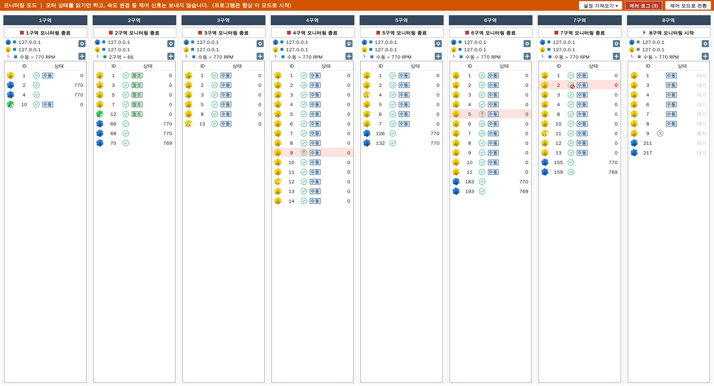

### 2.5 파일
| 파일 | 설명 |
|---|---|
| `Config.dll` | 모든 설정(IP, 제어 소스, 모터 목록, 속도제한). PORT 칸은 운영 프로그램과 같은 형식을 위해 항상 502 로 저장합니다. 암호화되어 있어 메모장으로는 볼 수 없습니다. 내용 확인: `python -m motor_monitor.config Config.dll`. 값이 없는 구역(새 파일)은 RPM 제어 소스 **수동 770 RPM** 으로 시작합니다 |
| `logs\motor_monitor.log` | 접속 성공/실패, 제어 시작/종료 기록 |
| `logs\error.log` | 에러 로그(4.5절): 접속 실패·연결 끊김·응답 없음·쓰기 실패와 그 복구 |
| `Config.dll.bak_날짜_시각` | 설정 가져오기(4.6절) 전에 만든 이전 설정 백업 |
| `speed_memory.json` | 2.5.0 에서만 쓰던 속도 기억 파일. 2.5.1 부터 쓰지 않으니 지워도 됩니다 |

> 프로그램은 한 번에 하나만 실행됩니다 ("모니터가 이미 실행중입니다.").
> `Config.dll` 이 손상되어 읽을 수 없으면 "프로그램 설정 정보가 처리중 오류가 발생했습니다. 제작사에 문의바랍니다." 가 뜨고 종료됩니다. 이때 파일은 바꾸지 않으므로 백업본으로 바꿔 넣으면 됩니다.

---

## 3. 화면 한눈에 보기

1~8구역이 가로로 나란히 표시됩니다. 권장 해상도는 1920×1080 이며 Windows 에서는 최대화된 상태로 시작합니다.

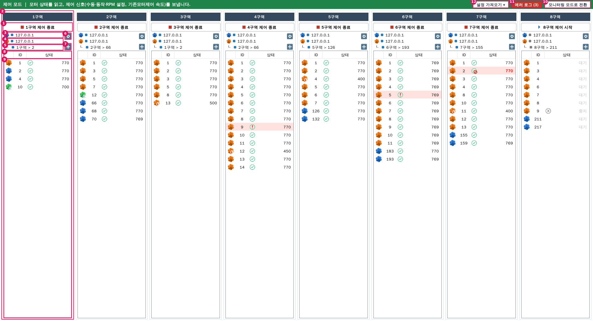

| 번호 | 이름 | ID |
|---|---|---|
| 1 | n구역 제어 시작/종료 버튼 | `ZONE-*-BTN-START` / `-STOP` |
| 2 | 구역 패널 | `ZONE-1` ~ `ZONE-8` |
| 3 | 기존모터 통신상태 점 + IP | `ZONE-*-DOT-OLD`, `-LBL-OLD` |
| 4 | 신규모터 통신상태 점 + IP | `ZONE-*-DOT-NEW`, `-LBL-NEW` |
| 5 | RPM 소스 상태 점 + 문구 | `ZONE-*-DOT-REF`, `-LBL-REF` |
| 6 | 설정 버튼 (톱니) | `ZONE-*-BTN-SET` |
| 7 | 추가 버튼 (+) | `ZONE-*-BTN-ADD` |
| 8 | 모터 목록 머리글 | `ZONE-*-LIST-HDR` |
| 9 | 모터 목록 | `ZONE-*-LIST` |
| 10 | 모드 전환 버튼 (맨 위 띠 오른쪽, 띠 색: 초록=제어 / 주황=모니터링) | `MAIN-MODE-BTN`, `MAIN-MODE-BANNER` |
| 11 | 에러 로그 버튼 (확인하지 않은 새 에러가 있으면 빨간 바탕에 건수) | `MAIN-BTN-ERRLOG` |
| 12 | 설정 가져오기 버튼 (운영 프로그램 Config.dll / 미니 제어기 목록) | `MAIN-BTN-IMPORT` |

**새 창은 프로그램 창 안에 뜹니다** (`DLG-MSG`)
- 구역설정·모터 추가/수정·에러 로그·설정 가져오기 창과 확인·알림 창은 모두 **프로그램 창 안 가운데**에 뜹니다. 모니터(화면) 기준으로 위치를 정하지 않으므로, 프로그램 창을 다른 모니터로 옮겨 두면 새 창도 그 모니터의 프로그램 창 안에 뜹니다.
- 창 위에서 띄운 확인·알림 창은 그 창 가운데에 뜨되 프로그램 창 밖으로는 나가지 않습니다. 닫으면 원래 창으로 돌아갑니다.
- 확인·알림 창은 Windows 기본 메시지 상자 대신 아래 모양으로 바뀌었습니다. 키보드로 바로 답할 수 있습니다: **Enter · Space · Y = 예(확인)**, **Esc · N = 아니오(닫기)** (한글 입력 상태의 ㅛ·ㅜ 도 같음). 창 왼쪽 아래에 안내가 나옵니다.
- 파일을 고르는 창(설정 가져오기)은 Windows 표준 창이라 위치를 Windows 가 정합니다(프로그램 창을 부모 창으로 지정해 띄움).

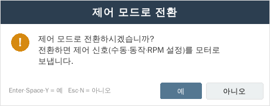

---

## 4. 메인 화면 기능

### 4.1 구역 제어 시작 / 종료 (`ZONE-*-BTN-START` / `-STOP`)
- **▶ n구역 제어 시작** → "n구역 제어를 시작하시겠습니까?" → **예**: 그 구역만 통신·자동 제어를 시작합니다. 버튼이 **■ n구역 제어 종료** 로 바뀝니다.
- **■ n구역 제어 종료** → "n구역 제어를 종료하시겠습니까?" → **예**: 그 구역의 통신·제어를 멈춥니다. 상태 점이 회색이 됩니다.
- 모니터링 모드에서는 같은 버튼이 **n구역 모니터링 시작/종료** 이며, 읽기만 합니다(2.4절). 모드는 맨 위 띠의 전환 버튼으로 바꿉니다.
- 구역마다 따로 시작/종료합니다. 프로그램을 켜면 모든 구역이 **중지 상태**로 시작하므로, 필요한 구역의 시작 버튼을 눌러야 합니다.
- 제어를 시작할 때마다 그 구역의 이상표시(빨간 !)가 지워지고 모든 모터가 '대기' 에서 다시 시작합니다.
- 시작하면 바로 한 번 점검하고, 그 뒤로는 모터마다 **30초에 한 번** 속도를 점검합니다(8-1절). 구역설정·모터 수정으로 설정을 바꾸거나 제어 모드로 바꾸면 30초를 기다리지 않고 바로 점검합니다.
- 제어를 멈춰도 신규모터는 마지막으로 받은 RPM 으로 계속 돌 수 있습니다(모터 쪽 동작).

### 4.2 머리 영역 (`ZONE-*`)

| 줄 | 표시 | 의미 |
|---|---|---|
| 1줄 | 청색 팬 + 점 + `IP` | 기존모터 통신장치 IP 와 접속 상태 (PORT 는 502 고정이라 표시 안 함) |
| 2줄 | 개나리색 팬 + 점 + `IP` | 신규모터 통신장치 IP 와 접속 상태 |
| 3줄 | `┖` + 점 + 문구 | 신규모터 목표 RPM 출처: `수동 > 770 RPM` 또는 `2구역 > 66` (2구역의 기존모터 66번을 따라감) |

> 화면이 좁아 문구 끝이 잘리면 문구 위에 마우스를 올려 전체 내용을 볼 수 있습니다.

**상태 점 색** (5초마다 갱신)

| 색 | 1줄·2줄 | 3줄 |
|---|---|---|
| 회색 | 이 구역 제어 중지 | 이 구역 제어 중지 |
| 파랑 | 접속 정상 | 수동이거나, 참조 기존모터가 '정상' |
| 빨강 | 접속 실패/끊김 (10초마다 재시도). 다시 접속되면 파랑으로 돌아옴 | 참조 기존모터가 정상이 아님 → **이 구역 신규모터는 제어 보류**(마지막 값 유지) |

### 4.3 설정 / 추가 버튼
- **톱니(`BTN-SET`)**: 그 구역의 **구역설정 창**(5장).
- **+(`BTN-ADD`)**: 그 구역에 모터를 등록하는 **모터 추가 창**(6장).

### 4.4 모터 목록 (`ZONE-*-LIST`)

| 열 | 내용 |
|---|---|
| (그림) | **청색 팬 = 기존모터**, **개나리색 팬 = 신규모터**(+ 빨간 **L** = 속도제한 중), **녹색 팬 + C = 기존모터제어** |
| ID | 모터 번호 |
| 상태 | 상태 그림 + **수동/참조 표시** + RPM (아래 표) |

| 상태 표시 | 의미 |
|---|---|
| 녹색 ✓ + 숫자 | **정상**. 숫자는 현재 RPM (신규모터는 모터가 보고하는 실제 RPM). 그림에 마우스를 올리면 신규모터·기존모터제어는 `설정 770 · 지정 785 · 실제 768 RPM (오차 1% 이내)` 처럼 설정 속도·보낸 지정값·실제 속도가 보임 |
| 빨간 **!** + "속도 미달" | **속도 문제**: 기존모터제어의 설정 속도가 모터 최고속도(h8)보다 높아 모터가 최고속도로 제한해 운전 중(6-1절). 그림에 마우스를 올리면 이유가 보이고 에러 로그에도 남음 |
| 빨간 **!** + 숫자(또는 대기) | **통신 이상**: 명령 후 60초 넘게 응답이 없거나, 통신장치에 접속할 수 없거나 연결이 끊김(기존모터제어는 제어 문제 포함). **다시 응답이 오면 바로 녹색 ✓ 로 돌아옵니다.** 그림에 마우스를 올리면 이유가 보이고, 에러 로그(4.5절)에도 남습니다 |
| ✓+빨간 금지표시 + **빨간 숫자** | **이상**: 마지막 응답 후 1시간이 지남 (숫자는 마지막 RPM) |
| 회색 ⓧ + **중지** | 사용 안 함으로 설정됨 (통신·제어 제외) |
| **대기** (그림 없음) | 제어 시작 전이거나, 시작 후 아직 응답 없음 |

> 속도제한 모터의 RPM 이 다른 모터보다 낮게 보이는 것은 정상입니다(최대속도로 제한 운전 중).

**정렬**: 처음에는 **ID 작은 순**입니다(종류와 관계없이, 같은 ID 는 기존모터 → 신규모터 → 기존모터제어). 머리글을 누르면 (그림)=종류, **ID**, **상태** 순으로 정렬되고, 같은 머리글을 다시 누르면 반대 순서입니다.
**문제 행 음영**: 빨간 **!**(통신·제어 이상), '이상'(1시간 응답 없음), 속도 미달인 모터는 **행 전체가 연한 붉은색**으로 칠해집니다. 문제가 풀리면 원래대로 돌아옵니다.
**수동/참조 표시**: 상태 그림과 숫자 사이에 그 모터의 속도를 어떻게 정하는지 보입니다. 표시에 마우스를 올리면 자세한 내용(지금 설정 속도 등)이 보입니다.

| 표시 | 신규모터 | 기존모터제어 |
|---|---|---|
| 파랑 **수동** | 구역설정(5장)의 RPM 제어 소스가 **수동** → 수동 RPM 값으로 운전 | 운전속도가 **수동 지정** → 입력한 속도로 운전 |
| 초록 **참조** | RPM 제어 소스가 **기존모터** → 참조 기존모터의 회전수를 **자동으로 따라** 운전 | 운전속도가 **구역 참조** → 이 구역 신규모터가 따르는 값을 같은 비율로 자동으로 따라 운전 |
| (없음) | 기존모터(읽기만 함), 사용 안 함(중지) 모터 | |

**속도 보냄 표시**: 모터에 속도 변경(신규모터 RPM 설정, 기존모터제어 운전속도)을 보내면 그 모터의 **팬 그림이 붉은 그림으로, 그 행 바탕이 붉은색으로 1초 동안** 바뀌었다가 원래대로 돌아옵니다(깜빡이지 않음). 모터가 가진 값이 목표와 같으면 보내지 않으므로 붉게 바뀌지 않습니다. 참조 방식에서는 참조 회전수가 바뀔 때마다 새 속도를 보내므로 자주 붉게 바뀔 수 있습니다.
**수정/삭제**: 항목을 **더블클릭**하면 모터 수정/삭제 창(7장)이 열립니다.

### 4.5 에러 로그 (`MAIN-BTN-ERRLOG`)

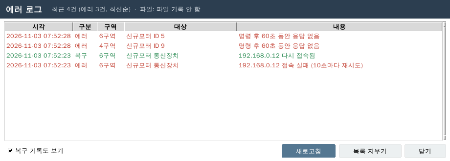

맨 위 띠의 **[에러 로그]** 를 누르면 최근 에러 기록 창이 열립니다(최신이 위, 최대 1000건). 확인하지 않은 새 에러가 있으면 버튼이 빨간 바탕에 **에러 로그 (건수)** 로 바뀝니다.

| 기록되는 내용 | 예 |
|---|---|
| 통신장치 접속 실패 / 연결 끊김 | `신규모터 통신장치 · 192.168.0.4 접속 실패 (10초마다 재시도)` |
| 모터 응답 없음 | `신규모터 ID 9 · 명령 후 60초 동안 응답 없음`, `마지막 응답 후 60분 넘게 응답 없음 (이상)` |
| 기존모터제어 문제 | 제어모드 설정 실패, 운전속도 쓰기 실패, `구역 참조값(2구역 기존모터 66) 60초 넘게 값 없음 … - 이전 지정 70% (770 RPM) 유지` |
| 속도 미달 (6-1절) | `모터 최고속도(h8) 600 RPM 이 설정 700 RPM 보다 낮아 최고속도로 운전` |
| 설정 저장 실패 | `설정 파일 · 저장 실패: …` |
| **복구**(녹색) | `다시 접속됨`, `응답 정상 (이상표시 해제)`, `속도 문제 해제` |

- 같은 문제가 계속되어도 **처음 한 번과 복구 한 번만** 기록합니다.
- 창이 열려 있으면 2초마다 새 기록이 반영됩니다. '복구 기록도 보기' 를 끄면 에러만 봅니다.
- **[목록 지우기]** 는 화면 목록만 지웁니다. 모든 기록은 `logs\error.log` 에 남고, 프로그램을 다시 켜면 지난 기록을 다시 보여 줍니다.

### 4.6 설정 가져오기 (`MAIN-BTN-IMPORT`)
맨 위 띠의 **[설정 가져오기 ▾]** 에서 고릅니다.

**운영 프로그램 설정 (Config.dll / Config.ini)…**
- 기존 운영 프로그램(BLDC_MOTOR_MONITOR, VB.NET) 폴더의 `Config.dll` 을 고르면 8개 구역의 통신 설정(IP, RPM 소스)과 모터 목록을 읽어 미리 보여 줍니다. 암호화된 `Config.dll`, 저장 중 남은 평문 `uconfig.dll`, 예전 버전의 평문 `Config.ini` 모두 읽을 수 있습니다. 파일에 502 가 아닌 PORT 가 적혀 있어도 502 로 접속합니다(`logs\motor_monitor.log` 에 기록).
- **[가져오기]** → 지금 `Config.dll` 을 `Config.dll.bak_날짜_시각` 으로 보관한 뒤 가져온 내용으로 바꾸고 저장합니다.
- 가져온 파일에 기존모터제어가 없으면 지금 등록된 기존모터제어는 그대로 둘 수 있습니다(기본 선택).
- **실행 중인 구역이 있으면 가져올 수 없습니다.** 모든 구역을 종료한 뒤 하세요.

**미니 제어기 목록 (mini_control.json)…**

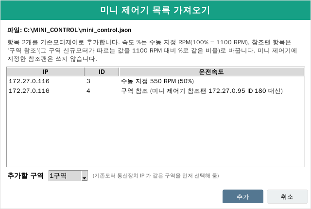

- 미니 제어기(13장) 폴더의 `mini_control.json` 을 고르면 항목을 **기존모터제어**로 추가합니다. 추가할 구역을 고릅니다(기존모터 통신장치 IP 가 같은 구역을 먼저 선택해 둠).
- 속도 % 항목 → 수동 지정 운전속도(100% = 1100 RPM). 참조팬 항목 → **구역 참조**(그 구역 신규모터가 따르는 값을 1100 대비 % 로 같은 비율, 6-1절). 미니 제어기에 지정했던 참조팬 IP·ID 는 쓰지 않으므로 목록에 "(미니 제어기 참조팬 … 대신)" 으로 보여 줍니다. 이미 있는 항목은 건너뜁니다.

---

## 5. 구역설정 창

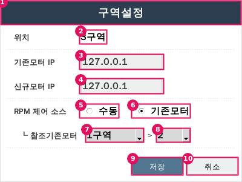 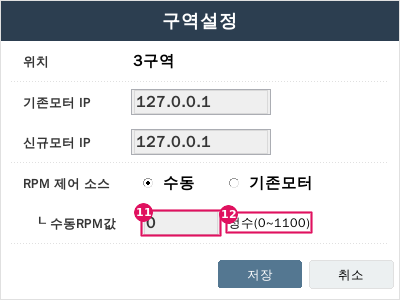

| 번호 | 항목 | 설명 |
|---|---|---|
| 2 | 위치 | 설정 중인 구역 |
| 3 | 기존모터 IP | 기존모터 통신장치 IP (PORT 는 502 고정이라 입력칸 없음) |
| 4 | 신규모터 IP | 신규모터 통신장치 IP |
| 5 | 수동 | 선택하면 11번 **수동RPM값** 칸이 나타남. 신규모터를 이 값(0~1100)으로 운전. 수동 RPM 을 한 번도 정하지 않은 구역은 **770** 이 미리 채워짐 |
| 6 | 기존모터 | 선택하면 7·8번 **참조기존모터** 칸이 나타남 |
| 7 | 참조 구역 | 따라갈 기존모터가 있는 구역 (1~8구역 어디든 가능) |
| 8 | 참조 ID | 선택한 구역에 등록된 **기존모터** 번호. 그 구역에 기존모터를 먼저 추가해야 나옵니다 |
| 9 | 저장 (Enter) | 검사 후 저장, 메인 화면 머리 영역이 바로 바뀜 |
| 10 | 취소 (Esc) | 저장하지 않고 닫음 |

**오류 메시지** (제목 "에러"): IP 를 비우거나 형식이 틀리면 "…IP를 입력해 주세요 / 올바른 형식이 아닙니다.." 수동 RPM 이 0~1100 밖이면 "수동 RPM속도를 0~1100범위내로 입력해주세요." 참조 구역/ID 를 고르지 않으면 "참조할 모터가 있는 구역을 선택해주세요. / 참조할 모터 ID를 선택해주세요."

**참고**: 수동 RPM·참조 모터 변경은 제어 중에도 바로 반영됩니다(이 구역 기존모터제어의 '구역 참조' 도 함께 따라 바뀜). IP 변경은 다음 접속부터 적용되므로, 즉시 적용하려면 그 구역 제어를 종료 → 시작하세요.

---

## 6. 모터 추가 창

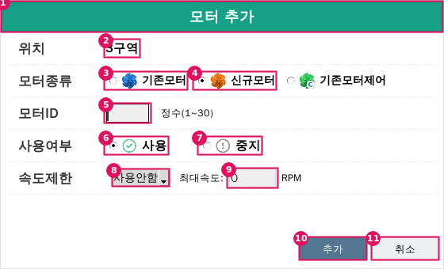

| 번호 | 항목 | 설명 |
|---|---|---|
| 3, 4, 15 | 모터종류 | 기존모터(청색) / 신규모터(개나리색) / 기존모터제어(녹색) (필수). **신규모터는 속도제한 줄, 기존모터제어는 접속 IP·운전속도·구역 참조값 줄이 나타남** |
| 5 | 모터ID | 통신장치에 설정된 모터 번호 (필수). **신규모터 1~30, 기존모터·기존모터제어 1~249** (종류를 고르면 옆에 범위가 표시됨) |
| 6, 7 | 사용여부 | 기본 '사용'. 중지: 등록만 하고 통신·제어 제외 |
| 8 | 속도제한 | 사용함 / 사용안함 (기본 사용안함) |
| 9 | 최대속도 | 속도제한 '사용함' 일 때 이 RPM 을 넘지 않게 운전 (0~1100) |
| 10 | 추가 (Enter) | 검사 → "해당 모터정보를 추가하시겠습니까?" → 예 → 등록·저장 |
| 11 | 취소 (Esc) | 닫기 |

오류 메시지(제목 "오류"): "모터 종류을 선택해 주세요." / "모터ID값은 숫자로 1-30범위로 입력하셔야 합니다."(신규모터, 기존모터·기존모터제어는 1-249) / "제한모드 RPM값은 숫자 0~1100범위로 입력하셔야 합니다." / "이미 해당 모터 종류와 ID를 갖는 모터가 있습니다. 확인바랍니다."

### 6-1. 기존모터제어 추가 (기존모터를 지정 속도로 운전)

기존모터의 아날로그 제어신호선에 문제가 있을 때, 기존모터를 **통신으로 받은 속도로 계속 운전**시킵니다. 속도는 **수동 지정** 값이나, **구역 참조**(이 구역 신규모터가 따르는 값을 최고속도 1100 RPM 대비 % 로 바꿔 같은 비율)를 따릅니다.

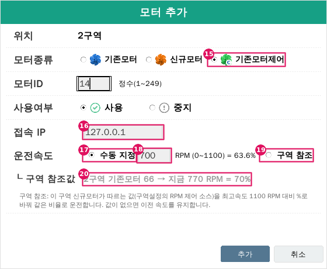

| 번호 | 항목 | 설명 |
|---|---|---|
| 15 | 기존모터제어 | 모터종류에서 선택 |
| 5 | 모터ID | 그 기존모터의 Modbus 주소 (1~249). 기존모터 목록의 ID 와 같은 번호 |
| 16 | 접속 IP | 그 기존모터가 연결된 통신장치 IP. 이 구역의 기존모터 IP 가 기본으로 채워짐 (PORT 는 502 고정) |
| 17, 18 | 운전속도 - 수동 지정 | 입력한 속도(RPM, 0~1100)로 계속 운전 (기본 선택). **추가할 때 기본값은 770 RPM(= 70%)**. 옆에 1100 대비 % 가 보임 (예: `770` → `= 70%`, `700` → `= 63.6%`) |
| 19 | 운전속도 - 구역 참조 | **이 구역 신규모터가 참조하는 값을 그대로 써서** 최고속도 1100 의 몇 % 인지 구하고, 같은 비율(1100 × %)로 운전. 구역설정(5장)이 '기존모터' 면 그 참조 기존모터의 현재 회전수, '수동' 이면 수동 RPM 값 — 신규모터와 같은 값입니다. 1100 을 넘으면 100% |
| 20 | 구역 참조값 | 지금 값과 % (예: `2구역 기존모터 66 → 지금 770 RPM = 70%`). 참조 기존모터를 아직 읽지 못했으면 `지금 값 없음` |

예) 2구역 구역설정이 `기존모터 2구역 > 66` 이고 66번이 770 RPM 이면 770 ÷ 1100 = **70%** → 기존모터제어도 1100 × 70% = **770 RPM** 으로 운전합니다. 66번이 880 RPM 이 되면 80% → 880 RPM 으로 따라갑니다.

**모터 최고속도(h8) 기준 %**: 구역 제어 중에는 모터의 최고속도 설정(h8, 1/min)을 읽어 **원하는 속도가 그 모터 최고속도의 몇 %인지** 계산해 보여 줍니다(목록 그림의 툴팁, 수정 창 아래 파란 글씨). 예) 최고속도 1400 인 모터로 770 RPM 을 원하면 770 ÷ 1400 = 55%.
- 속도는 지금처럼 **원하는 회전수(RPM)를 그대로** 보냅니다(절대 회전수 방식). 제조사 문서(L-BAL-E076-GB 3.4.2, 3.4.5 주3)에 따르면 % 로 보내는 방식은 최저속도(h7)가 0 보다 크면 실제 속도가 원하는 값보다 높아지고, 절대 회전수 방식은 최저속도와 관계없이 지정한 회전수를 유지하므로 원하는 속도를 얻는 데 더 정확합니다.
- 제어 모드에서 원하는 속도가 모터 최고속도보다 높으면 모터가 최고속도로 제한해 운전하므로 빨간 **!** 와 에러 로그로 알립니다(보내는 값은 원하는 속도 그대로, 모터 스캐너 15.2절에서 최고속도 확인). 모니터링 모드에서는 속도를 보내지 않으므로 이 알림을 새로 판단하지 않습니다.
- h8 이 0(설정 없음)이면 % 표시와 알림이 없습니다. 신규모터는 최고속도를 읽는 주소가 알려져 있지 않아 이 표시가 없습니다.

- **구역 참조값이 없을 때**(참조 기존모터 응답 없음·상태 이상, 참조 기존모터가 있는 구역을 실행하지 않음): **이전 속도를 유지**합니다(한 번도 정하지 못했으면 속도를 쓰지 않음). 값이 없는 상태가 **60초 넘게** 이어지면 빨간 **!** 와 에러 로그를 남깁니다. 구역을 막 시작해 아직 읽기 전에는 에러 없이 기다립니다.
- 참조 기존모터 **자신**(같은 통신장치 IP·같은 ID)은 구역 참조로 제어할 수 없습니다(자기 회전수를 목표로 하면 속도가 그대로 굳음). 추가할 때 막고, 나중에 구역설정을 바꿔 그렇게 되면 따라가지 않고 빨간 **!** 로 알립니다.

**동작** (그 구역의 제어를 시작해야 동작합니다)
1. 모터의 운전 방식을 '통신으로 받은 속도' 로 바꿉니다(처음 한 번만). 이때부터 아날로그 신호선은 속도에 쓰이지 않습니다.
2. 운전을 켜고 운전속도를 써넣습니다.
3. 30초마다 실제 회전수를 읽어 목록에 표시하고, 모터 쪽 값이 바뀌어 있으면(정전 후 재시작 등) 다시 운전속도로 맞춥니다.
4. 프로그램을 꺼도 모터는 마지막 운전속도로 계속 돕니다.

**운전속도 바꾸기**: 목록에서 그 모터(녹색 팬 + C)를 더블클릭 → 수동 지정 값 또는 방식(수동 지정 / 구역 참조) 수정 → 수정. 바로 반영됩니다. 구역 참조는 구역설정의 RPM 제어 소스를 바꾸면 따라 바뀝니다. 그림에 마우스를 올리면 방식, 구역 참조값과 %, 설정 속도, 모터 최고속도 대비 % 가 보입니다 (예: `운전속도: 구역 참조 2구역 기존모터 66 (지금 770 RPM = 70%) → 설정 70% = 770 RPM` / `모터 최고속도(h8) 1400 RPM: 설정 770 RPM = 최고속도의 55%`).
**멈추기**: 사용여부를 '중지' 로 수정하면 운전속도 0 을 한 번 보냅니다.

> **주의**
> - 운전 방식 변경은 모터에 영구 저장됩니다. 모터를 삭제하거나 중지해도 **아날로그 신호 제어로 자동으로 돌아가지 않습니다.** 신호선을 고친 뒤 원래대로 돌리려면 별도 조치가 필요합니다(문의).
> - 운전 방식 변경이 3번 실패하면(모터의 PIN 보호 설정 등) 더 시도하지 않고 빨간 **!** 로 표시합니다. 그림에 마우스를 올리면 내용이 보입니다.
> - 모니터링 모드에서는 읽기만 하고 아무것도 바꾸지 않습니다(구역 참조값도 확인해서 표시만 함).
> - 이 목록은 `Config.dll` 의 새 항목에 저장됩니다. 기존 운영 프로그램(exe)이 같은 `Config.dll` 을 저장하면 이 항목이 지워지니, 두 프로그램이 같은 파일을 쓰지 않게 하세요.

**현장 점검 도구 (`tools/ecblue_check.py`)** — 기존모터제어를 등록하기 전에, 그 모터가 통신에 응답하고 지정 속도로 도는지 확인합니다. 운영 `Config.dll` 은 건드리지 않으며 결과는 `logs\ecblue_check_날짜_시간.txt` 에도 저장됩니다.

| 단계 | 명령 (프로그램 폴더에서) | 하는 일 |
|---|---|---|
| 1단계 읽기 | `python tools\ecblue_check.py --ip 172.27.0.95 --ids 180 176` | 접속, h1~h4(운전/속도/제어모드) 와 실제 회전수 읽기. **모터에 아무것도 쓰지 않음** |
| 2단계 제어 | `python tools\ecblue_check.py --ip 172.27.0.95 --ids 180 176 --rpm 500 --seconds 90` | `YES` 입력 후 프로그램의 기존모터제어 코드로 지정 속도 운전, 2초마다 점검·실제 회전수 표시, 지정 속도 도달 판정, 끝나면 시험 전 설정 복원 여부를 물음(기본: 복원) |
| 응답이 없을 때 | `python tools\ecblue_check.py --ip 172.27.0.95 --ids 155 159 180 176` | 같은 통신장치에서 운영 프로그램이 읽고 있는 기존모터(예: 155, 159)와 비교. 운영 기존모터 읽기와 같은 요청이므로, 155·159 만 응답하면 문제는 180·176 쪽(ID·배선·통신설정) |
| ID 찾기 | `python tools\ecblue_check.py --ip 172.27.0.95 --ids 1-247 --timeout 0.5` | ID 가 9개 이상이면 실제 회전수만 읽어 응답하는 ID 목록을 보여 줌 (ECblue 공장 기본 주소 247) |

- `--timeout 5`: 응답 대기 시간을 늘림 (기본 2초). 응답이 늦게 오는 통신장치 확인용.
- 응답 없음 → ID·배선·통신장치 확인 / 예외 응답 11 → 그 ID 의 모터가 버스에서 응답하지 않음 / `[제어모드 설정 실패]` → 모터의 PIN 보호 확인.
- 2단계 중 `Ctrl+C` 로 바로 멈출 수 있고, 멈춰도 복원 질문은 나옵니다.

---

## 7. 모터 수정/삭제 창

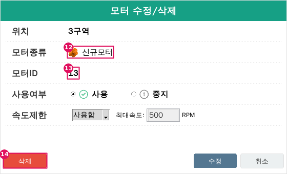

목록에서 모터를 더블클릭하면 열립니다. 종류(12)와 ID(13)는 바꿀 수 없고, **사용여부**와 (신규모터는) **속도제한·최대속도**, (기존모터제어는) **운전속도**를 바꿀 수 있습니다. 기존모터제어의 접속 IP 는 바꿀 수 없으니, 바꾸려면 삭제 후 다시 추가하세요.

| 버튼 | 동작 |
|---|---|
| 수정 | "해당 모터정보를 수정하시겠습니까?" → 예 → 저장 |
| 삭제 (빨강, 14) | "해당 모터정보를 삭제하시겠습니까?" → 예 → 삭제 |
| 취소 | 닫기 |

- **신규모터를 '중지' 로 바꾸면** 제어 중일 때 그 모터에 RPM 0 명령을 한 번 보내 멈춥니다.
- 다른 구역이 RPM 참조로 쓰는 **기존모터는 삭제할 수 없습니다** ("해당 모터를 참조로 사용하는 구역이 있습니다. 변경 후, 삭제할 수 있습니다.").

---

## 8. 자동 제어는 이렇게 동작합니다

구역 제어를 시작하면 그 구역에서 다음을 반복합니다.

0. **모니터링 모드**(프로그램 시작 시 기본)에서는 아래 1·2 처럼 읽기만 하고 3·4 의 쓰기는 하지 않습니다.
1. **기존모터 읽기**: 사용 중인 기존모터마다 **30초에 한 번** RPM 을 묻습니다(명령 사이 0.3초).
2. **신규모터 읽기**: 사용 중인 신규모터마다 **30초에 한 번** 현재 RPM(실제 속도)과 운전 설정(수동/자동, 동작/정지, 설정 RPM)을 읽습니다.
3. **목표 RPM 결정**
   - 수동 모드: 구역설정의 수동RPM값
   - 기존모터 모드: 참조 기존모터가 **정상**이면 그 RPM. 아니면 **제어하지 않고 기다림**
   - 속도제한 '사용함' 인 모터는 목표가 최대속도보다 크면 최대속도로
4. **맞추기**: 신규모터가 수동 모드가 아니면 수동으로, 정지 중이면 동작으로 바꾸고, RPM 설정이 목표와 다르면 **목표를 그대로** 써넣습니다. 이미 같으면 보내지 않습니다.
5. **기존모터제어**: 수동 지정은 그 속도로, 구역 참조는 3의 목표 RPM(속도제한 적용 전)을 1100 대비 % 로 바꿔 같은 비율로 써넣습니다(6-1절).
6. 접속이 끊기면 10초마다 다시 접속합니다. 모든 접속은 PORT 502 를 씁니다.

**상태 판정**(제어 중인 구역, 5초마다): 명령을 보낸 뒤 60초 동안 응답이 없거나 통신장치에 접속할 수 없으면 '이상표시(빨간 !)', 마지막 응답 후 1시간이 지나면 '이상' 입니다. **다시 응답이 오면 바로 정상(녹색 ✓)으로 돌아옵니다.** 이상과 복구는 에러 로그(4.5절)에 남습니다.

### 8-1. 속도 점검 (30초마다)

| 규칙 | 내용 |
|---|---|
| 점검 주기 | 모터마다 **30초에 한 번** 읽고, 모터가 가진 값이 목표와 다르면 목표를 보냄. 구역을 시작하거나, 설정(구역설정·모터 수정)을 바꾸거나, 제어 모드로 바꾸면 바로 한 번 점검 |
| 보내는 값 | **목표 속도(설정 속도) 그대로**: 신규모터는 구역 목표 RPM(속도제한 적용), 기존모터제어는 운전속도. 실제 속도를 보고 보내는 값을 바꾸지 않음 |
| 화면 | 그림에 마우스를 올리면 `설정 770 · 지정 770 · 실제 768 RPM (오차 1% 이내)` 처럼 설정 속도, 모터가 가진 지정값, 실제 속도가 보임. 실제 속도가 설정의 1% 안이면 '(오차 1% 이내)' |

> 2.5.0 에 있던 **속도 보정**(실제 속도가 느리면 지정값을 조금씩 올림, 60초 무반응 시 보정 멈춤·알림, 보정값 기억 `speed_memory.json`·최초 신호, 1% 이내 변화 무시)은 요청에 따라 **2.5.1 에서 삭제**했습니다.

---

## 9. 프로그램 종료

창의 X → "종료하시겠습니까? 종료시 제어기능이 동작하지 않습니다." → **예**: 설정을 저장하고 모든 통신을 끊은 뒤 종료합니다. (모니터링 모드에서는 "종료하시겠습니까?" 만 묻고, 설정을 자동 저장하지 않습니다.)

---

## 10. 문제 해결

| 증상 | 확인할 것 |
|---|---|
| 1줄/2줄 점이 빨강 | 통신장치 전원·랜선·IP(구역설정). PORT 는 502 고정이므로 통신장치도 502 를 써야 합니다. `logs\motor_monitor.log` 의 "접속 실패" 기록 |
| 3줄 점이 빨강 | 참조 기존모터가 정상이 아님 → 그 모터 상태 확인. 그동안 이 구역 신규모터는 제어되지 않음 |
| 모터에 빨간 ! | 지금 응답이 없거나(60초 이상) 통신장치 접속이 끊김. 그림에 마우스를 올려 이유 확인, [에러 로그] 확인. 다시 응답하면 자동으로 녹색 ✓ 로 바뀜 |
| 모터가 '이상'(빨간 숫자) | 1시간 넘게 응답 없음 → 모터/통신장치 점검 |
| 모터가 계속 '대기' | 제어를 시작하지 않았거나, 통신장치에 그 ID 가 없음 |
| 신규모터 RPM 이 낮음 | 속도제한(L 표시) 모터인지 확인 → 수정 창에서 최대속도 확인 |
| "모터 최고속도(h8) … 보다 낮아 최고속도로 운전" | 기존모터제어 모터의 최고속도 설정(h8)이 원하는 속도보다 낮음 → 모터 스캐너(15.2절)에서 최고속도 확인 |
| 참조 ID 목록이 비어 있음 | 선택한 구역에 기존모터가 등록되지 않음 |
| 기존모터제어(녹색 팬 + C)가 계속 '대기' | 그 구역 제어를 시작했는지, 접속 IP·ID 가 맞는지, [에러 로그]의 "기존모터제어 통신장치 … 접속 실패" 확인 |
| 기존모터제어에 빨간 ! + "구역 참조값 … 값 없음" | 구역설정의 RPM 제어 소스(참조 기존모터)와, 그 기존모터가 있는 구역이 실행 중인지, 그 기존모터 상태 확인. 그동안 이전 속도로 계속 운전 |
| 기존모터제어에 빨간 ! + "… 자신의 회전수라 따라갈 수 없음" | 구역설정의 참조 기존모터가 이 모터 자신임 → 수동 지정으로 바꾸거나 구역설정에서 다른 참조 기존모터를 지정 |
| 프로그램을 켰는데 모터가 제어되지 않음 | 프로그램은 항상 **모니터링 모드**로 시작함 → 맨 위 띠의 [제어 모드로 전환] |
| 기존모터제어에 빨간 ! + "제어모드 설정 실패" | 모터의 PIN 보호 설정으로 운전 방식을 바꾸지 못함 → 제조사 도구로 PIN 보호 단계 확인 필요 |
| 기존모터제어 속도가 지정값과 다름 | 프로그램은 운전속도를 그대로 보내며 실제 속도로 바꾸지 않음(툴팁에 1% 안이면 '오차 1% 이내'). 모터 최고속도(h8)가 더 낮으면 그 값으로 제한되고 알림이 뜸. 실제 회전수는 부하에 따라 약간 차이 날 수 있음 |

---

## 11. 장비 없이 시험하기 (시뮬레이터)

```
python -m motor_monitor.simulator --old 2:770 --new 1,3
```
- 이 PC 의 `127.0.0.1` (PORT 502) 에 기존모터 2번(770RPM), 신규모터 1번, 3번이 생깁니다. 신규모터의 현재 RPM 은 써넣은 설정 RPM 을 따라갑니다.
- 프로그램은 PORT 502 로만 접속하므로 시뮬레이터도 502 에서 기다립니다. 여러 개를 띄울 때는 `--host 127.0.0.2`, `--host 127.0.0.3` … 처럼 주소를 달리합니다(Windows 는 127.0.0.x 주소를 모두 이 PC 로 씀).
- 기존모터제어 시험: `--ecblue 10:0` 을 붙이면 ECblue 기존모터 10번(아날로그 신호 0 RPM 상태)이 생깁니다. 기존모터제어로 추가하고 운전속도를 넣으면 실제 회전수가 그 값으로 바뀝니다.
- 시험용 설정 파일로 실행하세요: `python run.py --config test_config.dll` (운영 `Config.dll` 을 건드리지 않도록).
- 구역설정 창에서 기존모터·신규모터 IP 를 `127.0.0.1` 로 저장하고 모터를 추가한 뒤 그 구역 제어를 시작합니다.

---

## 12. 기존모터 시험기

기존(ECblue) 모터 **ID 180, 176** (통신장치 **172.27.0.95:502**) 을 직접 시험하는 작은 별도 프로그램입니다. 대상은 고정되어 있어 입력할 것이 없습니다. 운영 프로그램과 `Config.dll` 은 건드리지 않습니다.

- 실행: **`ECBLUE_TESTER.exe`** 더블클릭 (파이썬 설치 불필요, 파일 하나만 복사해서 사용). 또는 프로그램 폴더의 `ecblue_tester.bat` / `python tools\ecblue_tester.py`
- exe 받기: 프로그램 폴더의 **`update.bat`** 이 최신으로 내려받아 줍니다(2.2-1). 또는 GitHub 저장소 → **Actions** → *Build ECblue tester exe* → 최근 실행 → 아래 **Artifacts** 의 `ECBLUE_TESTER` (zip 안에 exe). 직접 만들려면 Windows 에서 `build_tester_exe.bat` → `dist\ECBLUE_TESTER.exe`
- exe 로 실행하면 로그는 **exe 옆 `logs` 폴더**에 생깁니다. 시작하자마자 오류가 나면 `logs\ecblue_tester_error.txt` 에 원인이 남습니다.
- 화면: 620×520 (최소 460×470). 왼쪽이 180번, 오른쪽이 176번 모터입니다.

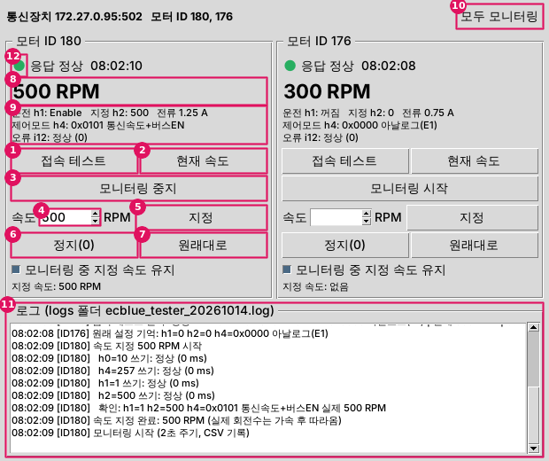

| 번호 | 이름 (ID) | 사용법 |
|---|---|---|
| 1 | 접속 테스트 (`TST-*-BTN-CONN`) | 통신장치에 새로 접속하고 모터 설정(h1~h4)·실제 회전수·전류·오류를 읽습니다. **모터에 아무것도 쓰지 않습니다.** 처음 읽은 설정을 '원래 설정' 으로 기억합니다. |
| 2 | 현재 속도 (`TST-*-BTN-SPEED`) | 실제 회전수만 한 번 읽습니다. |
| 3 | 모니터링 시작/중지 (`TST-*-BTN-MON`) | 2초마다 읽어 화면을 갱신하고 CSV 파일에 기록합니다. 응답이 끊기거나 돌아오면 로그에 남깁니다. |
| 4, 5 | 속도 입력 + 지정 (`TST-*-TXT-RPM`, `-BTN-SET`) | 0~1100 RPM 입력 → **지정** → 확인. 모터가 통신 속도제어 모드가 아니면 한 번 더 경고 확인 후 바꿉니다(전원을 꺼도 유지되는 설정). 지정 후 모니터링이 자동으로 켜집니다. |
| – | 모니터링 중 지정 속도 유지 (`TST-*-CHK-KEEP`) | 켜져 있으면, 모니터링 중에 모터의 지정 속도가 바뀐 것을 발견했을 때(정전 후 재시작 등) 다시 지정합니다. |
| 6 | 정지(0) (`TST-*-BTN-STOP`) | 운전속도를 0 으로 지정합니다. |
| 7 | 원래대로 (`TST-*-BTN-RESTORE`) | 접속 테스트 때 기억한 설정으로 되돌립니다(아날로그 0-10V 제어로 복귀). |
| 8, 9, 12 | 상태 표시 | 점(초록 응답 / 빨강 응답 없음), 실제 회전수, 운전·지정속도·전류·제어모드·오류 |
| 10 | 모두 모니터링 (`TST-BTN-MONALL`) | 두 모터 모니터링을 함께 켜고 끕니다. |
| 11 | 로그 (`TST-LOG`) | 모든 동작과 결과. 주황 = 경고, 빨강 = 오류 |

**권장 순서**: ① 접속 테스트(두 모터) → ② 응답 정상이면 모두 모니터링 → ③ 한 대씩 낮은 속도(예: 300)로 지정, 실제 회전수가 따라오는지 확인 → ④ 시험이 끝나면 '원래대로' 또는 원하는 속도로 지정한 채 종료.

**로그 파일** (`logs` 폴더, 날짜별):
- `ecblue_tester_YYYYMMDD.log` — 버튼 동작, 읽기/쓰기 결과, 응답 시간, 오류
- `ecblue_monitor_YYYYMMDD.csv` — 모니터링 측정값 (엑셀로 열기)

> - 응답 없음이 계속되면 10장과 6-1절 '현장 점검 도구' 의 ID 비교·찾기를 먼저 하세요.
> - 종료(X)해도 모터 설정은 바뀌지 않으며, 모터는 마지막으로 지정한 상태로 계속 돕니다.
> - 운영 프로그램의 기존모터제어에 같은 모터가 등록되어 있으면 두 프로그램이 같은 모터에 신호를 보내게 되니, 시험 중에는 한쪽만 쓰세요.

---

## 13. 미니 제어기

ECblue 팬을 **IP·ID 로 골라 속도를 지정**하는 작은 별도 프로그램입니다. 운영 프로그램과 `Config.dll` 은 사용하지 않습니다.

- 실행: **`MINI_CONTROL.exe`** 더블클릭 (파이썬 설치 불필요, 파일 하나). 또는 `mini_control.bat` / `python tools\mini_control.py`
- exe 받기: 프로그램 폴더의 **`update.bat`** 이 최신으로 내려받아 줍니다(2.2-1). 또는 GitHub → **Actions** → *Build mini controller exe* → 최근 실행 → **Artifacts** 의 `MINI_CONTROL`. 직접 만들려면 `build_mini_exe.bat` → `dist\MINI_CONTROL.exe`
- 항목 목록은 exe 옆 `mini_control.json` 에 저장되어 다음 실행 때 다시 나옵니다. 단, **제어는 [적용]을 눌러야 시작**합니다(실행만 해서는 팬에 아무것도 쓰지 않음).

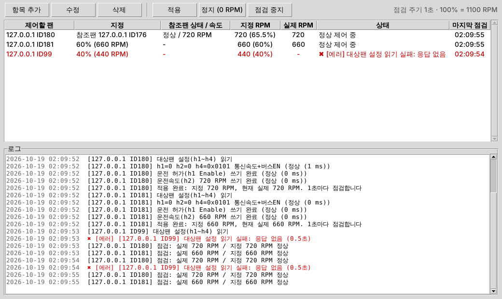 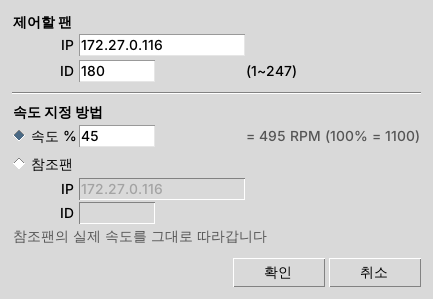

**항목 추가** → 창에서 입력:
- 제어할 팬: IP (기본 `172.27.0.116`), ID (1~247). 같은 IP·ID 는 한 번만 등록됩니다. PORT 는 502 고정.
- 속도 지정 방법 (둘 중 하나):
  - **속도 %**: 0~100. **100% = 1100 RPM** (예: 50% = 550 RPM). 입력하면 RPM 이 옆에 표시됩니다.
  - **참조팬**: 참조팬의 IP·ID. 참조팬의 실제 회전수(i14)를 읽어 **같은 속도**로 맞춥니다(1100 이 넘으면 1100). 목록에 참조팬의 상태(정상/응답 없음)와 속도가 표시됩니다.

**버튼** (목록에서 항목을 선택한 뒤. 여러 개 선택 가능)

| 버튼 | 동작 |
|---|---|
| 적용 | 단계별로 진행하며 로그에 남깁니다: (참조팬 속도 읽기) → 대상팬 설정 h1~h4 읽기 → 필요하면 제어모드(h4) 변경 **확인 창** → 운전 허가(h1) → 운전속도(h2) 쓰기 → 실제 속도 확인. 이후 **30초마다 점검**합니다. |
| 수정 (또는 더블클릭) | 지정을 바꿉니다. 제어 중이던 항목은 바뀐 지정으로 바로 다시 적용됩니다. |
| 정지 (0 RPM) | 운전속도 0 을 지정하고 점검을 멈춥니다. |
| 점검 중지 | 아무것도 쓰지 않고 점검만 멈춥니다. 팬은 마지막 지정 속도로 계속 돕니다. |
| 삭제 | 목록에서 지웁니다. 팬은 마지막 지정 속도로 계속 돕니다. |
| 항상 위 (체크박스, 오른쪽 위) | 체크하면 다른 프로그램 창에 가려지지 않고 이 창이 항상 맨 위에 표시됩니다. 설정은 `mini_control_settings.json` 에 저장되어 다음 실행 때도 유지됩니다. |

**정기 점검** (다른 지정을 할 때까지 계속)
- 참조팬 방식이면 참조팬 속도를 다시 읽어 바뀐 만큼 따라갑니다.
- 팬 쪽 지정 속도(h2)가 풀려 있으면(정전 후 재시작 등) 다시 지정하고 **[주의]** 로 기록합니다.
- 결과는 목록(지정 RPM·실제 RPM·상태·마지막 점검 시각)에 표시됩니다. **정상 결과는 로그에 남기지 않고**, 에러·주의와 '정상으로 돌아옴'(에러·주의 뒤 처음 정상)만 로그에 남깁니다. 실제 속도가 지정과 30 RPM 넘게 차이 나면 주황색 `⚠ 속도 맞추는 중` 으로 표시됩니다.
- 참조팬이 응답하지 않으면 **[에러]** 로 기록하고, 이전 지정 속도를 그대로 유지합니다.

**로그**
- 모든 줄의 맨 앞에 `YYYY-MM-DD HH:MM:SS` 시간이 붙습니다.
- 에러는 **빨간 글씨**로 `✖ [에러]`, 주의는 주황 글씨로 `⚠ [주의]` 가 앞에 붙습니다. 에러 항목은 목록에서도 빨간 줄로 표시됩니다.
- 같은 내용이 `logs\mini_control_YYYYMMDD.log` 에 저장됩니다.

> - 제어모드(h4)는 전원을 꺼도 유지되는 설정입니다. 바꾸면 팬은 아날로그(0-10V) 신호 대신 이 프로그램이 지정한 속도로 돕니다. 이 프로그램에는 아날로그 제어로 되돌리는 기능이 없습니다(12장 시험기의 '원래대로' 는 172.27.0.95 의 ID 180·176 전용).
> - 제어모드 쓰기는 실행 1회·항목 1개당 3번까지만 시도합니다(영구저장 레지스터 보호).
> - 운영 프로그램의 기존모터제어나 시험기와 같은 팬을 동시에 제어하지 마세요.

## 14. 모터 시험기 (SUNINUS MOTOR TEST)

현장에서 쓰던 `MOTOR_TESTER.exe`(VB.NET)를 파이썬으로 **새로 구현**한 프로그램입니다. 화면과 통신 순서는 원본과 같고, 원본이 실행 중 죽거나 멈추던 원인을 고쳤습니다. 운영 프로그램과 `Config.dll` 은 사용하지 않습니다.

- 실행: **`MOTOR_TESTER.exe`** 더블클릭 (파이썬 설치 불필요, 파일 하나). 또는 `motor_tester.bat` / `python tools\motor_tester.py`
- exe 받기: 프로그램 폴더의 **`update.bat`** 이 최신으로 내려받아 줍니다(2.2-1). 또는 GitHub → **Actions** → *Build motor tester exe* → 최근 실행 → **Artifacts** 의 `MOTOR_TESTER`. 직접 만들려면 `build_motor_tester_exe.bat` → `dist\MOTOR_TESTER.exe`

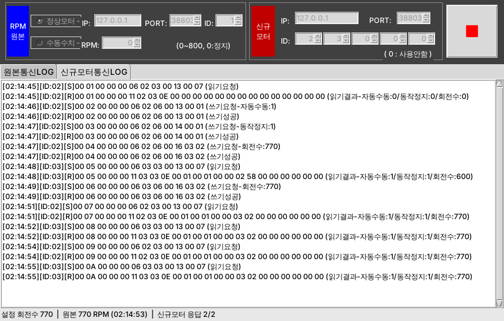

**화면** (원본과 같음)

| 영역 | 내용 |
|---|---|
| RPM원본 (파랑) | **정상모터**: 기존모터 IP·PORT·ID. 이 모터의 회전수(입력 레지스터 14)를 읽어 신규모터에 그대로 씁니다. **수동수치**: 기존모터를 읽지 않고 RPM 칸의 값(0~800, 0=정지)을 씁니다. |
| 신규모터 (빨강) | 통신장치 IP·PORT, 모터 ID 5칸 (0 = 사용안함, 같은 ID 는 한 번만) |
| ▶ / ■ | 시작 / 정지. 실행 중에는 입력칸이 잠깁니다. 수동수치로 실행 중이면 RPM 칸과 **[적용]** 버튼이 열려, 값을 바꾸고 [적용]을 누르면 바로 반영됩니다. |
| 원본통신LOG / 신규모터통신LOG | 보낸 내용 `[S]`, 받은 내용 `[R]`, 응답 없음·오류 `[E]` 를 시간과 함께 표시 |
| 상태 줄 (새로 추가, 맨 아래) | 설정 회전수, 원본 회전수와 읽은 시각, 응답한 신규모터 수, 작업 재시작 횟수 |

**동작 순서** (원본과 같음)
1. 정상모터: 기존모터를 읽어(1초 응답 대기 → 5초 쉼, 약 6초마다) 회전수를 설정 회전수로 삼습니다. 첫 응답이 온 뒤부터 신규모터를 다룹니다.
2. 신규모터를 1초 간격으로 하나씩 읽습니다(레지스터 0x13 부터 7개).
3. 응답을 보고 **자동이면 수동(0x13=1)**, **정지면 동작(0x14=1)**, **회전수(0x16)가 설정과 다르면 설정 회전수**를 씁니다(쓰기 사이 0.5초).
4. 한 바퀴 끝나면 응답이 없던 모터를 `[E]응답없음` 으로 남기고 5초 쉰 뒤 반복합니다.
5. 연결이 안 되면 `접속실패!` 를 남기고 1초 뒤 다시 접속합니다.

**파일** (exe 옆)
- 설정: `Motor_Config.ini` (원본과 같은 형식). 원본은 드라이브 맨 위(`C:\Motor_Config.ini`)에 저장했으므로, 프로그램 폴더에 설정 파일이 없으면 처음 한 번 그 파일을 읽어 옵니다. 설정은 **시작할 때와 종료할 때** 저장됩니다.
- 통신 로그: `log\source-YYYY-MM-DD.log`, `log\target-YYYY-MM-DD.log` (원본과 같은 이름, 모든 줄 저장)
- 프로그램 기록: `log\program-YYYY-MM-DD.log` (시작·정지, 처리 중 오류의 상세 내용), `log\fault.log` (파이썬이 비정상 종료될 때 위치). **멈춤·종료 문제가 생기면 이 두 파일을 보내 주세요.**

### 14.1 원본이 죽거나 멈추던 원인과 고친 점

원본 실행파일을 디컴파일해 확인한 내용입니다(실행해서 재현한 것이 아니라 코드에서 확인).

| # | 원본 문제 (코드 위치) | 결과 | 새 구현 |
|---|---|---|---|
| 1 | 작업 쓰레드의 일부 코드가 예외 처리 밖에 있음: 접속 실패 처리, 수신 쓰레드 재시작, 신규모터 송신 쓰레드 시작 (`src_send_job`, `target_send_job`) | .NET 은 작업 쓰레드에서 처리되지 않은 예외가 나면 **프로그램 전체가 바로 종료** | 쓰레드의 모든 동작을 예외 처리 안에 두고, 오류가 나면 기록 후 다시 접속. 그래도 쓰레드가 끝나면 감시가 다시 시작 |
| 2 | 신규모터 송신 쓰레드를 `IsAlive` 가 아니면 같은 쓰레드 객체로 다시 `Start()` 하는 구조 (`src_recv_job`, 수동 모드 `src_send_job`) | .NET 쓰레드는 한 번 끝나면 다시 시작할 수 없어 `ThreadStateException`. 평소에는 이 쓰레드가 끝나지 않아 드러나지 않지만, 끝나는 경우 복구되지 않는 구조(잠재 위험) | 쓰레드는 시작/정지 때만 만들고, 신규모터 시작은 신호(이벤트)로 알림 |
| 3 | 수동수치 모드에서 쉬지 않고 도는 반복문 (`src_send_job`) | CPU 한 개를 100% 사용 → PC 전체가 느려짐 | 수동 모드에서는 기존모터 작업을 아예 만들지 않음 |
| 4 | 로그를 `Control.Invoke`(화면이 처리할 때까지 대기)로 넘기고, 로그창(TextBox)에 **끝없이 추가** | 오래 켜 두면 로그창이 커져 화면이 느려지고 '응답 없음', 통신 쓰레드도 함께 멈춤 | 로그는 대기열로 넘기고 통신은 기다리지 않음. 로그창은 최근 3000줄만 유지(파일에는 모두 저장) |
| 5 | 접속 가능 확인용 소켓을 닫지 않고, 재접속 때 이전 소켓도 닫지 않음 (`CHECK_CONNECT_POSSIBLE`) | 접속을 시도할 때마다 연결이 남아 통신장치의 접속 수가 차고, 소켓 자원이 쌓임 | 접속은 한 번만, 재접속 전에 이전 연결을 반드시 닫음 |
| 6 | 신규모터 오류 처리에서 **기존모터 연결**을 닫음 (`target_send_job` catch) | 신규모터 쪽 문제로 기존모터 통신이 끊김 | 각자 자기 연결만 닫음 |
| 7 | 쓰기 대기열·모터 목록을 두 쓰레드가 잠금 없이 함께 사용 | 드물게 대기열이 깨지거나 예외 | 잠금 사용, 같은 레지스터 쓰기는 최신 값 하나만 |
| 8 | 정지할 때 `Thread.Abort` 로 강제 종료, 연결은 '연결됨' 일 때만 닫음 | 정지·종료 중 예외, 연결이 남음 | 정지 신호를 보내고 연결을 닫은 뒤 끝날 때까지 기다림(시험에서 1.5초 안에 정지) |
| 9 | TCP 응답이 나뉘거나 붙어 오면 무시됨 | 간헐적인 '응답없음' | 길이 필드로 프레임을 나눠 처리 |

### 14.1-1 "속도를 계속 바꾸면 중단" 재현 결과

원본 실행파일을 Mono(리눅스용 .NET)에서 시뮬레이터에 연결해 실제로 돌려 확인했습니다. 원본 코드는 그대로 두고, Mono 의 VB 라이브러리가 지원하지 않는 16진 문자열 변환 함수 1종(`Conversions.ToByte("&H..")`)만 Windows 와 같은 결과를 내는 함수로 바꿨습니다. 화면(Form)은 빼고 통신부(`CMotor_Runner`)만 실행했습니다.

| 조건 (각 5~6분) | 원본 결과 |
|---|---|
| 정상 장치, 속도 변경 없음 | 계속 동작 (단, 응답한 모터를 '응답없음'으로 잘못 기록 40회) |
| 정상 장치, 원본 회전수 3초마다 변경 | 계속 동작 |
| 정상 장치, 수동수치 1초마다 변경 | 계속 동작하나 CPU 117~128% 사용 |
| **쓰기(속도 변경) 때 장치가 끊기·늦게·예외로 답함** | **약 6초 만에 제어 중단.** 프로세스는 살아 있지만 이후 4분 반 동안 회전수가 500 에 멈춤 |

중단 순서 (원본 로그로 확인):
1. 신규모터에 쓰기를 보내는 중 통신 오류 발생
2. 원본의 신규모터 오류 처리부가 신규모터가 아닌 **기존모터(RPM원본) 연결을 닫음**
3. 닫힌 연결이 계속 '연결됨'으로 남아 다시 접속하지 않음 → 기존모터 읽기가 끝없이 실패(264회 연속)
4. 설정 회전수가 마지막 값에 고정 → 속도를 바꿔도 신규모터에 반영되지 않음

쓰기는 속도가 바뀔 때만 일어나므로, 속도를 자주 바꿀수록 쓰기 중 통신 오류를 만날 기회가 늘어 이 상태에 빠지기 쉽습니다. 다만 정상 장치에서는 속도를 바꿔도 재현되지 않았고, 이번 재현은 시험용 장치가 쓰기 때 일부러 오류를 낸 경우입니다. 현장 장치가 쓰기 때 실제로 어떤 오류를 냈는지는 확인하지 못했습니다.

**현장 로그로 확인하는 방법:** 원본의 `log\source-날짜.log` 에 `[ID:xx][S]... (읽기요청)` 만 1초 간격으로 계속 찍히고 `[R]`(읽기결과)도 `[E]응답없음`도 없다면 이 상태입니다.

새 구현에서는 각 쓰레드가 자기 연결만 닫고, 끊긴 연결은 반드시 다시 맺습니다. 같은 조건(5분, 3초마다 변경)에서 기존모터 통신은 오류 없이 계속됐습니다(`test_speed_changes_with_hostile_write_responses`).

같은 시험에서 새 구현의 약점도 2가지 찾아 고쳤습니다(원본도 같은 구조).
- **뒤쪽 모터가 차례를 못 받음:** 오류로 다시 접속하면 첫 모터부터 다시 읽어, 오류가 매 바퀴 나면 뒤쪽 모터에는 속도가 써지지 않았습니다(5분 중 3분간 4번 모터 0 RPM). → 다시 접속하면 멈춘 모터부터 이어서 진행하고, 모터마다 읽기 → 쓰기를 마친 뒤 다음 모터로 넘어갑니다(`test_errors_every_cycle_do_not_starve_later_motors`: 고치기 전에는 3개 중 1개만 써짐).
- **거절된 쓰기는 다음 바퀴(약 10초 뒤)까지 기다림:** 장치가 '사용 중' 등 예외로 답하면 바로 1번 다시 보냅니다. 로그에 `(쓰기요청-회전수:N, 재시도)` 로 표시됩니다(`test_rejected_write_is_retried_once`).

**그 밖에 바뀐 점**
- 신규모터 5번째 ID 칸이 원본에서는 저장·확인되지 않던 문제 수정(시작 시 ID 확인, 설정 저장 모두 5칸).
- 쓰기 응답(FC06)을 `(쓰기성공)` 으로 표시. 원본은 사용하지 않는 FC16 응답만 '쓰기성공'으로 인식해, FC06 응답은 `[R]` 데이터로만 남았습니다.
- 쓰기는 읽기 응답을 받은 직후에 보냅니다(원본은 한 바퀴 뒤 5초 쉰 다음에 보내는 경우가 있었음).
- 시작할 때 IP 형식을 확인합니다. 통신이 30초 넘게 진행되지 않으면 연결을 다시 맺습니다(감시).
- 상태 줄, 프로그램 기록(`program-*.log`, `fault.log`) 추가.

### 14.2 안정성 시험 (`tests/test_motor_tester.py`)
장비 없이 시뮬레이터로 확인합니다: 기존모터 회전수 따라가기·수동수치·[적용], 없는 모터 '응답없음', 통신장치가 꺼졌다 켜짐, 실행 중 연결 끊김, 깨진 데이터·나뉜/붙은 프레임·예외 응답·갑작스러운 끊김, 처리 중 오류, 쓰레드 강제 종료 후 자동 재시작, 시작/정지 25회 반복 뒤 쓰레드·소켓 남지 않음, 통신장치가 계속 켜졌다 꺼지는 장시간 운전, 로그창 줄 수 제한, 설정 파일 이상값(원본과 같이 기본값 사용).

## 15. 모터 스캐너

통신장치(IP)에 연결된 모터의 **ID 를 찾아 목록으로 보여주고**, ECblue 팬은 **상태 확인·설정 변경·통신 끊김 시 자동 운전 켜기/끄기**를 하는 별도 프로그램입니다. 운영 프로그램과 `Config.dll` 은 사용하지 않습니다.

- 실행: **`MOTOR_SCANNER.exe`** 더블클릭 (파이썬 설치 불필요). 또는 `motor_scanner.bat` / `python tools\motor_scanner.py`
- exe 받기: 프로그램 폴더의 **`update.bat`** 이 최신으로 내려받아 줍니다(2.2-1). 또는 GitHub → **Actions** → *Build motor scanner exe* → **Artifacts** 의 `MOTOR_SCANNER`. 직접 만들려면 `build_motor_scanner_exe.bat`
- 근거 자료: ZIEHL-ABEGG "ECblue MODBUS Description" L-BAL-E076-GB 1517 Index 013 (ECblue 펌웨어 1.03 ~ 14)

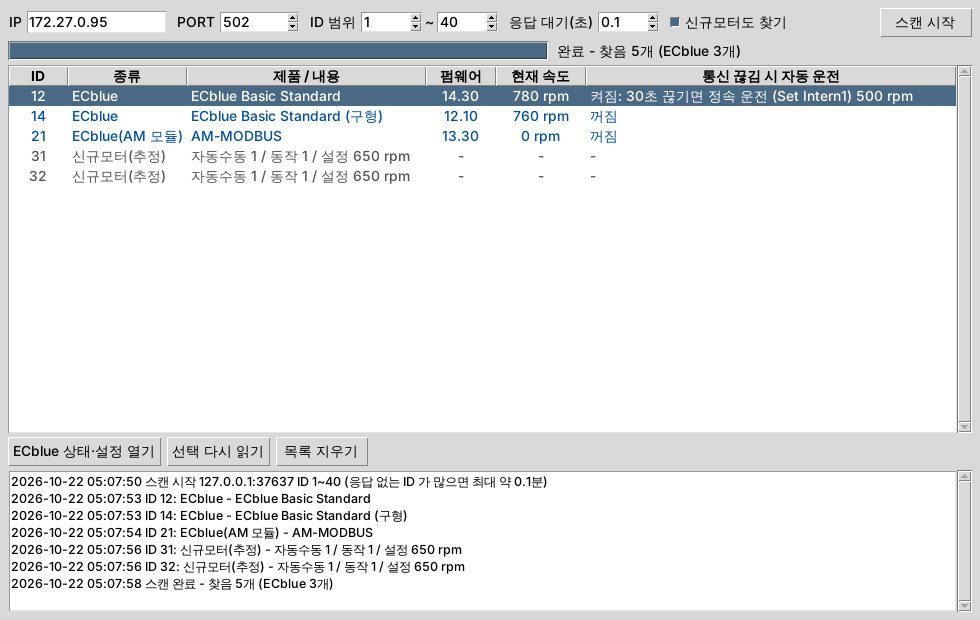

### 15.1 스캔
1. **IP**, **PORT**(기본 502), **ID 범위**(기본 1~240, 1~247 안에서 변경), **응답 대기**(기본 0.5초)를 정합니다.
2. **[스캔 시작]** → 범위의 ID 를 차례로 확인하며, 응답한 장치가 바로 목록에 추가됩니다. 진행 막대와 "ID n 확인 중, 찾음 m개" 가 표시됩니다. **[스캔 중지]** 로 멈출 수 있습니다.
3. 스캔은 **읽기만** 합니다(장치에 아무것도 쓰지 않음).

| 종류 | 판별 방법 |
|---|---|
| ECblue | 제품코드(i1) 상위 바이트 `0x01`, 또는 구형 `0x0032` |
| ECblue(AM 모듈) | 제품코드 `0x0401~0x0404` (ECblue 팬에 붙는 AM-MODBUS/PREMIUM 모듈, 같은 레지스터 사용) |
| ZIEHL-ABEGG 기타 | 그 밖의 ZIEHL-ABEGG 제품코드 (주파수 변환기 등). 설정 화면 없음 |
| 신규모터(추정) | 제품코드를 읽지 못하고, 신규모터 레지스터(0x13 부터 7개) 읽기에 응답 ('신규모터도 찾기' 체크 시) |
| 기타 장치 | 응답은 있으나(예외 응답 포함) 위에 해당하지 않음 |

- 응답이 없는 ID 는 응답 대기 시간만큼 기다리므로, 범위가 넓고 장치가 적으면 오래 걸립니다(1~240, 0.5초, 신규모터도 찾기 → 최대 약 4분). 통신장치가 '장치 없음' 예외(0x0A/0x0B)를 보내 주면 바로 다음 ID 로 넘어갑니다.
- 목록의 ECblue 는 펌웨어, 현재 속도, 통신 끊김 시 자동 운전 상태를 함께 보여 줍니다. 마지막 입력값은 `motor_scanner.json` 에 저장됩니다.

### 15.2 ECblue 상태·설정 (목록에서 ECblue 선택 → [ECblue 상태·설정 열기] 또는 더블클릭)

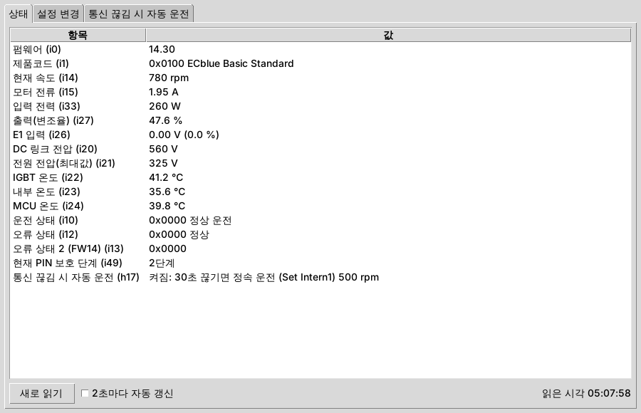

**상태 탭**: 펌웨어, 제품, 현재 속도, 전류, 전력, 출력, E1 입력, 전압, 온도, 운전 상태·오류 상태(비트 해석), PIN 보호 단계. [새로 읽기] 또는 2초마다 자동 갱신.

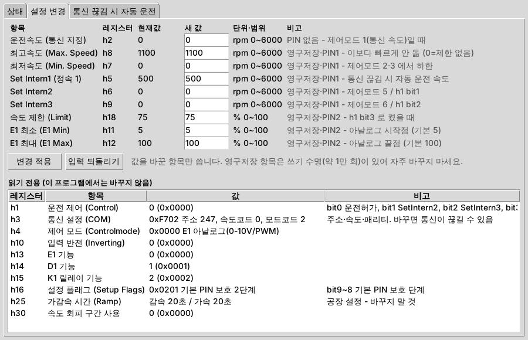

**설정 변경 탭**: '새 값' 을 고치고 **[변경 적용]** → 바뀐 항목만 확인 창에 보여 준 뒤 씁니다. 쓴 뒤 다시 읽어 확인하고 로그에 남깁니다.

| 항목 | 레지스터 | 범위 | 비고 |
|---|---|---|---|
| 운전속도 (통신 지정) | h2 | 0~6000 rpm | 제어모드 1(통신 속도)일 때 사용. 영구저장 아님 |
| **최고속도** | h8 | 0~6000 rpm | 이보다 빠르게 돌지 않음 (0 = 제한 없음) |
| **최저속도** | h7 | 0~6000 rpm | 제어모드 2·3 에서 하한 |
| Set Intern1 / 2 / 3 | h5 / h6 / h9 | 0~6000 rpm | 고정 속도 1·2·3. **Set Intern1 은 통신 끊김 시 자동 운전 속도** |
| 속도 제한 (Limit) | h18 | 0~100 % | h1 bit3 로 켰을 때의 제한 |
| E1 최소 / 최대 | h11 / h12 | 0~100 % | 아날로그 입력(0-10V) 사용 구간 |

- h2 외에는 모두 **영구저장** 항목입니다. 제조사 문서상 쓰기 수명이 약 1만 회이므로 자주 바꾸지 마세요.
- PIN 보호가 필요한 항목은 쓰기 전에 현재 보호 단계(i49)를 읽고, 부족하면 PIN `0010`(2단계 해제, 약 15분 유지)을 먼저 씁니다.
- 최저속도가 최고속도보다 크면 쓰지 않습니다.
- 통신 설정(h3), 제어 모드(h4), 입력·릴레이 기능(h10, h13~h16), 가감속(h25, 공장 설정) 등은 **읽기 전용**으로만 보여 줍니다. 바꾸면 통신이 끊기거나 운전 방식이 바뀌기 때문입니다(제어 모드는 13장 미니 제어기·운영 프로그램의 기존모터제어에서 다룹니다).

### 15.3 통신 끊김 시 자동 운전 (통신 워치독)

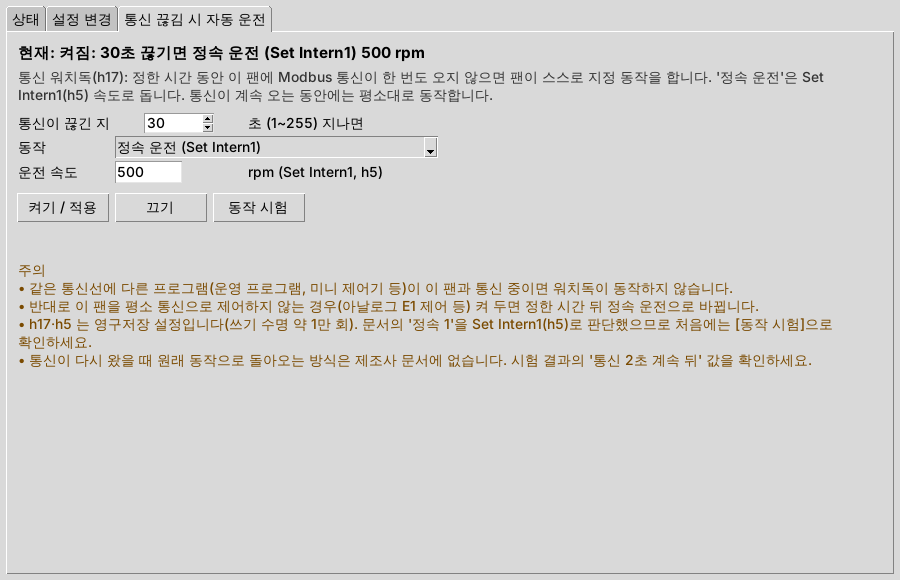

ECblue 의 **통신 워치독(h17)** 기능입니다. 정한 시간 동안 이 팬에 Modbus 통신이 한 번도 오지 않으면 팬이 스스로 지정 동작을 합니다(제조사 문서 3.5.8).

| h17 | 내용 |
|---|---|
| 상위 8비트 | 시간(초) 1~255. **0 = 꺼짐** |
| 하위 8비트 | 동작. 0 꺼짐, 1 경보만, **2 정속 운전**, 3 경보 + 정속 운전, 7 E1(아날로그) 제어로 전환, 8 경보 + E1 전환 (7·8 은 FW 13.30 부터) |

- **[켜기 / 적용]**: 시간, 동작, 운전 속도를 정해 씁니다. 운전 속도는 **Set Intern1(h5)** 에 쓰며, 값이 바뀔 때만 씁니다. 최고속도(h8)보다 크면 쓰지 않습니다.
- **[끄기]**: h17 = 0
- **[동작 시험]**: 이 프로그램의 통신을 (시간 + 3초) 동안 완전히 멈춘 뒤 속도와 오류 상태(i12 bit15 통신 워치독)를 읽고, 이어서 2초 동안 통신하며 원래대로 돌아오는지 기록합니다.

**확인이 필요한 점**
- 제조사 문서는 동작 2 를 "constant speed 1(정속 1)" 이라고만 씁니다. 고정 속도 Set Intern 1·2·3 의 첫 번째이므로 **Set Intern1(h5)로 판단**했습니다. 현장 팬 1대로 [동작 시험]을 해 실제 속도가 지정 속도와 같은지 먼저 확인하세요.
- 통신이 다시 왔을 때 원래 동작으로 돌아오는 방식은 문서에 없습니다. [동작 시험] 결과의 '통신 2초 계속 뒤' 값으로 확인하세요.
- 같은 통신선에서 다른 프로그램(운영 프로그램, 미니 제어기 등)이 이 팬과 통신 중이면 워치독이 동작하지 않고, 시험 결과도 맞지 않습니다.
- 평소 통신으로 제어하지 않는 팬(아날로그 E1 제어)에 켜 두면 정한 시간 뒤 정속 운전으로 바뀝니다.

### 15.4 파일
- 로그: `logs\motor_scanner_YYYYMMDD.log` (스캔 결과, 모든 쓰기와 결과)
- 마지막 입력값: `motor_scanner.json`

