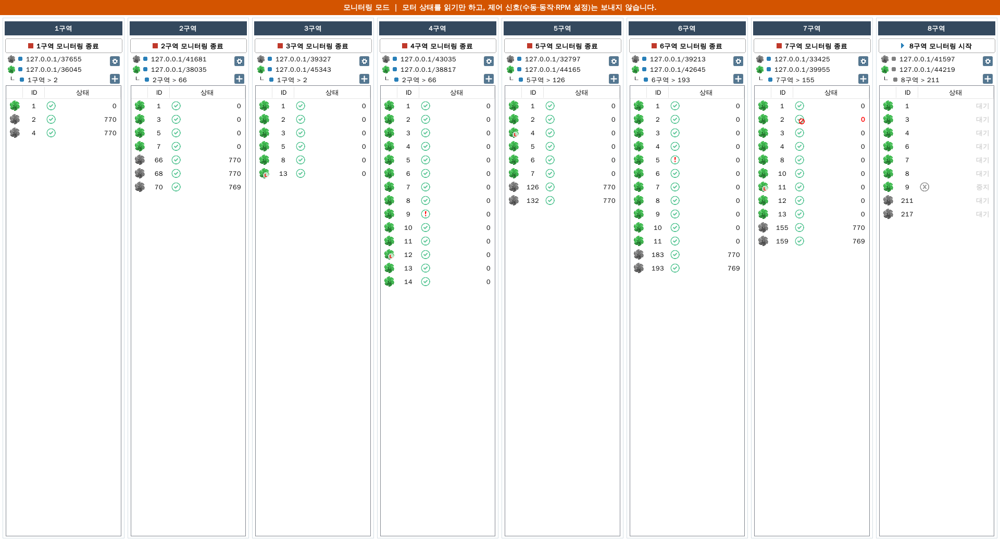
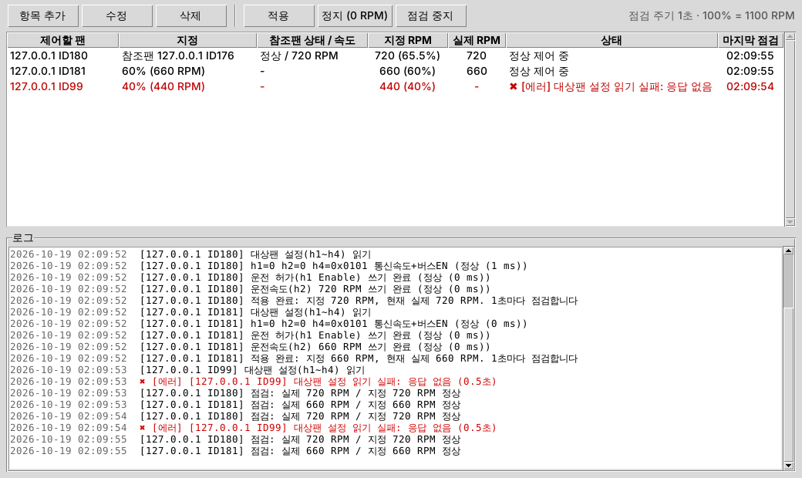
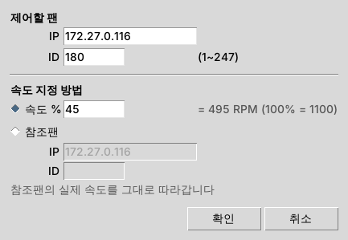
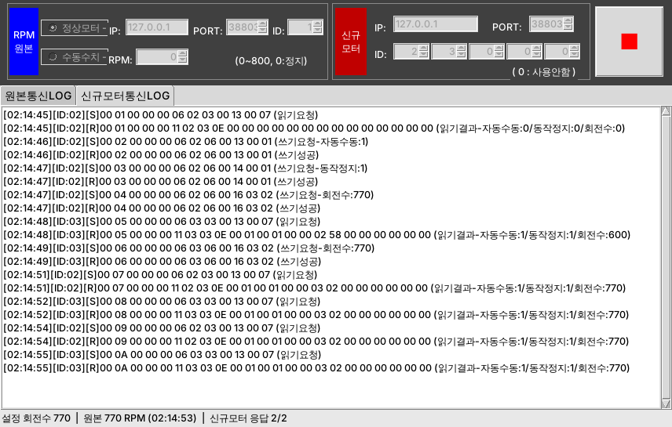

# BLDC MOTOR MONITOR — 사용자 매뉴얼

> 버전 2.3.0 (현재 운영 중인 실행파일과 같은 기능 + 모니터링 모드(화면에서 전환) + 기존모터제어) · 구성요소 이름(괄호 안 `ID`)은 [스펙시트](SPEC_SHEET.md)와 같습니다. 수정 요청 시 이 ID 를 사용하세요.

## 목차
1. [프로그램 개요](#1-프로그램-개요)
2. [설치와 실행](#2-설치와-실행)
3. [화면 한눈에 보기](#3-화면-한눈에-보기)
4. [메인 화면 기능](#4-메인-화면-기능)
5. [구역설정 창](#5-구역설정-창)
6. [모터 추가 창](#6-모터-추가-창)
7. [모터 수정/삭제 창](#7-모터-수정삭제-창)
8. [자동 제어는 이렇게 동작합니다](#8-자동-제어는-이렇게-동작합니다)
9. [프로그램 종료](#9-프로그램-종료)
10. [문제 해결](#10-문제-해결)
11. [장비 없이 시험하기 (시뮬레이터)](#11-장비-없이-시험하기-시뮬레이터)
12. [기존모터 시험기](#12-기존모터-시험기)
13. [미니 제어기](#13-미니-제어기)
14. [모터 시험기 (SUNINUS MOTOR TEST)](#14-모터-시험기-suninus-motor-test)

---

## 1. 프로그램 개요

온실 1~8구역의 **기존 팬 모터(기존모터)** 회전수(RPM)를 읽어서, 같은 구역의 **신규 팬 모터(신규모터)** 가 같은 RPM(또는 지정한 고정 RPM)으로 돌도록 자동 제어하고, 모든 모터의 상태를 한 화면에서 감시합니다.

| 용어 | 뜻 |
|---|---|
| 구역 | 1~8구역. 구역마다 기존모터 통신장치(게이트웨이) 1개, 신규모터 통신장치 1개가 연결됨 |
| 기존모터 | RPM 을 **읽기만** 하는 모터 (회색 팬 그림) |
| 신규모터 | RPM 을 **써넣어 제어**하는 모터 (녹색 팬 그림) |
| RPM 제어 소스 | 신규모터 목표 RPM 을 정하는 방법: **수동**(고정값) 또는 **기존모터**(지정한 기존모터의 현재 RPM 을 따라감) |
| 속도제한(제한모드) | 신규모터별로 최대속도를 정해, 목표 RPM 이 그보다 높으면 최대속도로 운전 (그림에 빨간 **L**) |
| 기존모터제어 | 기존모터(ECblue)를 통신으로 **직접 지정한 속도로 계속 운전**시키는 모터 종류 (회색 팬 + 파란 **C**). 기존 아날로그 제어신호선에 문제가 있을 때 사용 (6-1절) |

---

## 2. 설치와 실행

### 2.1 기존 운영 프로그램에서 바꾸기
1. 기존 실행 폴더의 **`Config.dll`** 을 새 프로그램 폴더로 복사합니다(같은 형식이라 그대로 읽습니다). 바꾸기 전에 `Config.dll` 을 따로 백업해 두세요.
2. 기존 프로그램을 종료한 뒤 새 프로그램을 실행합니다.

### 2.2 파이썬으로 실행
1. Windows 에 파이썬 3.9 이상을 설치합니다(python.org 설치본). 추가 패키지는 필요 없습니다.
2. 프로그램 폴더에서 `python run.py` 를 실행합니다.
   - `--config 경로` : 다른 설정 파일 사용 (기본은 프로그램 폴더의 `Config.dll`)
   - `--debug` : 통신 패킷까지 로그에 기록

### 2.2-1 최신 버전으로 업데이트
git 으로 받은 프로그램 폴더의 **`update.bat`** 을 더블클릭하면 최신 버전으로 바뀝니다 ("Update complete."). 설정 파일 `Config.dll` 과 로그는 바뀌지 않습니다. 실행 중인 프로그램은 종료 후 다시 실행해야 새 버전이 적용됩니다. exe 로 쓰는 경우 업데이트 후 `build_exe.bat` 으로 다시 만드세요.

### 2.3 실행파일(.exe)로 만들기
`build_exe.bat` 을 더블클릭하면 `dist\BLDC_MOTOR_MONITOR\BLDC_MOTOR_MONITOR.exe` 가 만들어집니다. 이 폴더째 현장 PC 에 복사하고 `Config.dll` 을 exe 옆에 둡니다.

### 2.4 모니터링 모드 (시험용, 제어 신호 보내지 않음)
운영 프로그램이 모터를 제어하는 동안 이 프로그램을 시험할 때 사용합니다. 모터 상태를 **읽기만** 하고, 신규모터에 수동·동작·RPM 설정 신호를 **보내지 않으므로** 운영 프로그램의 제어와 겹치지 않습니다.

- **모니터링 모드로 시작**: `run_monitoring.bat` 더블클릭 (또는 `python run.py --monitoring`, `BLDC_MOTOR_MONITOR.exe --monitoring`). 일반 실행은 제어 모드로 시작합니다.
- **현재 모드 확인**: 화면 맨 위 띠(`MAIN-MODE-BANNER`)를 봅니다.
  - **초록 띠 "제어 모드"** — 제어 신호를 보냅니다. 버튼은 "n구역 제어 시작/종료".
  - **주황 띠 "모니터링 모드"** — 읽기만 합니다. 버튼은 "n구역 모니터링 시작/종료", 창 제목에도 `[모니터링 모드 - 제어 신호 전송 안 함]`.
- **실행 중 모드 바꾸기**: 띠 오른쪽의 흰 버튼(`MAIN-MODE-BTN`)을 누릅니다.
  - 제어 모드에서 **[모니터링 모드로 전환]** → 확인 창에서 **예** → 즉시 제어 신호 전송이 멈추고 띠가 주황으로 바뀝니다. 모터는 마지막으로 받은 설정대로 계속 운전합니다.
  - 모니터링 모드에서 **[제어 모드로 전환]** → 경고 확인 창(실행 중인 구역이 있으면 그 구역 이름과 "신호가 겹칠 수 있습니다" 안내) → **예** → 다음 주기부터 제어 신호를 보내고 띠가 초록으로 바뀝니다.
  - 구역을 멈추거나 다시 시작할 필요는 없습니다. **운영 프로그램이 같은 모터를 제어하는 중이면 제어 모드로 바꾸지 마세요.**
  - 모니터링 모드 중에 '사용중지' 로 바꾼 모터의 정지(RPM 0) 신호는 제어 모드로 바꾸는 순간 보냅니다.
- 모니터링 모드에서는 시작·종료 때 `Config.dll` 을 자동으로 다시 저장하지 않습니다. 단, 구역설정이나 모터 추가/수정/삭제를 하면 그 내용은 저장되므로, 시험할 때는 **설정 파일 복사본**을 쓰는 것이 안전합니다: `python run.py --monitoring --config 시험용\Config.dll`
- 읽기 요청은 보내므로 통신장치에 접속이 하나 더 생깁니다. 통신장치가 동시 접속을 허용하는지 확인하세요.



### 2.5 파일
| 파일 | 설명 |
|---|---|
| `Config.dll` | 모든 설정(IP/PORT, 제어 소스, 모터 목록, 속도제한). 암호화되어 있어 메모장으로는 볼 수 없습니다. 내용 확인: `python -m motor_monitor.config Config.dll` |
| `logs\motor_monitor.log` | 접속 성공/실패, 제어 시작/종료 기록 |

> 프로그램은 한 번에 하나만 실행됩니다 ("모니터가 이미 실행중입니다.").
> `Config.dll` 이 손상되어 읽을 수 없으면 "프로그램 설정 정보가 처리중 오류가 발생했습니다. 제작사에 문의바랍니다." 가 뜨고 종료됩니다. 이때 파일은 바꾸지 않으므로 백업본으로 바꿔 넣으면 됩니다.

---

## 3. 화면 한눈에 보기

1~8구역이 가로로 나란히 표시됩니다. 권장 해상도는 1920×1080 이며 Windows 에서는 최대화된 상태로 시작합니다.


| 번호 | 이름 | ID |
|---|---|---|
| 1 | n구역 제어 시작/종료 버튼 | `ZONE-*-BTN-START` / `-STOP` |
| 2 | 구역 패널 | `ZONE-1` ~ `ZONE-8` |
| 3 | 기존모터 통신상태 점 + IP/PORT | `ZONE-*-DOT-OLD`, `-LBL-OLD` |
| 4 | 신규모터 통신상태 점 + IP/PORT | `ZONE-*-DOT-NEW`, `-LBL-NEW` |
| 5 | RPM 소스 상태 점 + 문구 | `ZONE-*-DOT-REF`, `-LBL-REF` |
| 6 | 설정 버튼 (톱니) | `ZONE-*-BTN-SET` |
| 7 | 추가 버튼 (+) | `ZONE-*-BTN-ADD` |
| 8 | 모터 목록 머리글 | `ZONE-*-LIST-HDR` |
| 9 | 모터 목록 | `ZONE-*-LIST` |
| 10 | 모드 전환 버튼 (맨 위 띠 오른쪽, 띠 색: 초록=제어 / 주황=모니터링) | `MAIN-MODE-BTN`, `MAIN-MODE-BANNER` |

---

## 4. 메인 화면 기능

### 4.1 구역 제어 시작 / 종료 (`ZONE-*-BTN-START` / `-STOP`)
- **▶ n구역 제어 시작** → "n구역 제어를 시작하시겠습니까?" → **예**: 그 구역만 통신·자동 제어를 시작합니다. 버튼이 **■ n구역 제어 종료** 로 바뀝니다.
- **■ n구역 제어 종료** → "n구역 제어를 종료하시겠습니까?" → **예**: 그 구역의 통신·제어를 멈춥니다. 상태 점이 회색이 됩니다.
- 모니터링 모드에서는 같은 버튼이 **n구역 모니터링 시작/종료** 이며, 읽기만 합니다(2.4절). 모드는 맨 위 띠의 전환 버튼으로 바꿉니다.
- 구역마다 따로 시작/종료합니다. 프로그램을 켜면 모든 구역이 **중지 상태**로 시작하므로, 필요한 구역의 시작 버튼을 눌러야 합니다.
- 제어를 시작할 때마다 그 구역의 '이상기록(빨간 !)' 이 지워지고 모든 모터가 '대기' 에서 다시 시작합니다.
- 제어를 멈춰도 신규모터는 마지막으로 받은 RPM 으로 계속 돌 수 있습니다(모터 쪽 동작).

### 4.2 머리 영역 (`ZONE-*`)

| 줄 | 표시 | 의미 |
|---|---|---|
| 1줄 | 회색 팬 + 점 + `IP/PORT` | 기존모터 통신장치 주소와 접속 상태 |
| 2줄 | 녹색 팬 + 점 + `IP/PORT` | 신규모터 통신장치 주소와 접속 상태 |
| 3줄 | `┖` + 점 + 문구 | 신규모터 목표 RPM 출처: `수동 > 800 RPM` 또는 `1구역 > 2` (1구역의 기존모터 2번을 따라감) |

> 화면이 좁아 문구 끝이 잘리면 문구 위에 마우스를 올려 전체 내용을 볼 수 있습니다.

**상태 점 색** (5초마다 갱신)

| 색 | 1줄·2줄 | 3줄 |
|---|---|---|
| 회색 | 이 구역 제어 중지 | 이 구역 제어 중지 |
| 파랑 | 접속 정상 | 수동이거나, 참조 기존모터가 '정상' |
| 빨강 | 접속 실패/끊김 (10초마다 재시도) | 참조 기존모터가 정상이 아님 → **이 구역 신규모터는 제어 보류**(마지막 값 유지) |

### 4.3 설정 / 추가 버튼
- **톱니(`BTN-SET`)**: 그 구역의 **구역설정 창**(5장).
- **+(`BTN-ADD`)**: 그 구역에 모터를 등록하는 **모터 추가 창**(6장).

### 4.4 모터 목록 (`ZONE-*-LIST`)

| 열 | 내용 |
|---|---|
| (그림) | 회색 팬 = 기존모터, 녹색 팬 = 신규모터, 녹색 팬 + 빨간 **L** = 속도제한 중인 신규모터 |
| ID | 모터 번호 |
| 상태 | 상태 그림 + RPM (아래 표) |

| 상태 표시 | 의미 |
|---|---|
| 녹색 ✓ + 숫자 | **정상**. 숫자는 현재 RPM (신규모터는 모터가 보고하는 실제 RPM) |
| 빨간 **!** + 숫자 | **정상이지만 이상기록 있음**: 제어 시작 후 한 번이라도 60초 넘게 응답이 없었던 모터. 지금은 응답 중이며, 구역 제어를 다시 시작하면 지워짐 |
| ✓+빨간 금지표시 + **빨간 숫자** | **이상**: 마지막 응답 후 1시간이 지남 (숫자는 마지막 RPM) |
| 회색 ⓧ + **중지** | 사용 안 함으로 설정됨 (통신·제어 제외) |
| **대기** (그림 없음) | 제어 시작 전이거나, 시작 후 아직 응답 없음 |

> 속도제한 모터의 RPM 이 다른 모터보다 낮게 보이는 것은 정상입니다(최대속도로 제한 운전 중).

**정렬**: 머리글을 누르면 (그림)=종류, **ID**, **상태** 순으로 정렬됩니다. 같은 머리글을 다시 누르면 반대 순서. 처음에는 신규모터가 먼저, ID 작은 순입니다.
**수정/삭제**: 항목을 **더블클릭**하면 모터 수정/삭제 창(7장)이 열립니다.

---

## 5. 구역설정 창

 

| 번호 | 항목 | 설명 |
|---|---|---|
| 2 | 위치 | 설정 중인 구역 |
| 3, 4 | 기존모터 IP/PORT | 기존모터 통신장치 주소 (기본 PORT 502) |
| 5, 6 | 신규모터 IP/PORT | 신규모터 통신장치 주소 |
| 7 | 수동 | 선택하면 13번 **수동RPM값** 칸이 나타남. 신규모터를 이 값(0~1100)으로 운전 |
| 8 | 기존모터 | 선택하면 9·10번 **참조기존모터** 칸이 나타남 |
| 9 | 참조 구역 | 따라갈 기존모터가 있는 구역 (1~8구역 어디든 가능) |
| 10 | 참조 ID | 선택한 구역에 등록된 **기존모터** 번호. 그 구역에 기존모터를 먼저 추가해야 나옵니다 |
| 11 | 저장 (Enter) | 검사 후 저장, 메인 화면 머리 영역이 바로 바뀜 |
| 12 | 취소 (Esc) | 저장하지 않고 닫음 |

**오류 메시지** (제목 "에러"): IP/PORT 를 비우거나 형식이 틀리면 "…IP를 입력해 주세요 / 올바른 형식이 아닙니다.. / PORT를 숫자로 1~65535범위로 입력해 주세요." 수동 RPM 이 0~1100 밖이면 "수동 RPM속도를 0~1100범위내로 입력해주세요." 참조 구역/ID 를 고르지 않으면 "참조할 모터가 있는 구역을 선택해주세요. / 참조할 모터 ID를 선택해주세요."

**참고**: 수동 RPM·참조 모터 변경은 제어 중에도 바로 반영됩니다. IP/PORT 변경은 다음 접속부터 적용되므로, 즉시 적용하려면 그 구역 제어를 종료 → 시작하세요.

---

## 6. 모터 추가 창


| 번호 | 항목 | 설명 |
|---|---|---|
| 3, 4, 15 | 모터종류 | 기존모터 / 신규모터 / 기존모터제어 (필수). **신규모터는 속도제한 줄, 기존모터제어는 접속 IP/PORT·운전속도 줄이 나타남** |
| 5 | 모터ID | 통신장치에 설정된 모터 번호, 1~250 (기존모터제어는 1~247) (필수) |
| 6, 7 | 사용여부 | 기본 '사용'. 중지: 등록만 하고 통신·제어 제외 |
| 8 | 속도제한 | 사용함 / 사용안함 (기본 사용안함) |
| 9 | 최대속도 | 속도제한 '사용함' 일 때 이 RPM 을 넘지 않게 운전 (0~1100) |
| 10 | 추가 (Enter) | 검사 → "해당 모터정보를 추가하시겠습니까?" → 예 → 등록·저장 |
| 11 | 취소 (Esc) | 닫기 |

오류 메시지(제목 "오류"): "모터 종류을 선택해 주세요." / "모터ID값은 숫자로 1-250범위로 입력하셔야 합니다." / "제한모드 RPM값은 숫자 0~1100범위로 입력하셔야 합니다." / "이미 해당 모터 종류와 ID를 갖는 모터가 있습니다. 확인바랍니다."

### 6-1. 기존모터제어 추가 (기존모터를 지정 속도로 운전)

기존모터의 아날로그 제어신호선에 문제가 있을 때, 기존모터를 **통신으로 직접 지정한 속도로 계속 운전**시킵니다.


| 번호 | 항목 | 설명 |
|---|---|---|
| 15 | 기존모터제어 | 모터종류에서 선택 |
| 5 | 모터ID | 그 기존모터의 Modbus 주소 (1~247). 기존모터 목록의 ID 와 같은 번호 |
| 16, 17 | 접속 IP/PORT | 그 기존모터가 연결된 통신장치 주소. 이 구역의 기존모터 IP/PORT 가 기본으로 채워짐 |
| 18 | 운전속도 | 이 속도(RPM, 0~1100)로 계속 운전. **꼭 입력해야 함** |

**동작** (그 구역의 제어를 시작해야 동작합니다)
1. 모터의 운전 방식을 '통신으로 받은 속도' 로 바꿉니다(처음 한 번만). 이때부터 아날로그 신호선은 속도에 쓰이지 않습니다.
2. 운전을 켜고 운전속도를 써넣습니다.
3. 몇 초마다 실제 회전수를 읽어 목록에 표시하고, 모터 쪽 값이 바뀌어 있으면(정전 후 재시작 등) 다시 운전속도로 맞춥니다.
4. 프로그램을 꺼도 모터는 마지막 운전속도로 계속 돕니다.

**운전속도 바꾸기**: 목록에서 그 모터(파란 C)를 더블클릭 → 운전속도 수정 → 수정. 다음 주기(수 초 안)에 반영됩니다.
**멈추기**: 사용여부를 '중지' 로 수정하면 운전속도 0 을 한 번 보냅니다.

> **주의**
> - 운전 방식 변경은 모터에 영구 저장됩니다. 모터를 삭제하거나 중지해도 **아날로그 신호 제어로 자동으로 돌아가지 않습니다.** 신호선을 고친 뒤 원래대로 돌리려면 별도 조치가 필요합니다(문의).
> - 운전 방식 변경이 3번 실패하면(모터의 PIN 보호 설정 등) 더 시도하지 않고 빨간 **!** 로 표시합니다. 그림에 마우스를 올리면 내용이 보입니다.
> - 모니터링 모드에서는 읽기만 하고 아무것도 바꾸지 않습니다.
> - 이 목록은 `Config.dll` 의 새 항목에 저장됩니다. 기존 운영 프로그램(exe)이 같은 `Config.dll` 을 저장하면 이 항목이 지워지니, 두 프로그램이 같은 파일을 쓰지 않게 하세요.

**현장 점검 도구 (`tools/ecblue_check.py`)** — 기존모터제어를 등록하기 전에, 그 모터가 통신에 응답하고 지정 속도로 도는지 확인합니다. 운영 `Config.dll` 은 건드리지 않으며 결과는 `logs\ecblue_check_날짜_시간.txt` 에도 저장됩니다.

| 단계 | 명령 (프로그램 폴더에서) | 하는 일 |
|---|---|---|
| 1단계 읽기 | `python tools\ecblue_check.py --ip 172.27.0.95 --ids 180 176` | 접속, h1~h4(운전/속도/제어모드) 와 실제 회전수 읽기. **모터에 아무것도 쓰지 않음** |
| 2단계 제어 | `python tools\ecblue_check.py --ip 172.27.0.95 --ids 180 176 --rpm 500 --seconds 90` | `YES` 입력 후 프로그램의 기존모터제어 코드로 지정 속도 운전, 2초마다 실제 회전수 표시, 지정 속도 도달 판정, 끝나면 시험 전 설정 복원 여부를 물음(기본: 복원) |
| 응답이 없을 때 | `python tools\ecblue_check.py --ip 172.27.0.95 --ids 155 159 180 176` | 같은 통신장치에서 운영 프로그램이 읽고 있는 기존모터(예: 155, 159)와 비교. 운영 기존모터 읽기와 같은 요청이므로, 155·159 만 응답하면 문제는 180·176 쪽(ID·배선·통신설정) |
| ID 찾기 | `python tools\ecblue_check.py --ip 172.27.0.95 --ids 1-247 --timeout 0.5` | ID 가 9개 이상이면 실제 회전수만 읽어 응답하는 ID 목록을 보여 줌 (ECblue 공장 기본 주소 247) |

- `--timeout 5`: 응답 대기 시간을 늘림 (기본 2초). 응답이 늦게 오는 통신장치 확인용.
- 응답 없음 → ID·배선·통신장치 확인 / 예외 응답 11 → 그 ID 의 모터가 버스에서 응답하지 않음 / `[제어모드 설정 실패]` → 모터의 PIN 보호 확인.
- 2단계 중 `Ctrl+C` 로 바로 멈출 수 있고, 멈춰도 복원 질문은 나옵니다.

---

## 7. 모터 수정/삭제 창


목록에서 모터를 더블클릭하면 열립니다. 종류(12)와 ID(13)는 바꿀 수 없고, **사용여부**와 (신규모터는) **속도제한·최대속도**, (기존모터제어는) **운전속도**를 바꿀 수 있습니다. 기존모터제어의 접속 IP/PORT 는 바꿀 수 없으니, 바꾸려면 삭제 후 다시 추가하세요.

| 버튼 | 동작 |
|---|---|
| 수정 | "해당 모터정보를 수정하시겠습니까?" → 예 → 저장 |
| 삭제 (빨강, 14) | "해당 모터정보를 삭제하시겠습니까?" → 예 → 삭제 |
| 취소 | 닫기 |

- **신규모터를 '중지' 로 바꾸면** 제어 중일 때 그 모터에 RPM 0 명령을 한 번 보내 멈춥니다.
- 다른 구역이 RPM 참조로 쓰는 **기존모터는 삭제할 수 없습니다** ("해당 모터를 참조로 사용하는 구역이 있습니다. 변경 후, 삭제할 수 있습니다.").

---

## 8. 자동 제어는 이렇게 동작합니다

구역 제어를 시작하면 그 구역에서 다음을 반복합니다.

1. **기존모터 읽기**: 사용 중인 기존모터에 0.3초 간격으로 RPM 을 묻습니다.
2. **신규모터 읽기**: 사용 중인 신규모터마다 현재 RPM(화면 표시용)과 운전 설정(수동/자동, 동작/정지, 설정 RPM)을 읽습니다.
3. **목표 RPM 결정**
   - 수동 모드: 구역설정의 수동RPM값
   - 기존모터 모드: 참조 기존모터가 **정상**이면 그 RPM. 아니면 **제어하지 않고 기다림**
   - 속도제한 '사용함' 인 모터는 목표가 최대속도보다 크면 최대속도로
4. **맞추기**: 신규모터가 수동 모드가 아니면 수동으로, 정지 중이면 동작으로, 설정 RPM 이 목표와 다르면 목표로 써넣습니다.
5. 접속이 끊기면 10초마다 다시 접속합니다.

**상태 판정**(제어 중인 구역, 5초마다): 명령을 보낸 뒤 60초 동안 응답이 없으면 '이상기록(빨간 !)', 마지막 응답 후 1시간이 지나면 '이상' 입니다.

---

## 9. 프로그램 종료

창의 X → "종료하시겠습니까? 종료시 제어기능이 동작하지 않습니다." → **예**: 설정을 저장하고 모든 통신을 끊은 뒤 종료합니다.

---

## 10. 문제 해결

| 증상 | 확인할 것 |
|---|---|
| 1줄/2줄 점이 빨강 | 통신장치 전원·랜선·IP/PORT(구역설정). `logs\motor_monitor.log` 의 "접속 실패" 기록 |
| 3줄 점이 빨강 | 참조 기존모터가 정상이 아님 → 그 모터 상태 확인. 그동안 이 구역 신규모터는 제어되지 않음 |
| 모터에 빨간 ! | 한동안(60초 이상) 응답이 끊긴 적이 있음. 통신선·모터 점검 후 구역 제어를 종료→시작하면 표시가 지워짐 |
| 모터가 '이상'(빨간 숫자) | 1시간 넘게 응답 없음 → 모터/통신장치 점검 |
| 모터가 계속 '대기' | 제어를 시작하지 않았거나, 통신장치에 그 ID 가 없음 |
| 신규모터 RPM 이 낮음 | 속도제한(L 표시) 모터인지 확인 → 수정 창에서 최대속도 확인 |
| 참조 ID 목록이 비어 있음 | 선택한 구역에 기존모터가 등록되지 않음 |
| 기존모터제어(파란 C)가 계속 '대기' | 그 구역 제어를 시작했는지, 접속 IP/PORT·ID 가 맞는지, 로그의 "[기존모터제어] 접속 실패" 확인 |
| 기존모터제어에 빨간 ! + "제어모드 설정 실패" | 모터의 PIN 보호 설정으로 운전 방식을 바꾸지 못함 → 제조사 도구로 PIN 보호 단계 확인 필요 |
| 기존모터제어 속도가 지정값과 다름 | 모터 최대속도(h8) 설정이 더 낮으면 그 값으로 제한됨. 실제 회전수는 부하에 따라 약간 차이 날 수 있음 |

---

## 11. 장비 없이 시험하기 (시뮬레이터)

```
python -m motor_monitor.simulator --port 5020 --old 2:770 --new 1,3
```
- 127.0.0.1:5020 에 기존모터 2번(770RPM), 신규모터 1번, 3번이 생깁니다. 신규모터의 현재 RPM 은 써넣은 설정 RPM 을 따라갑니다.
- 기존모터제어 시험: `--ecblue 10:0` 을 붙이면 ECblue 기존모터 10번(아날로그 신호 0 RPM 상태)이 생깁니다. 기존모터제어로 추가하고 운전속도를 넣으면 실제 회전수가 그 값으로 바뀝니다.
- 시험용 설정 파일로 실행하세요: `python run.py --config test_config.dll` (운영 `Config.dll` 을 건드리지 않도록).
- 구역설정 창에서 IP `127.0.0.1`, PORT `5020` 으로 저장하고 모터를 추가한 뒤 그 구역 제어를 시작합니다.

---

## 12. 기존모터 시험기

기존(ECblue) 모터 **ID 180, 176** (통신장치 **172.27.0.95:502**) 을 직접 시험하는 작은 별도 프로그램입니다. 대상은 고정되어 있어 입력할 것이 없습니다. 운영 프로그램과 `Config.dll` 은 건드리지 않습니다.

- 실행: **`ECBLUE_TESTER.exe`** 더블클릭 (파이썬 설치 불필요, 파일 하나만 복사해서 사용). 또는 프로그램 폴더의 `ecblue_tester.bat` / `python tools\ecblue_tester.py`
- exe 받기: GitHub 저장소 → **Actions** → *Build ECblue tester exe* → 최근 실행 → 아래 **Artifacts** 의 `ECBLUE_TESTER` (zip 안에 exe). 직접 만들려면 Windows 에서 `build_tester_exe.bat` → `dist\ECBLUE_TESTER.exe`
- exe 로 실행하면 로그는 **exe 옆 `logs` 폴더**에 생깁니다. 시작하자마자 오류가 나면 `logs\ecblue_tester_error.txt` 에 원인이 남습니다.
- 화면: 620×520 (최소 460×470). 왼쪽이 180번, 오른쪽이 176번 모터입니다.


| 번호 | 이름 (ID) | 사용법 |
|---|---|---|
| 1 | 접속 테스트 (`TST-*-BTN-CONN`) | 통신장치에 새로 접속하고 모터 설정(h1~h4)·실제 회전수·전류·오류를 읽습니다. **모터에 아무것도 쓰지 않습니다.** 처음 읽은 설정을 '원래 설정' 으로 기억합니다. |
| 2 | 현재 속도 (`TST-*-BTN-SPEED`) | 실제 회전수만 한 번 읽습니다. |
| 3 | 모니터링 시작/중지 (`TST-*-BTN-MON`) | 2초마다 읽어 화면을 갱신하고 CSV 파일에 기록합니다. 응답이 끊기거나 돌아오면 로그에 남깁니다. |
| 4, 5 | 속도 입력 + 지정 (`TST-*-TXT-RPM`, `-BTN-SET`) | 0~1100 RPM 입력 → **지정** → 확인. 모터가 통신 속도제어 모드가 아니면 한 번 더 경고 확인 후 바꿉니다(전원을 꺼도 유지되는 설정). 지정 후 모니터링이 자동으로 켜집니다. |
| – | 모니터링 중 지정 속도 유지 (`TST-*-CHK-KEEP`) | 켜져 있으면, 모니터링 중에 모터의 지정 속도가 바뀐 것을 발견했을 때(정전 후 재시작 등) 다시 지정합니다. |
| 6 | 정지(0) (`TST-*-BTN-STOP`) | 운전속도를 0 으로 지정합니다. |
| 7 | 원래대로 (`TST-*-BTN-RESTORE`) | 접속 테스트 때 기억한 설정으로 되돌립니다(아날로그 0-10V 제어로 복귀). |
| 8, 9, 12 | 상태 표시 | 점(초록 응답 / 빨강 응답 없음), 실제 회전수, 운전·지정속도·전류·제어모드·오류 |
| 10 | 모두 모니터링 (`TST-BTN-MONALL`) | 두 모터 모니터링을 함께 켜고 끕니다. |
| 11 | 로그 (`TST-LOG`) | 모든 동작과 결과. 주황 = 경고, 빨강 = 오류 |

**권장 순서**: ① 접속 테스트(두 모터) → ② 응답 정상이면 모두 모니터링 → ③ 한 대씩 낮은 속도(예: 300)로 지정, 실제 회전수가 따라오는지 확인 → ④ 시험이 끝나면 '원래대로' 또는 원하는 속도로 지정한 채 종료.

**로그 파일** (`logs` 폴더, 날짜별):
- `ecblue_tester_YYYYMMDD.log` — 버튼 동작, 읽기/쓰기 결과, 응답 시간, 오류
- `ecblue_monitor_YYYYMMDD.csv` — 모니터링 측정값 (엑셀로 열기)

> - 응답 없음이 계속되면 10장과 6-1절 '현장 점검 도구' 의 ID 비교·찾기를 먼저 하세요.
> - 종료(X)해도 모터 설정은 바뀌지 않으며, 모터는 마지막으로 지정한 상태로 계속 돕니다.
> - 운영 프로그램의 기존모터제어에 같은 모터가 등록되어 있으면 두 프로그램이 같은 모터에 신호를 보내게 되니, 시험 중에는 한쪽만 쓰세요.

---

## 13. 미니 제어기

ECblue 팬을 **IP·ID 로 골라 속도를 지정**하는 작은 별도 프로그램입니다. 운영 프로그램과 `Config.dll` 은 사용하지 않습니다.

- 실행: **`MINI_CONTROL.exe`** 더블클릭 (파이썬 설치 불필요, 파일 하나). 또는 `mini_control.bat` / `python tools\mini_control.py`
- exe 받기: GitHub → **Actions** → *Build mini controller exe* → 최근 실행 → **Artifacts** 의 `MINI_CONTROL`. 직접 만들려면 `build_mini_exe.bat` → `dist\MINI_CONTROL.exe`
- 항목 목록은 exe 옆 `mini_control.json` 에 저장되어 다음 실행 때 다시 나옵니다. 단, **제어는 [적용]을 눌러야 시작**합니다(실행만 해서는 팬에 아무것도 쓰지 않음).

 

**항목 추가** → 창에서 입력:
- 제어할 팬: IP (기본 `172.27.0.116`), ID (1~247). 같은 IP·ID 는 한 번만 등록됩니다. PORT 는 502 고정.
- 속도 지정 방법 (둘 중 하나):
  - **속도 %**: 0~100. **100% = 1100 RPM** (예: 50% = 550 RPM). 입력하면 RPM 이 옆에 표시됩니다.
  - **참조팬**: 참조팬의 IP·ID. 참조팬의 실제 회전수(i14)를 읽어 **같은 속도**로 맞춥니다(1100 이 넘으면 1100). 목록에 참조팬의 상태(정상/응답 없음)와 속도가 표시됩니다.

**버튼** (목록에서 항목을 선택한 뒤. 여러 개 선택 가능)

| 버튼 | 동작 |
|---|---|
| 적용 | 단계별로 진행하며 로그에 남깁니다: (참조팬 속도 읽기) → 대상팬 설정 h1~h4 읽기 → 필요하면 제어모드(h4) 변경 **확인 창** → 운전 허가(h1) → 운전속도(h2) 쓰기 → 실제 속도 확인. 이후 **30초마다 점검**합니다. |
| 수정 (또는 더블클릭) | 지정을 바꿉니다. 제어 중이던 항목은 바뀐 지정으로 바로 다시 적용됩니다. |
| 정지 (0 RPM) | 운전속도 0 을 지정하고 점검을 멈춥니다. |
| 점검 중지 | 아무것도 쓰지 않고 점검만 멈춥니다. 팬은 마지막 지정 속도로 계속 돕니다. |
| 삭제 | 목록에서 지웁니다. 팬은 마지막 지정 속도로 계속 돕니다. |
| 항상 위 (체크박스, 오른쪽 위) | 체크하면 다른 프로그램 창에 가려지지 않고 이 창이 항상 맨 위에 표시됩니다. 설정은 `mini_control_settings.json` 에 저장되어 다음 실행 때도 유지됩니다. |

**정기 점검** (다른 지정을 할 때까지 계속)
- 참조팬 방식이면 참조팬 속도를 다시 읽어 바뀐 만큼 따라갑니다.
- 팬 쪽 지정 속도(h2)가 풀려 있으면(정전 후 재시작 등) 다시 지정하고 **[주의]** 로 기록합니다.
- 결과는 목록(지정 RPM·실제 RPM·상태·마지막 점검 시각)에 표시됩니다. **정상 결과는 로그에 남기지 않고**, 에러·주의와 '정상으로 돌아옴'(에러·주의 뒤 처음 정상)만 로그에 남깁니다. 실제 속도가 지정과 30 RPM 넘게 차이 나면 주황색 `⚠ 속도 맞추는 중` 으로 표시됩니다.
- 참조팬이 응답하지 않으면 **[에러]** 로 기록하고, 이전 지정 속도를 그대로 유지합니다.

**로그**
- 모든 줄의 맨 앞에 `YYYY-MM-DD HH:MM:SS` 시간이 붙습니다.
- 에러는 **빨간 글씨**로 `✖ [에러]`, 주의는 주황 글씨로 `⚠ [주의]` 가 앞에 붙습니다. 에러 항목은 목록에서도 빨간 줄로 표시됩니다.
- 같은 내용이 `logs\mini_control_YYYYMMDD.log` 에 저장됩니다.

> - 제어모드(h4)는 전원을 꺼도 유지되는 설정입니다. 바꾸면 팬은 아날로그(0-10V) 신호 대신 이 프로그램이 지정한 속도로 돕니다. 이 프로그램에는 아날로그 제어로 되돌리는 기능이 없습니다(12장 시험기의 '원래대로' 는 172.27.0.95 의 ID 180·176 전용).
> - 제어모드 쓰기는 실행 1회·항목 1개당 3번까지만 시도합니다(영구저장 레지스터 보호).
> - 운영 프로그램의 기존모터제어나 시험기와 같은 팬을 동시에 제어하지 마세요.

## 14. 모터 시험기 (SUNINUS MOTOR TEST)

현장에서 쓰던 `MOTOR_TESTER.exe`(VB.NET)를 파이썬으로 **새로 구현**한 프로그램입니다. 화면과 통신 순서는 원본과 같고, 원본이 실행 중 죽거나 멈추던 원인을 고쳤습니다. 운영 프로그램과 `Config.dll` 은 사용하지 않습니다.

- 실행: **`MOTOR_TESTER.exe`** 더블클릭 (파이썬 설치 불필요, 파일 하나). 또는 `motor_tester.bat` / `python tools\motor_tester.py`
- exe 받기: GitHub → **Actions** → *Build motor tester exe* → 최근 실행 → **Artifacts** 의 `MOTOR_TESTER`. 직접 만들려면 `build_motor_tester_exe.bat` → `dist\MOTOR_TESTER.exe`



**화면** (원본과 같음)

| 영역 | 내용 |
|---|---|
| RPM원본 (파랑) | **정상모터**: 기존모터 IP·PORT·ID. 이 모터의 회전수(입력 레지스터 14)를 읽어 신규모터에 그대로 씁니다. **수동수치**: 기존모터를 읽지 않고 RPM 칸의 값(0~800, 0=정지)을 씁니다. |
| 신규모터 (빨강) | 통신장치 IP·PORT, 모터 ID 5칸 (0 = 사용안함, 같은 ID 는 한 번만) |
| ▶ / ■ | 시작 / 정지. 실행 중에는 입력칸이 잠깁니다. 수동수치로 실행 중이면 RPM 칸과 **[적용]** 버튼이 열려, 값을 바꾸고 [적용]을 누르면 바로 반영됩니다. |
| 원본통신LOG / 신규모터통신LOG | 보낸 내용 `[S]`, 받은 내용 `[R]`, 응답 없음·오류 `[E]` 를 시간과 함께 표시 |
| 상태 줄 (새로 추가, 맨 아래) | 설정 회전수, 원본 회전수와 읽은 시각, 응답한 신규모터 수, 작업 재시작 횟수 |

**동작 순서** (원본과 같음)
1. 정상모터: 기존모터를 읽어(1초 응답 대기 → 5초 쉼, 약 6초마다) 회전수를 설정 회전수로 삼습니다. 첫 응답이 온 뒤부터 신규모터를 다룹니다.
2. 신규모터를 1초 간격으로 하나씩 읽습니다(레지스터 0x13 부터 7개).
3. 응답을 보고 **자동이면 수동(0x13=1)**, **정지면 동작(0x14=1)**, **회전수(0x16)가 설정과 다르면 설정 회전수**를 씁니다(쓰기 사이 0.5초).
4. 한 바퀴 끝나면 응답이 없던 모터를 `[E]응답없음` 으로 남기고 5초 쉰 뒤 반복합니다.
5. 연결이 안 되면 `접속실패!` 를 남기고 1초 뒤 다시 접속합니다.

**파일** (exe 옆)
- 설정: `Motor_Config.ini` (원본과 같은 형식). 원본은 드라이브 맨 위(`C:\Motor_Config.ini`)에 저장했으므로, 프로그램 폴더에 설정 파일이 없으면 처음 한 번 그 파일을 읽어 옵니다. 설정은 **시작할 때와 종료할 때** 저장됩니다.
- 통신 로그: `log\source-YYYY-MM-DD.log`, `log\target-YYYY-MM-DD.log` (원본과 같은 이름, 모든 줄 저장)
- 프로그램 기록: `log\program-YYYY-MM-DD.log` (시작·정지, 처리 중 오류의 상세 내용), `log\fault.log` (파이썬이 비정상 종료될 때 위치). **멈춤·종료 문제가 생기면 이 두 파일을 보내 주세요.**

### 14.1 원본이 죽거나 멈추던 원인과 고친 점

원본 실행파일을 디컴파일해 확인한 내용입니다(실행해서 재현한 것이 아니라 코드에서 확인).

| # | 원본 문제 (코드 위치) | 결과 | 새 구현 |
|---|---|---|---|
| 1 | 작업 쓰레드의 일부 코드가 예외 처리 밖에 있음: 접속 실패 처리, 수신 쓰레드 재시작, 신규모터 송신 쓰레드 시작 (`src_send_job`, `target_send_job`) | .NET 은 작업 쓰레드에서 처리되지 않은 예외가 나면 **프로그램 전체가 바로 종료** | 쓰레드의 모든 동작을 예외 처리 안에 두고, 오류가 나면 기록 후 다시 접속. 그래도 쓰레드가 끝나면 감시가 다시 시작 |
| 2 | 신규모터 송신 쓰레드를 `IsAlive` 가 아니면 같은 쓰레드 객체로 다시 `Start()` 하는 구조 (`src_recv_job`, 수동 모드 `src_send_job`) | .NET 쓰레드는 한 번 끝나면 다시 시작할 수 없어 `ThreadStateException`. 평소에는 이 쓰레드가 끝나지 않아 드러나지 않지만, 끝나는 경우 복구되지 않는 구조(잠재 위험) | 쓰레드는 시작/정지 때만 만들고, 신규모터 시작은 신호(이벤트)로 알림 |
| 3 | 수동수치 모드에서 쉬지 않고 도는 반복문 (`src_send_job`) | CPU 한 개를 100% 사용 → PC 전체가 느려짐 | 수동 모드에서는 기존모터 작업을 아예 만들지 않음 |
| 4 | 로그를 `Control.Invoke`(화면이 처리할 때까지 대기)로 넘기고, 로그창(TextBox)에 **끝없이 추가** | 오래 켜 두면 로그창이 커져 화면이 느려지고 '응답 없음', 통신 쓰레드도 함께 멈춤 | 로그는 대기열로 넘기고 통신은 기다리지 않음. 로그창은 최근 3000줄만 유지(파일에는 모두 저장) |
| 5 | 접속 가능 확인용 소켓을 닫지 않고, 재접속 때 이전 소켓도 닫지 않음 (`CHECK_CONNECT_POSSIBLE`) | 접속을 시도할 때마다 연결이 남아 통신장치의 접속 수가 차고, 소켓 자원이 쌓임 | 접속은 한 번만, 재접속 전에 이전 연결을 반드시 닫음 |
| 6 | 신규모터 오류 처리에서 **기존모터 연결**을 닫음 (`target_send_job` catch) | 신규모터 쪽 문제로 기존모터 통신이 끊김 | 각자 자기 연결만 닫음 |
| 7 | 쓰기 대기열·모터 목록을 두 쓰레드가 잠금 없이 함께 사용 | 드물게 대기열이 깨지거나 예외 | 잠금 사용, 같은 레지스터 쓰기는 최신 값 하나만 |
| 8 | 정지할 때 `Thread.Abort` 로 강제 종료, 연결은 '연결됨' 일 때만 닫음 | 정지·종료 중 예외, 연결이 남음 | 정지 신호를 보내고 연결을 닫은 뒤 끝날 때까지 기다림(시험에서 1.5초 안에 정지) |
| 9 | TCP 응답이 나뉘거나 붙어 오면 무시됨 | 간헐적인 '응답없음' | 길이 필드로 프레임을 나눠 처리 |

### 14.1-1 "속도를 계속 바꾸면 중단" 재현 결과

원본 실행파일을 Mono(리눅스용 .NET)에서 시뮬레이터에 연결해 실제로 돌려 확인했습니다. 원본 코드는 그대로 두고, Mono 의 VB 라이브러리가 지원하지 않는 16진 문자열 변환 함수 1종(`Conversions.ToByte("&H..")`)만 Windows 와 같은 결과를 내는 함수로 바꿨습니다. 화면(Form)은 빼고 통신부(`CMotor_Runner`)만 실행했습니다.

| 조건 (각 5~6분) | 원본 결과 |
|---|---|
| 정상 장치, 속도 변경 없음 | 계속 동작 (단, 응답한 모터를 '응답없음'으로 잘못 기록 40회) |
| 정상 장치, 원본 회전수 3초마다 변경 | 계속 동작 |
| 정상 장치, 수동수치 1초마다 변경 | 계속 동작하나 CPU 117~128% 사용 |
| **쓰기(속도 변경) 때 장치가 끊기·늦게·예외로 답함** | **약 6초 만에 제어 중단.** 프로세스는 살아 있지만 이후 4분 반 동안 회전수가 500 에 멈춤 |

중단 순서 (원본 로그로 확인):
1. 신규모터에 쓰기를 보내는 중 통신 오류 발생
2. 원본의 신규모터 오류 처리부가 신규모터가 아닌 **기존모터(RPM원본) 연결을 닫음**
3. 닫힌 연결이 계속 '연결됨'으로 남아 다시 접속하지 않음 → 기존모터 읽기가 끝없이 실패(264회 연속)
4. 설정 회전수가 마지막 값에 고정 → 속도를 바꿔도 신규모터에 반영되지 않음

쓰기는 속도가 바뀔 때만 일어나므로, 속도를 자주 바꿀수록 쓰기 중 통신 오류를 만날 기회가 늘어 이 상태에 빠지기 쉽습니다. 다만 정상 장치에서는 속도를 바꿔도 재현되지 않았고, 이번 재현은 시험용 장치가 쓰기 때 일부러 오류를 낸 경우입니다. 현장 장치가 쓰기 때 실제로 어떤 오류를 냈는지는 확인하지 못했습니다.

**현장 로그로 확인하는 방법:** 원본의 `log\source-날짜.log` 에 `[ID:xx][S]... (읽기요청)` 만 1초 간격으로 계속 찍히고 `[R]`(읽기결과)도 `[E]응답없음`도 없다면 이 상태입니다.

새 구현에서는 각 쓰레드가 자기 연결만 닫고, 끊긴 연결은 반드시 다시 맺습니다. 같은 조건(5분, 3초마다 변경)에서 기존모터 통신은 오류 없이 계속되고, 신규모터는 바뀐 회전수를 따라갔습니다(`test_speed_changes_with_hostile_write_responses`).

**그 밖에 바뀐 점**
- 신규모터 5번째 ID 칸이 원본에서는 저장·확인되지 않던 문제 수정(시작 시 ID 확인, 설정 저장 모두 5칸).
- 쓰기 응답(FC06)을 `(쓰기성공)` 으로 표시. 원본은 사용하지 않는 FC16 응답만 '쓰기성공'으로 인식해, FC06 응답은 `[R]` 데이터로만 남았습니다.
- 쓰기는 읽기 응답을 받은 직후에 보냅니다(원본은 한 바퀴 뒤 5초 쉰 다음에 보내는 경우가 있었음).
- 시작할 때 IP 형식을 확인합니다. 통신이 30초 넘게 진행되지 않으면 연결을 다시 맺습니다(감시).
- 상태 줄, 프로그램 기록(`program-*.log`, `fault.log`) 추가.

### 14.2 안정성 시험 (`tests/test_motor_tester.py`)
장비 없이 시뮬레이터로 확인합니다: 기존모터 회전수 따라가기·수동수치·[적용], 없는 모터 '응답없음', 통신장치가 꺼졌다 켜짐, 실행 중 연결 끊김, 깨진 데이터·나뉜/붙은 프레임·예외 응답·갑작스러운 끊김, 처리 중 오류, 쓰레드 강제 종료 후 자동 재시작, 시작/정지 25회 반복 뒤 쓰레드·소켓 남지 않음, 통신장치가 계속 켜졌다 꺼지는 장시간 운전, 로그창 줄 수 제한, 설정 파일 이상값(원본과 같이 기본값 사용).

